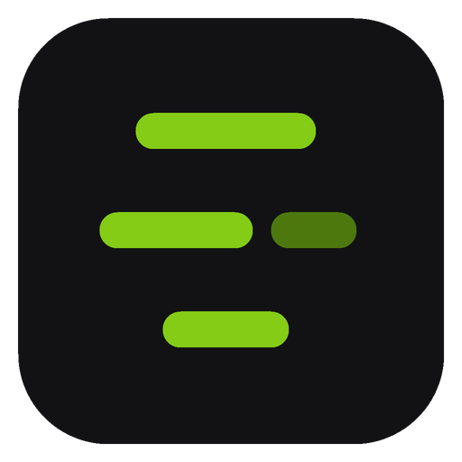
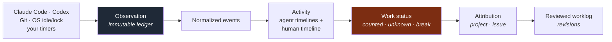
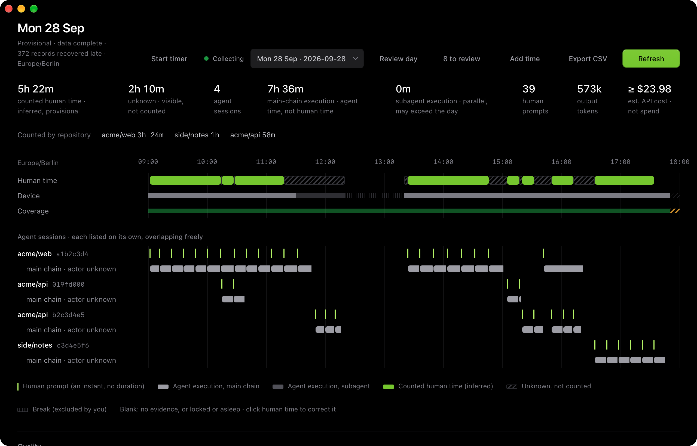

<div align="center">



# tracr

**A local development diary and time ledger for people who work with several coding agents at once.**

*What happened. How long you really worked. What it cost. And what you can trust.*

[](https://github.com/JoKeks2023/tracr/actions/workflows/ci.yml)


[Website](https://tracr.jorisconrad.com/) · [Product](docs/product.md) · [Architecture](docs/architecture.md) · [MVP](docs/mvp.md) · [Walkthroughs](docs/walkthroughs.md) · [All docs](docs/README.md)

</div>

---

## Why tracr exists

You run Claude Code in one project, Codex in another, and a third session is still open from this morning. Three questions are surprisingly hard to answer:

- **How long did I actually work on issue X today?** Session lifetimes overstate effort, and adding parallel sessions double-counts.
- **What did each of my agents do?** Collapsing them into one "active session" hides work.
- **What did it cost?** Token counts, list prices, subscriptions and real bills are different quantities, and most tools show an estimate that reads like spend.

tracr reads the evidence your tools already leave on disk, keeps every session visible on its own, counts *your* time once, and never pretends to know more than it does.

## What makes it different

| | |
|---|---|
| **Agent time is not your time** | Every agent session has its own timeline and usage. Human minutes are inferred separately and counted at most once, even when five sessions overlap. |
| **Unknown stays unknown** | If it is not established that you worked, the time is shown as *unknown* and **not counted** until you decide. No silent guessing, no numeric fake confidence. |
| **Money kinds never mix** | Estimated API cost, a provider's own figure, subscription cost and real expense are separate kinds. An estimate is labelled *"API-equivalent estimate, not spend"*. A missing price is *unpriced*, never `0`. |
| **Immutable evidence, rebuildable views** | The ledger is append-only. Everything you see is derived from it and can be rebuilt. Your corrections survive a rebuild; changes show up as discrepancies, never as silent edits. |
| **You can fix the numbers** | Confirm as work, mark as break, split, retarget, add manual entries, run a timer, then review the day. Every correction is revisioned and can be undone. |
| **Local-first and metadata-only** | No account, no sync, no upload. Prompt and tool text is never stored; the app reads usage, timing and structure. |

## How it works



Reading stays safe by design: transcripts are opened read-only, every source is version-gated and fails visibly, unknown record types are quarantined and counted, and re-importing the same history adds nothing.

## A day, at a glance



*Demo data: invented projects. The screenshot is reproducible, see [Development](#development).*

The same day as `tracr day` prints it:

```text
tracr · 2026-09-28 · Europe/Berlin · provisional (not reviewed)

Human time, inferred (provisional)           322 min
  acme/web                                 204
  side/notes                                60
  acme/api                                  58
  by basis: inferred 322
Unknown, not counted                         130
  10:14–10:15    1  unresolved window
  10:27–10:28    1  unresolved window
  11:18–12:20   62  conflicting evidence
  13:20–13:24    4  conflicting evidence
  14:46–15:05   19  unresolved window
  15:17–15:20    3  unresolved window
  15:32–15:50   18  unresolved window
  16:12–16:34   22  unresolved window
Non-work (excluded by you)                     0
Human evidence span 09:02–17:34 = 512 min: an upper bound, not a total

Agent activity (not human time)            exec min   span          tokens
  Claude Code  acme/web                       283   09:02–16:22    26.6 M
  Codex        acme/api                        35   10:15–15:19     2.0 M +?
  Claude Code  acme/api                        72   11:50–16:20     7.6 M
  Claude Code  side/notes                      66   16:34–17:45     7.3 M
  456 execution minutes within 523 min of agent wall clock; sessions overlap, never merged
  43.5 M tokens across sessions

Estimated API cost · API-equivalent estimate, not spend · catalog 2026-10-24.1 as of 2026-10-01
  Claude Code  acme/web                          14.65 USD
  Codex        acme/api                        >= 2.59 USD
  Claude Code  acme/api                           4.10 USD
  Claude Code  side/notes                         2.64 USD
  identified usage of the day                 >= 23.98 USD
```

`>=` means a floor: part of the usage could not be priced (here the Codex model's cache writes are only a marker), and tracr says so instead of rounding it away.

## Status

tracr is **pre-release** (`0.10.0` is the current [pre-release](https://github.com/JoKeks2023/tracr/releases/tag/v0.10.0)) and built in the open, in vertical slices.

| Slice | What | State |
|---|---|---|
| **S1** | Evidence, derivation, cost, Codex | Done: Claude Code and Codex import (including compressed Codex rollouts), day view, estimated cost and provider-reported figures, `tracr day`, menu-bar summary |
| **S2** | Corrections, manual time, review | Implemented: corrections, manual entries and timer, reviewed day revisions, discrepancies. Hands-on validation of the desktop UI is still in progress |
| **S3** | Projects, mappings, issue suggestions, GitHub and Huly context | Next |
| **S4** | Export, finalization, deletion, hooks | Planned |

The platform target is macOS and Windows. Today the desktop app runs on **macOS**; Windows currently builds the non-UI crates in CI only and makes no parity claim.

## Try it

### Download (macOS)

[**Download tracr for macOS**](https://tracr.jorisconrad.com/download): the [download page](https://tracr.jorisconrad.com/download) lists every file with its checksum. The universal .dmg runs on Apple Silicon and Intel. Open it and drag tracr to Applications. The app is signed and notarized. The `tracr` command line tool is inside it (`/Applications/tracr.app/Contents/MacOS/tracr`); Homebrew puts it on your `PATH` for you.

| Download | For |
|---|---|
| [Universal .dmg](https://tracr.jorisconrad.com/download/universal) (17 MB) | any Mac |
| [Apple Silicon](https://tracr.jorisconrad.com/download/apple-silicon) (8 MB) | M1 and later |
| [Intel](https://tracr.jorisconrad.com/download/intel) (9 MB) | Macs with an Intel processor |
| [Installer (.pkg)](https://tracr.jorisconrad.com/download/pkg) (17 MB) | any Mac; installs the app and links `tracr` into `/usr/local/bin` |

### With Homebrew (Apple Silicon and Intel)

```sh
brew tap JoKeks2023/tracr
brew trust JoKeks2023/tracr      # Homebrew asks you to trust a third-party tap once
brew install --cask tracr        # the desktop app and the `tracr` command
# command line only: brew install tracr-cli
```

### From source

You need the pinned Rust toolchain (picked up from `rust-toolchain.toml`) and, for the desktop app, Node with `pnpm`.

```sh
cargo install --path apps/cli
```

### First steps

```sh
# Tell tracr which provider folders it may read (nothing is read until you approve)
tracr roots add --provider ~/.claude/projects
tracr roots add --provider ~/.codex/sessions

# Import history, derive, and look at a day
tracr import
tracr rebuild
tracr day                      # or: tracr day 2026-09-16
tracr sessions                 # every agent session of the day, listed individually
```

| Command | Purpose |
|---|---|
| `roots` | Approve provider or repository roots |
| `import` | Discover and reconcile every source (idempotent) |
| `run` | Collect live: transcript hints, sweeps, OS sensor, heartbeats |
| `rebuild` | Rebuild the derived store from the ledger |
| `days` · `day` · `sessions` | Look at what was derived |
| `export` | CSV for agent sessions, human time and cost ([docs/export.md](docs/export.md)) |
| `sources` · `stats` | Inspect the ledger: cursors, quarantine, gaps, producer versions |

The **desktop app** (Tauri 2, React) shows the Day view with the timeline, agent lanes, cost and a quality footer, and handles corrections, manual entries and review. See [apps/desktop/README.md](apps/desktop/README.md).

To run the desktop app from source:

```sh
cd apps/desktop && pnpm install && pnpm tauri dev
```

## Repository map

```text
crates/
  tracr-core               pure model: evidence, events, counting, money, pricing (no I/O)
  tracr-store              ledger and derived SQLite stores, migrations
  tracr-ingest             discovery and the one reconcile path (cursors, continuity, recovery)
  tracr-provider-claude    Claude Code adapter
  tracr-provider-codex     Codex adapter (incl. zstd-compressed rollouts)
  tracr-git                read-only git probes
  tracr-platform           clock, file identity, OS sensors
  tracr-app                use cases: import, derive, day view, corrections, export
  tracr-testkit            fixtures and builders
apps/
  cli                      the `tracr` command
  desktop                  Tauri desktop host and React UI
pricing/                   the versioned price catalog (list prices, with sources)
docs/                      specification, architecture, per-task reports
research/                  the research package behind the design
```

Providers sit behind adapter traits, so the core never knows which agent produced a record. A third provider is a new crate plus a manifest.

## Documentation

Start with [Product](docs/product.md), then [Concepts](docs/concepts.md) and the [Architecture](docs/architecture.md). The [walkthroughs](docs/walkthroughs.md) trace concrete days (parallel sessions, a possible break, a missed notification, a changed derivation with a prior correction) with the exact minutes tracr must produce; the implemented ones are mirrored by tests. [MVP](docs/mvp.md) lists what is in, what is deferred, and why. [Open questions](docs/open-questions.md) is the honest list of what is still undecided.

## Development

```sh
cargo fmt --all --check
cargo clippy --workspace --all-targets -- -D warnings
cargo test --workspace
pnpm --dir apps/desktop typecheck
```

The screenshot and the sample output above come from invented data: `cargo run -p tracr-app --example demo_day -- <dir>` writes a fictional working day with three git repos and a derived data directory, and `TRACR_DATA_DIR=<dir>/data` points the CLI or the desktop app at it. It never touches a real ledger.

CI runs formatting, clippy and tests on Linux, builds and tests on macOS, and checks the portable crates on Windows. Work is tracked per task under `docs/tasks/T-xxxx_*` (brief, scope, done-when, implementation and validation reports); engineering decisions that outlive a task live in the repository canon at [`.claude/canon.md`](.claude/canon.md).

## Privacy

tracr never stores prompt text, assistant messages or tool output. It reads structure, timing, model names, token counts and tool names. Provider folders are read only after you approve them, the desktop window has no filesystem, shell or network capability, and nothing leaves your machine. Searching or re-reading message content is therefore deliberately impossible.

Four sources are opt-in and each stores only numbers and names, never text:
- **Rate limits.** Codex rollouts already carry the plan limits and credits; for Claude Code you can turn on a status line tap that copies the limit figures Claude Code reports into a local file. Turning it off restores your previous status line.
- **Hooks.** If you switch them on, Claude Code tells tracr when a session starts, waits or stops (event, session id, kind and time only), so the app can show who is waiting for you.
- **Running sessions.** If you approve your Claude folder, tracr reads the session registry in it (process, state, name, folder) to show running sessions. Key files in that folder are never opened.
- **Notifications.** Warnings about limits, cost and waiting sessions are shown by the system; nothing is sent anywhere.

## License

tracr is licensed under the [GNU Affero General Public License v3.0 or later](LICENSE) (`AGPL-3.0-or-later`). Anyone may use it, also commercially. If you distribute a modified version, or offer it as a network service, you must publish its source under the same license. See [CONTRIBUTING.md](CONTRIBUTING.md) for contributions.
