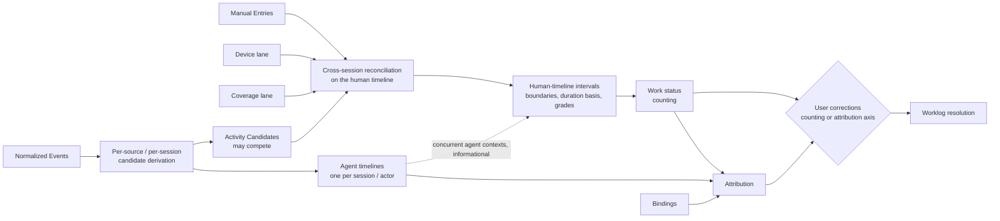

# Activity model

Status: **Draft specification v0.2 (2026-09-28)**. Evidence: [research/activity-tracking.md](../research/activity-tracking.md), [research/time-tracking.md](../research/time-tracking.md). **Every algorithm in this document is a candidate. None has been calibrated against real workflows.**

## 1. What "activity" means here

An **Activity Segment** is tracr's *inference* that activity of a certain kind happened during a period, on a certain **timeline**. It is never ground truth. It always carries:

- the timeline it belongs to,
- boundaries with explicit uncertainty and a boundary basis (§4),
- a duration basis for each of its sub-intervals (§4),
- an evidence grade and reason codes (§7),
- references to the normalized events and manual records it was derived from,
- the rule version that produced it.

A human-timeline interval additionally carries a **work status** (§5), its **engaged contexts** and its **concurrent agent contexts** (§9). Its attribution is a separate record on a separate axis ([attribution](attribution.md)). Activity answers *what is evidenced, on which timeline*. Counting (§5) and attribution are later, independent steps ([concepts §1](concepts.md#1-the-processing-chain)).

**Timelines and lanes (Proposed):**

| Timeline / lane | One per | Overlap allowed? | Fed by |
|---|---|---|---|
| **Agent timeline** | Agent session, and per identified actor within it. The actor may be `unknown` ([attribution §10](attribution.md#10-agentprovider-attribution)). | **Yes.** Agent timelines of different sessions, providers and projects overlap freely. Each is logged individually. | Session lifecycle, turn/tool lifecycle, usage timing |
| **Human timeline** | User | **No double counting.** A separately reconciled timeline. Each instant is counted at most once. One interval may reference several engaged contexts (§9). | Interaction events, manual entries, device state, optionally editor metadata (later) |
| **Device lane** | Machine | n/a (state per machine) | OS idle/active/lock/suspend events |
| **Coverage lane** | Source | n/a | Collector coverage events |

Agent-timeline segments describe agent execution. They never contribute to human work time by themselves. Agent timelines are never collapsed into one "active session". Their durations may sum to more than wall-clock time. That is correct for agent time and irrelevant to human time ([concepts §5](concepts.md#5-three-clocks)).

## 2. Pipeline



The **work status** step (§5) decides whether a human-timeline interval counts as human work. It sits between reconciliation and attribution. Bindings feed attribution only. They never create human minutes. Counting and attribution are separate axes with separate precedence ([time and worklog §3](time-and-worklog.md#3-two-precedence-axes-and-operation-scope)). A change on one axis never implicitly changes the other.

Reconciliation has two **candidate approaches** (research, activity-tracking). The choice is **unresolved** ([OQ-A-01](open-questions.md#architecture-questions)):

- **Interval algebra.** Derive candidate intervals per source, split at every boundary into atoms, rank evidence within each atom, union compatible neighbors. Transparent and replay-friendly.
- **Replayable state machine.** Process ordered events into open/closed segments and emit revisions on late events. Efficient live, but needs explicit ordering and late-event rules.

Either approach must satisfy the invariants in §10.

## 3. Evidence signals

What each observation *can* and *cannot* establish about the human timeline. This follows research, activity-tracking; the effects are **Proposed**.

| Signal | Effect on human timeline | Does not establish |
|---|---|---|
| `timer_started` / `timer_stopped`, retroactive manual entry | User-asserted interval: work status `work`, duration basis `timer_measured` or `user_asserted`, and its target | That a forgotten timer's stop time is correct |
| `user_interaction` (prompt, approval) in session S | **Engagement instant** for S's context: an observed instant with no duration | Continuous attention before or after it, or between two such instants |
| `binding_set` (session/worktree → issue) | Attribution for matching subjects. No effect on the human timeline or on counting. | That time was spent |
| Editor file activity in a bound worktree *(later phase)* | Strong supporting evidence for that worktree | Which of several issues on one branch |
| Foreground app is a terminal *(later phase, optional)* | Weak supporting evidence | Which tab/pane/session |
| `device_idle` (input absent ≥ threshold) | The last-input instant is observed. Idle blocks continuation bridging across it (§6, rule 2), so no inferred minutes cover the idle. Review may **propose** the last-input instant as the end of work inside the resulting `unknown` window (a `policy` boundary, reason `idle_end_proposed`). The proposal never creates or extends inferred minutes. | That the person is not reading, thinking or in a meeting |
| `device_locked`, `device_suspended` | Observed device event. **Ends automatic inference** of human work (`observed` boundary). | That the person stopped working (meeting, paper). Agent termination: agents may keep running. |
| Agent generating, tool running | Agent-timeline segment only. Listed as a concurrent agent context (§9). | Any human time |
| `session_ended`, `turn_completed` | Agent-timeline boundary | A switch of human attention |
| `git_commit` | Point evidence of output in a repository | Time spent preparing it |
| File change by an agent tool | Agent output evidence | Human attention |
| Coverage `missing` | Human-timeline evidence for that source is **unknown** (§8) | Absence of work, or presence of work |

Idle and lock never end user-asserted time (a running timer, a manual entry, a confirmation).

## 4. Boundaries and duration basis

Two things are recorded separately: **where an endpoint lies** (boundary basis) and **what supports counting the minutes** (duration basis). An observed instant is point evidence. It has no duration. Two observed prompts do not measure the attention between them.

**Principle:** a boundary is stored as a **window**, not a single instant, whenever evidence does not pin it down.

```pseudo
Boundary {
  earliest, latest          // equal when the boundary is pinned to one instant
  basis: observed           // coincides with an observed instant: timer action, lock/suspend event, engagement instant
       | bounded            // lies somewhere between two observations; no evidence inside the window
       | policy             // placed by a named policy, e.g. idle trimming at an observed last-input instant (a proposal)
       | user               // stated by the user
  policyId?                 // when basis = policy
}
```

**Duration basis** (per sub-interval, **Proposed**):

| Duration basis | What supports counting the minutes | Reported as |
|---|---|---|
| `timer_measured` | Elapsed time between durable timer start/stop actions. The elapsed interval is measured. Classifying it as work is a user assertion. | *user-asserted (timer)* |
| `user_asserted` | Retroactive manual entry, or a user confirmation or correction | *user-asserted* |
| `inferred_continuity` | Minutes between observed engagement instants in one context, bridged by the named continuation rule (§6). Not measured attention. | *inferred* (provisional) |
| `policy_estimated` | Assigned by a window policy (§5). Never counted silently ([OQ-P-18](open-questions.md#product-questions)). | *estimated* |
| (none) | Nothing supports the minutes | *unknown* |

A derived work interval may have **mixed provenance**: a list of sub-intervals, each with its own duration basis. Example: the user confirms 09:25–09:32 as A after the inferred run 09:00–09:25. The resulting interval 09:00–09:32 has 25 `inferred_continuity` minutes and 7 `user_asserted` minutes. Its counting basis follows the sub-intervals: 09:00–09:25 is `inferred`, 09:25–09:32 is `user_asserted`. Reports explain mixed intervals by showing minutes per duration basis and boundary basis ([reporting: mixed provenance](reporting.md#mixed-provenance)). Inferred minutes are never upgraded to "measured" or "observed".

A human interval bridged from four engagement instants therefore has four observed instants and zero observed minutes. Its minutes are inferred.

Reported durations separate *user-asserted minutes* (timer shown as such), *inferred minutes*, *unknown minutes* and, only where a policy proposed a value, *policy-estimated minutes*, labeled as such and not counted silently (§5).

## 5. Work status: counting is separate from activity

Activity says what is evidenced. **Counting** asks a separate question: does this human-timeline interval count as human work? **Attribution** asks what counted time was for. The three answers are recorded independently.

Every human-timeline interval has a **work status** (**Principle**):

| Work status | Meaning | In counted human total? |
|---|---|---|
| `work` | Human work is accepted for this interval. It carries a **counting basis**: `user_asserted` (manual entry, timer, or user confirmation) or `inferred` (automatic inference under a named rule, provisional until reviewed). | Yes. Asserted and inferred minutes are shown separately. Inferred minutes are provisional. |
| `unknown` | It is **not established** that human work happened. Reasons: `unresolved_window` (gap between engagement instants that no rule bridges, §6), `conflicting_evidence`, `coverage_gap` inside otherwise plausible work. | **No.** Shown separately as unknown minutes. Never silently counted. |
| `non_work` | The user declared a break or exclusion. | No. |

```pseudo
HumanTimelineInterval {                        // conceptual
  [start, end), boundaries { start, end }      // §4
  subIntervals[] { range, durationBasis }      // §4, mixed provenance
  workStatus: work { countingBasis: user_asserted | inferred }   // per sub-interval, from its durationBasis: timer_measured | user_asserted → user_asserted; inferred_continuity → inferred. A mixed interval carries both; minutes per basis come only from subIntervals.
            | unknown { reason: unresolved_window | conflicting_evidence | coverage_gap }
            | non_work
  engagedContexts[]                            // §9
  concurrentAgentContexts[]                    // §9, informational only
  // attribution: separate records, separate axis (attribution.md)
}
```

**Blank, unknown and coverage gap are different:**

| Situation | On the human timeline | Counted? | Shown as |
|---|---|---|---|
| No human-activity evidence at all, coverage `collecting` (device locked or suspended, e.g. overnight; only agents running; before the first or after the last engagement instant; between user-asserted intervals with no engagement instant, as in [walkthrough A](walkthroughs.md#a-manual-only-work)) | No interval: blank | No | Blank. Not flagged as unknown. |
| Gap between consecutive engagement instants that the continuation rule does not bridge (§6). Locked or suspended periods inside it stay blank, and any part covered by a user-asserted interval counts as that interval (counting precedence). | `unknown` (`unresolved_window`) | No | Unknown minutes, offered for review |
| Contradictory evidence inside one window | `unknown` (`conflicting_evidence`) | No | Unknown minutes, with the competing contexts |
| Coverage missing inside otherwise plausible work | `unknown` (`coverage_gap`) | No | Coverage gap and unknown minutes |
| Coverage missing, no human-activity evidence around it | No interval | No | Coverage gap (§8) |

**`unknown` ≠ `unattributed`.** `unattributed` means the time **is** counted as human work (`work`), but its target is unknown. `unknown` means it is not established that the interval was human work at all. Unknown minutes appear in neither the attributed nor the unattributed work totals.

**Principle: Unknown is not work.** An interval whose work status is `unknown` never enters the counted human total unless the user asserts it (confirm as work, manual entry) or an explicitly enabled and labeled policy does so. Whether any such policy may count is **Unresolved** ([OQ-P-18](open-questions.md#product-questions); [AC-12](requirements.md#activity-ac)).

**Window policies only propose.** A window policy (carry forward, lead-in, exclude, …) may only *propose* a resolution for an unknown window. Its result is labeled `policy_estimated`. It is never merged silently into counted totals. In MVP, window policies may only pre-fill suggestions in review. The window stays `unknown` until the user acts. The choice of suggestion policy stays open ([OQ-P-03](open-questions.md#product-questions)).

**Resolving an unknown window (Proposed):** review offers a finite list: work for one engaged context, work for several contexts jointly, break, or "Other…". Leaving it unresolved keeps it `unknown` and uncounted ([AC-10](requirements.md#activity-ac)).

**Inferred work is provisional.** It depends on the named continuation rule and its unresolved parameters ([OQ-P-02](open-questions.md#product-questions)). Inferred minutes are *not measured attention*.

**Upper bound.** Counted human time in a period ≤ the period's length. The span covered by evidence (e.g. 09:00–10:47 = 107 min) is an **upper bound**, never a total.

**Counting precedence** (per instant of the human timeline): correction → manual entry → inferred activity → unknown. Bindings never appear on this axis. A binding never creates human minutes. Composition of several corrections is **Unresolved** ([OQ-P-19](open-questions.md#product-questions)). Operation scope is specified in [time and worklog §3](time-and-worklog.md#3-two-precedence-axes-and-operation-scope).

A total below the enclosing span does not show that counting is correct. Acceptance must test that non-work is excluded and that unknown windows are not counted.

## 6. Quiet thinking, idle and heartbeats

### Quiet thinking and reading

After an engagement instant, the person may keep working without producing observable events: reading agent output, thinking, sketching. **Candidate approach:** a **continuation rule** bridges consecutive engagement instants in the same context when all of these hold:

1. the gap does not exceed a maximum continuation length (**Unresolved** value, [OQ-P-02](open-questions.md#product-questions)). The research warns against adopting 5/15/30 minutes by convention,
2. no `device_idle`, lock or suspend lies inside the gap,
3. no engagement instant for a *different* context lies inside the gap,
4. coverage for the relevant sources is `collecting`, and no part of the gap has coverage completeness `gap` for those sources ([event model §10–11](event-model.md#11-coverage-and-diagnostics)). A source can be `collecting` while an interval inside it is a completeness `gap`.

For this rule, the context of an engagement instant is the agent session in which it was observed (§3). "Same context" means the same session. Engagement in another session blocks bridging (rule 3), even when both sessions share a worktree, project or issue. Bridging across sessions at a coarser level is a form of cross-context continuity and is **not adopted** ([OQ-P-18](open-questions.md#product-questions)).

**Proposed:** bridged minutes have duration basis `inferred_continuity`. Their work status is `work` with counting basis `inferred`: provisional until reviewed. They are graded `inferred_continuity`, never `observed_instant`. **Declared default:** quiet time inside a gap this rule bridges counts as inferred work (provisional until reviewed). Whether quiet reading and planning should instead count only when confirmed is **Unresolved** ([OQ-P-14](open-questions.md#product-questions)). Quiet time that no rule bridges stays `unknown` and uncounted until the user asserts it (AC-12); counting it by policy is [OQ-P-18](open-questions.md#product-questions).

A gap that fails the rule becomes a window with work status `unknown`. Its reason is `coverage_gap` where coverage is missing inside otherwise plausible work (rule 4; §8), `conflicting_evidence` where engagement instants of different contexts interleave inside the window (§9), and otherwise `unresolved_window`. A locked or suspended period inside the gap is not part of the unknown window. It stays blank (see Idle and AFK below; §5). Only the rest of the gap is `unknown`. It is not counted. It is not zero evidence. It is not automatically the previous owner's time. Its interior boundary basis is `bounded`.

### Idle and AFK

OS elapsed-input time gives a bound without content capture (**D/C**: Windows `GetLastInputInfo` is session-scoped; ActivityWatch macOS watcher). **Proposed:**

- the last-input instant is observed (via the elapsed-input value). Idle ≥ threshold blocks bridging (rule 2): the window stays `unknown` and is not counted (§5). Placing the end of work at the last-input instant is only a *proposal* offered in review: a `policy` boundary anchored at an observed instant. It never creates or extends inferred minutes. The window stays `unknown` until the user acts,
- lock/suspend is an observed device event. It ends automatic inference (`observed` boundary). It does not prove that the person stopped working,
- the locked or suspended period itself carries no human-activity evidence. It is blank on the human timeline (§5): not counted, not flagged as unknown,
- idle and lock never end user-asserted time. The user can cover idle periods (meeting, reading on paper) with a manual entry or a confirmation.

### Heartbeats

Continuous-state sources (device active, later editor activity) may report periodic **heartbeats**. **Candidate approach** (ActivityWatch precedent, **C**): merge consecutive heartbeats with equal payload inside a bounded pulse window into one interval, and extend only monotonically. A heartbeat says the *source* was active, not which task the person worked on. A merged heartbeat interval is source-state evidence. It does not by itself give counted human minutes.

## 7. Evidence grades

**Proposed:** categorical grades first. Numeric confidence is **deferred** until it can be calibrated against user-corrected diaries (research, activity-tracking; [OQ-P-01](open-questions.md#product-questions)). A score like 0.9 must not be shown as a probability without validation.

| Grade | Applies to | Meaning |
|---|---|---|
| `user_asserted` | intervals | Manual entry, timer, or user-confirmed interval |
| `observed_instant` | points / boundaries | Observed interaction or device event; no duration |
| `inferred_continuity` | intervals | Bridged between observed engagement instants in one context by the named rule |
| `policy_estimated` | intervals | Proposed by a window policy; not counted silently |
| `conflicting` | intervals | Contradictory evidence (e.g. engagement in two contexts inside one gap; manual entry vs detected other context) |
| `unknown` | intervals | Insufficient evidence or coverage missing |

`observed_instant` never applies to a duration. A grade describes evidence. Work status (§5) is recorded separately.

Every segment also carries **reason codes** (e.g. `prompt_in_session`, `bridged_gap_Nm`, `closed_by_lock`, `idle_end_proposed`, `timer_manual`, `window_unresolved`, `coverage_gap`) and source references. Reason codes are what the review UI explains. The grade is a summary.

## 8. Coverage gaps

**Principle:** the affected period is a coverage gap, not `inactive`, when a source that would normally provide evidence is `missing` (collector not running, permission lost, source unreachable), or `degraded` so that its records could not be parsed (parse failures, quarantined formats), or when reconciliation marks the interval's completeness as `gap` (unrecoverable ingestion, [event model §10](event-model.md#10-ingestion-completeness-and-recovery)). Coverage state and completeness are independent: a source can be `collecting` while an interval inside it is a completeness `gap` ([event model §11](event-model.md#11-coverage-and-diagnostics)). Reports show it as a gap. A day with a collector outage must never look like a day off (research, activity-tracking).

Inside otherwise plausible work, a coverage gap gives work status `unknown` (`coverage_gap`): not counted, not zero. Where recovery cannot establish completeness, the gap is visible with a reason ([event model §10](event-model.md#10-ingestion-completeness-and-recovery)).

## 9. Concurrent agent sessions and the human timeline

Concurrent agent sessions are first-class.

- **Agent timelines** (one per agent session, and per identified actor within it) hold the session span, agent execution segments, turns, tool calls and usage. Agent timelines of different sessions, providers and projects **overlap freely**. Every session is ingested, stored and displayed individually. They are never collapsed into one "active session". Where the source does not identify the actor, the actor is `unknown`; tracr never invents one ([attribution §10](attribution.md#10-agentprovider-attribution)).
- The **human timeline** (one per user) is reconciled separately. Each instant is counted **at most once**, regardless of how many agent sessions or contexts are active.

A human-timeline interval references contexts in two different ways:

| Field | Meaning | Creates human time? | Is attribution? |
|---|---|---|---|
| `engagedContexts[]` | Contexts (session / worktree / project / issue) with human-engagement evidence inside or bounding the interval. May contain several. | No. Work status (§5) decides counting. | No. It is evidence for attribution candidates. |
| `concurrentAgentContexts[]` | Contexts whose agents were running during the interval | No | No. Informational only. |

tracr is **not forced to split** human attention between simultaneous contexts. Walkthrough C shows engagement instants A 09:25, B 09:26, A 09:27, B 09:28. Before review this window is `unknown` (`conflicting_evidence`). After the user confirms it as work, a valid representation is:

```text
09:25–09:28
human work: 3 min (user_asserted)
engaged contexts: PDF Export, Server Fix
attribution: joint {PDF Export, Server Fix} — no split
```

It must not become PDF Export 3 + Server Fix 3 = human 6. Nor may tracr invent a 2/1 split. A **joint** interval is counted once in the human total. Per-target views show it as "joint with …", never added in full to each target's exclusive total ([attribution §7](attribution.md#7-multiple-targets-joint-contexts-and-allocation)). A split or allocation needs evidence or a user statement.

Operations on human time never reattribute agent sessions, agent segments, usage, tool calls or costs. Example: a manual meeting on TRACR-12 while a background agent works on SERV-7. The agent's usage and estimated cost stay attributed to SERV-7 ([time and worklog §3](time-and-worklog.md#3-two-precedence-axes-and-operation-scope)).

**Principle:** concurrent agent activity is fully logged even when human time is reconciled separately.

The full parallel-session example (three sessions, 134 agent-execution minutes in 80 minutes of wall clock, 55 counted human minutes after review) is [walkthrough C](walkthroughs.md#c-parallel-sessions). See also [concepts §6](concepts.md#6-concurrent-sessions-and-contexts) and [reporting: human-time totals and parallel sessions](reporting.md#human-time-totals-and-parallel-sessions).

## 10. Reconciliation invariants

These hold for any chosen algorithm:

1. **Human-timeline exclusivity.** Counted human time in any period ≤ the length of that period. Each instant is counted at most once, regardless of how many agent sessions or contexts are active. Concurrent contexts are resolved by a single target, an explicit allocation or joint attribution, never by addition.
2. **Agent timelines overlap and are logged individually.** They are never added to human time and never collapsed into one active session.
3. **Manual intent wins** on both axes within its interval, for the human timeline only. A manual entry decides both counting and attribution of its stated human-timeline interval. A correction decides only the axis or axes the operation-scope table assigns to it ([time and worklog §3](time-and-worklog.md#3-two-precedence-axes-and-operation-scope)): a counting correction (confirm as work, mark break, trim/extend) never sets a target by itself, and an attribution correction (reattribute, confirm/reject target, allocate, mark joint) never changes work status. The overridden automatic candidates remain stored and visible as disagreements. Composition of several corrections is [OQ-P-19](open-questions.md#product-questions).
4. **No invented switch times.** Where evidence places a switch only within a window, the boundary is a window (§4).
5. **Half-open intervals** `[start, end)`, split at reporting-day boundaries in the reporting timezone.
6. **Replay-stable.** Re-running the same evidence with the same rule versions yields the same segments.
7. **Coverage-aware.** Missing coverage yields a visible gap or `unknown`, never silent zero.
8. **Reviewed history is stable.** New derivations never silently change a reviewed worklog revision (see [time and worklog §6](time-and-worklog.md#6-reconciliation-and-late-evidence)).
9. **Unknown is not work.** An `unknown` interval never enters the counted human total without a user assertion (§5; policies: [OQ-P-18](open-questions.md#product-questions)).
10. **Joint intervals count once.** A joint interval contributes its length once to the human total and is never added in full to each target.
11. **Human-time operations never reattribute agent records.** Correcting human time never changes the attribution of agent sessions, agent segments, usage, tool calls or costs.
12. **Observed instants are not durations.** Every counted minute carries a duration basis. Inferred minutes are never reported as measured or observed.
13. **Counting and attribution are separate.** A reattribution never changes work status. A binding never creates human minutes. A non-work mark never deletes attribution records.

## 11. Worked example: A → B → A with sparse evidence

Two Claude Code sessions, **A: "PDF Export"** and **B: "Server Fix"**, in different worktrees. No manual timer. OS idle sensor active, no idle detected.

```text
09:00  A prompt_submitted                        (engagement A)
09:02–09:20  A agent running
09:12, 09:21  A prompt_submitted                 (engagement A)
09:25  A approval_given                          (engagement A)  ← last A evidence before quiet
09:26  A turn_completed                          (agent lane only)
         … no events …
09:32  B session_started, prompt_submitted       (engagement B)
09:40, 09:51, 10:02  B prompt_submitted          (engagement B)
10:03–10:12  B agent running; 10:12 B turn_completed
         … no events …
10:15  A prompt_submitted                        (engagement A — A active again)
10:30  B session_ended                           (agent lane only — B ends while A is active)
10:30, 10:47  A prompt_submitted / approval      (engagement A)
10:48–10:55  A agent running
```

Assume the continuation maximum is at least 17 minutes (an assumption for this example only; the value is [OQ-P-02](open-questions.md#product-questions)). Then every gap between consecutive engagement instants *in the same context* is bridged (longest: A 10:30→10:47). The 09:25→09:32 and 10:02→10:15 gaps are **not** bridged, whatever their length, because they lie between engagement in *different* contexts (§6, rule 3). Bridging only ever happens within one context.

The log also assumes an approval source. [Event model §5.1](event-model.md#51-claude-code-and-codex-side-by-side) marks `approval_given` as **U** for Claude Code, so an adapter emits it only if its capability manifest declares a source for it ([event model §5](event-model.md#5-event-kinds)). Without one, the approval instants (09:25, and the approval at 10:30/10:47) are absent, fewer gaps are bridged, and nothing is invented.

**Human timeline (Proposed derivation):**

| Interval | Engaged context | Work status | Basis | Minutes |
|---|---|---|---|---:|
| 09:00–09:25 | A | work | inferred (`inferred_continuity` between observed instants 09:00, 09:12, 09:21, 09:25) | 25 |
| 09:25–09:32 | A→B, cross-context gap (A reading? break? planning B?) | **unknown** (`unresolved_window`) | none | 7 |
| 09:32–10:02 | B | work | inferred (`inferred_continuity` between observed instants 09:32, 09:40, 09:51, 10:02) | 30 |
| 10:02–10:15 | B→A, cross-context gap (reading B's 10:12 output? back on A before prompting?) | **unknown** (`unresolved_window`) | none | 13 |
| 10:15–10:47 | A | work | inferred (`inferred_continuity` between observed instants 10:15, 10:30, 10:47) | 32 |
| **Counted human work** | A 57, B 30 | work | inferred, provisional | **87** |
| **Unknown, not counted** | | unknown | none | **20** |
| Evidence span 09:00–10:47 | | | upper bound only | *(107)* |

Counted (inferred, provisional): A 57 (25 + 32) + B 30 = **87** minutes. Unknown: 7 + 13 = **20** minutes, visible and not counted. The evidence span 09:00–10:47 = 107 minutes is an upper bound only. The 87 minutes depend on the assumed continuation rule. They are not measured attention. There are observed instants here, but no observed minutes.

B's agent run 10:03–10:12 lies inside the unknown window 10:02–10:15. It is a concurrent agent context of that window (§9), not evidence of human work.

**What tracr must not report:**

- session spans A 09:00–10:55 (115 min) + B 09:32–10:30 (58 min) = **173 session-minutes** as work,
- exact switch instants at 09:32 or 10:15 as the moment attention moved, since those are only the first *evidence* of the new context,
- **107 minutes as the human total**. 107 is the evidence span. Reaching it requires user assertions for both unknown windows,
- the 20 unknown minutes as *unattributed* work (§5).

```mermaid
gantt
    dateFormat HH:mm
    axisFormat %H:%M
    section Session spans (not effort)
    A session           :done, 09:00, 10:55
    B session           :done, 09:32, 10:30
    section Agent timelines
    A agent             :active, 09:02, 09:20
    B agent             :active, 10:03, 10:12
    A agent             :active, 10:48, 10:55
    section Human timeline
    A inferred          :crit, 09:00, 09:25
    unknown             :09:25, 09:32
    B inferred          :crit, 09:32, 10:02
    unknown             :10:02, 10:15
    A inferred          :crit, 10:15, 10:47
```



**Outcomes after review (Proposed):**

| Outcome | User action | A | B | Counted human total | Unknown | Non-work |
|---|---|---:|---:|---:|---:|---:|
| **Unresolved** (default) | none | 57 (inferred) | 30 (inferred) | **87** | 20 (visible, not counted) | 0 |
| **Break** | marks both windows as break | 57 | 30 | **87** | 0 | 20 |
| **User-confirmed work** | confirms 09:25–09:32 as A (reading output) and 10:02–10:15 as B (reviewing result) | 64 | 43 | **107** | 0 | 0 |
| **Partial** | confirms 09:25–09:32 as A; marks 10:02–10:15 as break | 64 | 30 | **94** | 0 | 13 |

The 107 outcome is **conditional on user evidence**: the confirmations are user assertions. The original session evidence does not prove 107. The 87 inferred minutes remain inferred (provisional) until reviewed. Arithmetic: 25 + 32 = 57; 57 + 30 = 87; 7 + 13 = 20; 57 + 7 = 64; 30 + 13 = 43; 64 + 43 = 107; 64 + 30 = 94. The same example appears as [walkthrough B](walkthroughs.md#b-a--b--a-with-a-possible-break) and in [time and worklog §7](time-and-worklog.md#7-concurrency-example).

**Resolving the unknown windows (Proposed):** the review UI asks per window: *A / B / joint A+B / break / other…* (a finite choice list with an "Other…" escape). A **window policy** may pre-fill a suggestion. It never resolves the window by itself. Candidate policies, choice **Unresolved** ([OQ-P-03](open-questions.md#product-questions)):

| Policy | Effect on work status (09:25–09:32) | Effect on attribution | Risk |
|---|---|---|---|
| Leave unknown (default, MVP) | Stays `unknown`. Not counted. Visible. | none | More review work |
| Carry forward | Would propose `work` (`policy_estimated`) for the previous owner: A +7 | A | Overcredits the session that went quiet. Counting it is [OQ-P-18](open-questions.md#product-questions). |
| Lead-in | Proposes `work` (`policy_estimated`) for the next owner: B +7 | B | Overcredits the new session. [OQ-P-18](open-questions.md#product-questions). |
| Exclude | Proposes `non_work` without user evidence | none | Undercounts reading/thinking |

Policy results keep `basis = policy` on their boundaries, are labeled estimated, and are not counted silently. In MVP they only pre-fill review suggestions. The window stays `unknown` until the user acts.

### Variant: interleaved engagement

Research example (Timelog): A engagement at 09:00 and 09:20, B at 09:10 and 09:25. Under the same-context continuation rule (§6, rule 3), no bridge crosses other-context engagement:

- A's gap 09:00→09:20 contains B@09:10. Not bridged.
- B's gap 09:10→09:25 contains A@09:20. Not bridged.

| Interval | Engaged contexts | Work status | Minutes |
|---|---|---|---:|
| 09:00–09:25 | A, B (four observed instants: A 09:00, B 09:10, A 09:20, B 09:25) | **unknown** (`conflicting_evidence` / `unresolved_window`) | 25 |

Result: **0 inferred minutes**. 09:00–09:25 = **25 minutes `unknown`**.

- Per-session gap sums (Timelog) credit A = 20 and B = 15, **35 min**. That overcounts.
- The union 09:00–09:25 = 25 min is an **upper bound**, not a human total. The research's 35-versus-25 calculation demonstrates Timelog's overcounting. It does not validate 25 human minutes.

**Outcomes (Proposed):**

| Outcome | User action | Counted human total | Attribution | Unknown | Non-work |
|---|---|---:|---|---:|---:|
| (a) Unresolved (default) | none | 0 | — | 25 | 0 |
| (b) Joint | confirms 09:00–09:25 as work, joint {A, B} | 25, counted once | joint {A, B}, no split | 0 | 0 |
| (c) Split or allocation | confirms and splits, e.g. 09:00–09:12 A and 09:12–09:25 B; or states an allocation | 12 + 13 = 25 | A 12, B 13 (or the user-stated weights) | 0 | 0 |
| (d) Break | marks all of 09:00–09:25 as break | 0 | — | 0 | 25 |

Marking only part as break leaves the rest `unknown` until the user confirms it. A cross-context continuity rule (dense engagement in any context bridges gaps as work with a joint or unknown target) is **not adopted**. Whether any such rule may count is [OQ-P-18](open-questions.md#product-questions).

### Variant: manual timer present

The user ran a manual timer "B" 09:30–10:10. Everything else is as in the event log above.

| Interval | Work status | Duration basis | Attribution | Minutes |
|---|---|---|---|---:|
| 09:00–09:25 | work (inferred) | `inferred_continuity` | A | 25 |
| 09:25–09:30 | **unknown** (`unresolved_window`) | none | — | 5 |
| 09:30–10:10 | work (user-asserted) | `timer_measured` | B (manual entry) | 40 |
| 10:10–10:15 | **unknown** (`unresolved_window`) | none | — | 5 |
| 10:15–10:47 | work (inferred) | `inferred_continuity` | A | 32 |

Counted: 25 + 40 + 32 = **97** minutes (57 inferred, 40 user-asserted). Unknown: 5 + 5 = **10** minutes, not counted. B's engagement 09:32–10:02 lies inside the timer. The timer wins, and the agreement is shown. Automatic evidence that disagrees (none here) would be shown, not discarded.

## 12. Sparse-evidence situations

| Situation | Behavior (Proposed) |
|---|---|
| Only transcript backfill, no OS sensor coverage | Engagement instants from transcript timestamps. Device lane `unknown`. Rules 2 and 4 of the continuation rule (§6) cannot be met, so no gap is bridged: gaps between engagement instants are `unknown` (`coverage_gap`, §8), not counted, until the user confirms them (as in [walkthrough F3](walkthroughs.md#f-missed-watcher-notification)). No idle-based trimming is possible, and the report says so. |
| Session with prompts but no end event (crash) | Agent timeline ends at last evidence (bounded). Human timeline unaffected beyond the last engagement instant. |
| Long agent run, user elsewhere with no evidence | Agent-timeline segment only, fully logged. **No human work is counted.** Without human evidence the period is blank on the human timeline. A gap bounded by engagement instants that no rule bridges is `unknown`, not counted. Never the agent's context by default. |
| Agent runs overnight | Agent timeline only. No human time, no streak qualification from it ([reporting](reporting.md)). |
| Several agent sessions running while the user engages one | Every agent timeline logged individually. Human time counted once, for the engaged context. The other sessions are concurrent agent contexts only (§9). |
| Two machines active simultaneously | Both feed one human timeline (one person). Each instant is counted at most once. Engagement on both inside one window is `conflicting`: work status `unknown` (`conflicting_evidence`) until resolved. Multi-device merge is **Unresolved** ([OQ-P-11](open-questions.md#product-questions)). |

## 13. Deferred

Numeric confidence, editor/IDE sensors, terminal-pane focus adapters, learned continuation thresholds, and automatic issue-level splitting inside a session are **deferred** beyond MVP. See [MVP](mvp.md).
