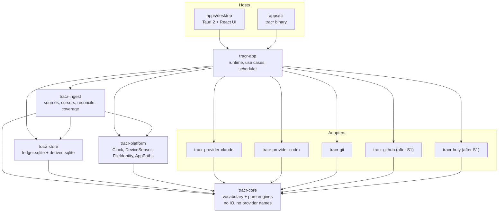
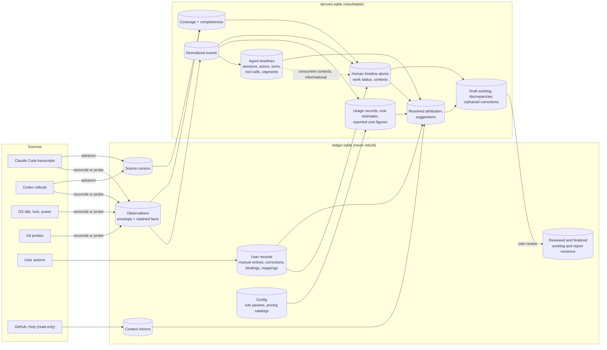
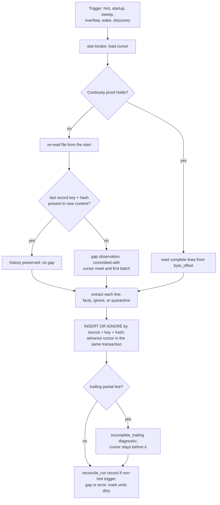
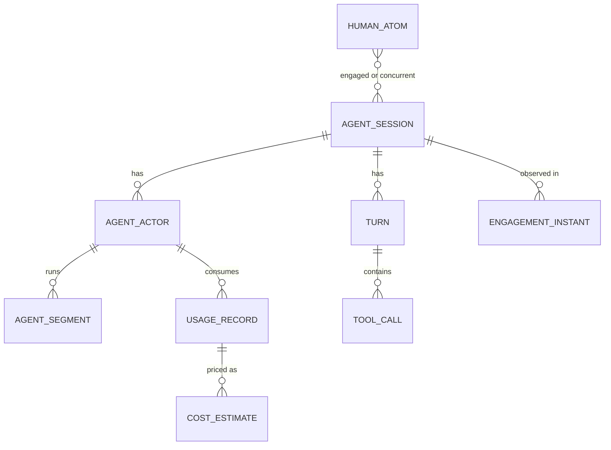

# tracr 0.9 architecture

Status: **Architecture v1 for tracr 0.9 (2026-09-29)**. Basis: [specification v0.2](README.md) (final Codex gate review: `PROCEED`). This document chooses the technology and structure for tracr 0.9. It resolves the architecture questions OQ-A-01…10 where 0.9 needs an answer. It also sets defaults for the few product questions that code cannot leave open; those are marked **0.9 default** and product review can change them. It changes no v0.2 semantics. Where this document and a normative spec section disagree, the spec wins and this document gets corrected. Adversarial review results are in the [validation report](tasks/T-0003_architecture/05_validation_report.md).

Task record: [tasks/T-0003_architecture](tasks/T-0003_architecture/00_brief.md).

**Local facts this document relies on** (checked 2026-09-29 on the target machine; structure only, no content read):

- **Claude Code transcripts** are in `~/.claude/projects/<dir>/<session>.jsonl`, with subagent files in `<session>/subagents/agent-<id>.jsonl`. Their records carry `uuid`, `sessionId`, `timestamp`, `cwd`, `gitBranch`, `version`, `isSidechain`, `agentId`, `requestId`, `message.id`, `message.model`, and `message.usage` with disjoint token categories and `service_tier`.
- **Codex rollouts** are in `~/.codex/sessions/YYYY/MM/DD/` and `~/.codex/archived_sessions/`. Every Codex line carries an `ordinal`. The current producer writes `token_usage_record` lines (per-response usage with `response_id`) and cumulative `token_count` events. Subagent threads carry `session_meta.source.subagent.thread_spawn.parent_thread_id`.
- **Rust is not installed** on the machine. Node 24, pnpm and Swift 6.4 are.

## 0. Decisions at a glance

| ID | Decision | Resolves |
|---|---|---|
| AD-01 | **Rust** for everything except the UI, in one Cargo workspace. `tracr-core` is pure: no IO, no clock, no SQL, no threads, no provider names. | OQ-A-06 (core) |
| AD-02 | **Tauri 2** desktop shell (menu bar on macOS, tray later on Windows) with a **React + TypeScript** UI (Vite, pnpm). | OQ-A-06 (shell) |
| AD-03 | **One user-session process** hosts the collector, the deriver and the UI. Closing the window keeps it running and Quit stops it. `tracr run` hosts the same runtime headless. No system service and no helper daemon in 0.9. A lock file enforces a single writer. | OQ-A-06 (process) |
| AD-04 | **SQLite** (bundled into the binary), in two files. `ledger.sqlite` holds evidence, user records, outward records, config and context mirrors; it is backed up and never rebuilt. `derived.sqlite` holds everything rebuildable; it is never migrated, only rebuilt, and only by the lock holder. | OQ-A-05 |
| AD-05 | **Hybrid evidence store**: immutable observation envelopes plus append-only retained-fact rows, one per extractor version. Payload is `never_stored` in 0.9, so no payload table exists yet. | OQ-A-04 |
| AD-06 | **Provider transcript files are the primary channel** for live *and* backfill: Claude Code JSONL and Codex rollout JSONL. Filesystem events are only hints. There is exactly **one read path**, `reconcile(source)`, which starts from a durable cursor. Hooks come later as a secondary channel through spool files. No IPC server. | OQ-A-07, OQ-A-08 |
| AD-07 | **Interval algebra**, computed as pure functions. Per agent session: timelines and usage. Per reporting day, over the span between neighbouring engagement instants: human timeline, counting, attribution and worklog draft. Each is recomputed when its inputs change. Every time-dependent rule gets an explicit `as_of`. No incremental state machine. | OQ-A-01 |
| AD-08 | The worklog stores **exact half-open sub-intervals** with duration basis and attribution shape. A reviewed revision is a per-day snapshot in the ledger. | OQ-A-02 |
| AD-09 | **IDs:** UUIDv7 for evidence and user records. Deterministic BLAKE3 IDs for derived records. Records with an evidence natural key (session, actor, turn, usage occurrence) hash only that key, so their IDs survive rule changes. **Corrections anchor to time ranges or evidence natural keys, never to a bare derived ID.** Only corrections anchored to an agent segment or a turn can become visible orphans. There is no remapping table. | OQ-A-03 |
| AD-10 | **Correction composition:** per axis and per instant (or per agent subject), the latest non-revoked correction that sets a field wins for that field. Superseded corrections stay visible as "superseded by …". Undo is a `revoke` correction. Rejections form a suppression set, not a precedence level. Bindings and overlapping manual entries are *not* ordered by time: they stay `conflicting`. | OQ-P-19 (0.9 default); OQ-P-20 default kept |
| AD-11 | **Money** is integer nano-units of a stated currency. Pricing comes from a **bundled, versioned catalog file** with nullable effective dates, matched on the exact model only. A missing rule means unpriced. No network fetch in 0.9. | OQ-A-10 |
| AD-12 | **Security and scope:** no network listener and no local IPC server. Secrets live in the OS credential store. Filesystem access is limited to approved provider roots and approved repository roots. DBs are unencrypted; FileVault (later BitLocker) is the at-rest layer. The webview gets no filesystem or shell capability. | OQ-A-09 |
| AD-13 | Rule parameters are versioned configuration. **Provisional dogfooding values:** continuation maximum 20 min, idle threshold 5 min. Every derived record carries `rule@version` plus a parameter hash. | OQ-P-02 stays open (calibration) |
| AD-14 | Reporting timezone: one **fixed home zone**, chosen at setup (default: the system zone), recorded on every reviewed revision and report. | OQ-P-08 (0.9 default) |
| AD-15 | Timers: at most **one running timer**. Start and stop persist immediately. Elapsed = stop − start in UTC. A suspend or wall-clock jump inside a running timer is shown as a hint and never deducted. | OQ-P-25 (0.9 default) |
| AD-16 | Temporally coarse usage: a record whose extent lies inside one reporting day belongs to that day. If a coverage gap overlaps it, it is annotated "may be incomplete for <gap>". A record whose extent crosses a day boundary goes on a separate *spanning usage* line with its extent; it is never split and never assigned to one day. | OQ-P-23 (0.9 default) |
| AD-17 | Unidentified usage is kept and never merged. It stays out of the headline usage total and appears on its own *unidentified* line with its own estimate. | OQ-P-24 (0.9 default) |
| AD-18 | Review freezes counting only. Attribution states are stored as shown, so inferred stays inferred. Confirming targets is explicit: "confirm all targets" creates explicit corrections. | OQ-P-04 (0.9 default) |
| AD-19 | **Producer-version gating:** each adapter manifest declares the producer-version ranges it was fixture-validated for, plus structural shape checks per record kind. A record from an unvalidated version is processed by the nearest validated manifest (the nearest lower one, else the lowest) if it passes that manifest's shape checks, and is flagged "producer version X not fixture-validated". A record's producer version is its **stream's** version: Claude's per-record `version`; Codex `session_meta.cli_version`, stored on the source at discovery and passed to the extractor for every line, including tail reads. A record that fails the shape checks is quarantined (`degraded`). For unvalidated versions, **interactive-source classification** uses the nearest validated manifest's declared values (Claude `entrypoint`, Codex `session_meta.source`/`originator`), flagged "not fixture-validated"; only values that manifest does not list produce no engagement instants. A routine provider auto-update therefore keeps producing flagged instants. The other **fixture-gated capabilities** are off for unvalidated versions and fall back: Codex subagent linkage → the child is its own session with actor `unknown`; copy markers → identity/containment election (§8.1); compaction mapping → no `context_compacted`. | IN-03 mechanics |
| AD-20 | When retained facts are removed (after S1), dependent derived drafts are **not kept**, since `derived.sqlite` is disposable. The removed extent is kept as a tombstone and shown as "evidence removed, not rebuildable", never as zero. | OQ-P-22 (0.9 default) |
| AD-21 | **Actor `main` only from documented semantics.** Main-chain records of both providers get actor `unknown` unless the manifest cites documented provider semantics that identify the main agent for that channel. Transcript structure alone (C-level) is not enough. Subagents with a native ID are `known`. Totals are unaffected. | AT-09 mechanics |

## 1. System boundaries

### 1.1 Components

| Layer | Crate | Owns | Must not know |
|---|---|---|---|
| Domain core | `tracr-core` | Vocabulary: IDs, time, observations, retained facts, normalized events, targets, money kinds. Adapter traits and capability manifests. Pure engines: agent timelines, usage and copy election, human timeline, counting, attribution, worklog, cost estimation, coverage, report projection. | SQL, files, clocks, threads, the OS, provider names, MCP, HTTP |
| Observation adapters | `tracr-provider-claude`, `tracr-provider-codex`, `tracr-git` | Discovery patterns or probe plans, record extraction (bytes → retained facts, by allowlist), normalizer rules, capability manifests per producer-version range, fixture corpus. `tracr-git` plans and parses read-only `git` probes; `tracr-ingest` executes them. | SQL, other adapters, UI |
| Context adapters | `tracr-github`, `tracr-huly` (after S1) | Read-only context reads, natural keys, mirror DTOs. `HulyContextPort` and its transports. | Activity, counting, worklog |
| Ingestion | `tracr-ingest` | Source registry, durable cursors, the JSONL line reader, `reconcile(source)`, discovery, the stat sweep, git probe execution, collector lifecycle and heartbeats, gap and diagnostic observations | Provider formats (reached only through core traits), UI |
| Persistence | `tracr-store` | Schemas, migrations, connection factory (pragmas), immutability triggers, typed repositories, backup, derived-store rebuild swap | Derivation rules |
| Platform | `tracr-platform` | Traits `Clock`, `DeviceSensor`, `FileIdentity`, `AppPaths`, `SecretStore`, `Autostart`. Implementations: `unix` (`FileIdentity` = `(st_dev, st_ino)`), `macos` (sensor, paths, autostart), and `unsupported` (sensor reports "unavailable") | Domain rules |
| Application | `tracr-app` | Runtime (threads, scheduler), use cases (import, rebuild, day report, user actions, review), derivation orchestration, dirty-unit computation | UI toolkit |
| Hosts | `apps/cli` (`tracr`), `apps/desktop` (Tauri + `ui/`) | Command parsing, windows, menu bar, rendering | Anything below `tracr-app` |
| Test kit | `tracr-testkit` (dev only) | Scenario builder that writes provider-format fixture files and scenario-time collector records; acceptance harness | Production code paths |

### 1.2 Dependency rule



- Every dependency points toward `tracr-core`. `tracr-core` depends on no workspace crate. Adapters depend on `tracr-core` only.
- The adapter traits live in `tracr-core::adapter`: `ObservationAdapter` (discover, extract), `ProbeAdapter` (plan, parse), `Normalizer`, `CapabilityManifest`, `ContextPort`. `tracr-app` registers the concrete adapters with `tracr-ingest`. `tracr-ingest` never imports an adapter crate. **No derivation code path performs IO**, and in particular none invokes `git`.
- Enforcement in CI:
  1. A check that `tracr-core`'s manifest has no workspace dependencies.
  2. A test that fails if `tracr-core/src` mentions `claude`, `codex` or `mcp` outside doc comments.
  3. `cargo check` of all non-host crates on a Windows runner (§10).

Where typical questions are answered:

| Question | Answered in |
|---|---|
| Is this Claude `user` record a human prompt? | Claude extractor records kind, subtype and the structural markers. The normalizer re-decides from them (§13.2). |
| Does this gap between engagement instants bridge? | `tracr-core::human` |
| Is the screen locked? Is input idle? | `tracr-platform` (value), `tracr-core::human` (meaning) |
| When is a source re-read? | `tracr-ingest` + `tracr-app` scheduler |
| Which issue or repository does this time belong to? | `tracr-core::attribution` (user records from the ledger, mirrors from context adapters) |
| How are minutes shown? | `tracr-core::report` projection, rendered by the UI |

## 2. Data flow

### 2.1 Stores and stages



The ledger is the only store that holds anything that cannot be recomputed. The derived store is a pure function of the ledger, the rule versions, the pricing catalog and `as_of`. `tracr rebuild` recomputes it at any time (§3.1).

### 2.2 Lifecycle of one event

A prompt in Claude Code session A at 09:10 ([walkthrough C](walkthroughs.md#c-parallel-sessions)):

| Step | Component | Record produced | Store | Identity |
|---|---|---|---|---|
| 1 | A filesystem hint schedules `reconcile(A)` (or a startup, sweep or wake trigger) | none | none | none |
| 2 | `reconcile` reads the new complete line from A's cursor. The Claude extractor builds the retained facts: kind `user_interaction`, subtype `prompt_submitted`, `occurredAt` 09:10, `cwd`, `gitBranch` and the structural markers (§13.2). No prompt text. | Observation | ledger | UUIDv7; dedup key (source A, record `uuid`, content hash) |
| 3 | The Claude normalizer runs for session A | Normalized event `user_interaction.prompt_submitted` (human interaction, so no agent actor), time quality `source` | derived | BLAKE3(observation IDs, normalizer version, ordinal) |
| 4 | Agent derivation for session A | Turn start; engagement instant (09:10, session A) | derived | BLAKE3(session key, native IDs) |
| 5 | Day derivation, human timeline | Atom 09:00–09:25 `work`/inferred, bridged over the instants 09:00, 09:10 and 09:25; engaged {A}; concurrent agents {C, A} | derived | BLAKE3(inputs' natural keys, range, rule ref) |
| 6 | Counting | No correction and no manual entry covers it, so the candidate status stands | derived | same atom |
| 7 | Attribution | Engaged context A plus A's binding gives `jokeks2023/TRACR-12`, `confirmed`, origin binding. Structural context is recorded separately: repository `tracr-app`. | derived | (atom, level, target) |
| 8 | Worklog draft | Entry TRACR-12 09:00–09:25, 25 min `inferred_continuity` | derived | BLAKE3(inputs' natural keys, range, rule ref) |
| 9 | Review (S2) | Reviewed revision r1, a snapshot of the resolved day | ledger | UUIDv7 |
| 10 | Report | Draft projection (derived); a finalized revision is a JSON snapshot | derived / ledger | UUIDv7 when finalized |

### 2.3 Where things live

| What | Store and table | Lifecycle |
|---|---|---|
| Raw evidence | ledger `observation` (envelope) + `observation_facts` (retained facts, per extractor version) | Insert-only. Deletion only through a tombstone (after S1). |
| Ingest progress | ledger `source_cursor` | Operational state, advanced in the same transaction as the observations it covers |
| Collector lifecycle, gaps, diagnostics | ledger `observation` rows with channel `collector` | Evidence |
| Normalized events, agent timelines, usage, estimates, coverage, human atoms, attribution, drafts | `derived.sqlite` | Recomputed |
| Corrections | ledger `correction` | Append-only |
| Manual entries, bindings, projects, mappings, notes, settings (incl. approved roots) | ledger `*_rev` tables | Append-only revisions |
| External context (GitHub, Huly) | ledger `ext_entity`, `ext_relation` mirrors. Attributions reference **natural keys**, never mirror row IDs. | Refreshable. Marked stale or unavailable, never deleted while referenced. |
| Usage | derived `usage_record` | Rebuildable |
| Estimated API cost, provider-reported figures | derived `cost_estimate`, `reported_cost` | Rebuildable. A finalized report keeps its own snapshot. |
| Pricing catalogs | ledger `pricing_catalog` (content-hashed copy of the bundled file) | Versioned; never deleted while referenced |
| Actual expenses, subscriptions, allocation runs | ledger (after S1) | User-authoritative / finalized |
| Reviewed and finalized worklog, finalized reports | ledger `worklog_revision*`, `report_revision` | Append-only revisions |

## 3. Storage

### 3.1 Choice

**SQLite (bundled with `rusqlite`), WAL mode, two files.** It is embedded, transactional and needs no administration. Each store is one file that is easy to back up and export. It behaves the same on macOS and Windows and is proven for this workload ([research/desktop.md](../research/desktop.md): native Claudoscope, claude-usage). At 0.9 volumes (thousands of observations per day), an analytical engine such as DuckDB adds packaging cost without benefit. If analytics ever need one, it can be fed from `derived.sqlite` without touching the ledger.

Two files make the core invariant physical. Nothing in `derived.sqlite` can overwrite evidence or user records.

| File | Contents | Settings | Schema changes |
|---|---|---|---|
| `ledger.sqlite` | Evidence, cursors, user records, revisions, mirrors, config | WAL, `synchronous=FULL`, `foreign_keys=ON`, **`recursive_triggers=ON`** (all set by the single connection factory in `tracr-store`, §3.3) | Forward-only, additive migrations (`PRAGMA user_version`, embedded SQL files). Evidence columns are never dropped. Backup before every migration. |
| `derived.sqlite` | Everything rebuildable | WAL, `synchronous=NORMAL` | Never migrated. On a schema-version mismatch it is rebuilt. |

- **Location:** `AppPaths::data_dir()`, which is `~/Library/Application Support/tracr/` on macOS and `%LOCALAPPDATA%\tracr\` later on Windows. Not the roaming `%APPDATA%`, because WAL must not live on a synced or network profile. The directory also holds `tracr.lock` (exclusive single-writer lock), `backups/` and `logs/`.
- **Backup:** `VACUUM INTO backups/ledger-YYYYMMDD.sqlite`, run by the ledger writer daily (14 kept) and before each migration. It is never a raw file copy, because recent commits may still sit in the WAL. `derived.sqlite` is never backed up.
- **Rebuild:** only the holder of `tracr.lock` rebuilds, including a schema-mismatch reset. It builds `derived.next.sqlite` and renames it over `derived.sqlite` together with its `-wal`/`-shm` after all derived connections are closed. Readers reopen on a generation bump. A process without the lock that finds a mismatch reports "derived store out of date, rebuild pending" and deletes nothing.
- **Export (M10):** JSON Lines and CSV of the day report and worklog, with stable IDs and the quality footer.
- **Time:** timestamps are `INTEGER` UTC epoch milliseconds, the precision the sources provide. Durations keep that precision (TW-05). Day keys are computed in the reporting timezone with `jiff`, which handles DST (TW-06).

### 3.2 Ledger schema (excerpt of `0001_init.sql`)

```sql
CREATE TABLE machine (id TEXT PRIMARY KEY, label TEXT, created_at INTEGER NOT NULL);

CREATE TABLE source (                       -- one logical evidence stream
  id TEXT PRIMARY KEY,                      -- UUIDv7
  kind TEXT NOT NULL,                       -- claude_transcript | codex_rollout | os_sensor | git | manual | collector
  machine_id TEXT NOT NULL REFERENCES machine(id),
  stream_key TEXT NOT NULL,                 -- provider-native stream identity, never a path
  adapter TEXT NOT NULL, adapter_version TEXT NOT NULL, created_at INTEGER NOT NULL,
  stream_meta TEXT,                         -- JSON from the stream header at discovery, e.g. Codex session_meta:
                                            -- cli_version, source variant, originator (no content)
  UNIQUE (kind, machine_id, stream_key)
);
CREATE TABLE source_locator (source_id TEXT NOT NULL REFERENCES source(id), path TEXT NOT NULL,
  file_identity TEXT, birth_time INTEGER,   -- file creation time where the OS provides it (copy election, §8.1)
  first_seen INTEGER, last_seen INTEGER, PRIMARY KEY (source_id, path));
CREATE TABLE source_cursor (                -- mutable operational state; never an input to derivation
  source_id TEXT PRIMARY KEY REFERENCES source(id),
  path TEXT, file_identity TEXT, byte_offset INTEGER NOT NULL, size_at_read INTEGER, mtime_at_read INTEGER,
  head_fp BLOB, head_len INTEGER,           -- hash of the first min(4 KiB, size_at_read) bytes, and that length
  last_line_fp BLOB, last_record_key TEXT, last_record_hash BLOB, last_record_at INTEGER,
  last_read_at INTEGER, ended_at INTEGER, updated_at INTEGER NOT NULL
);

CREATE TABLE observation (                  -- envelope; insert-only
  seq INTEGER PRIMARY KEY AUTOINCREMENT,    -- global order; derivation watermark
  id TEXT UNIQUE NOT NULL,                  -- UUIDv7
  source_id TEXT NOT NULL REFERENCES source(id),
  record_key TEXT NOT NULL,                 -- native record ID, else 'h:' || content_hash || '#' || occurrence
  content_hash BLOB NOT NULL,               -- BLAKE3 of the line bytes without terminator (CRLF = LF)
  channel TEXT NOT NULL,                    -- transcript | os_sensor | git | manual | collector | hook (later)
  locator_path TEXT, cursor_offset INTEGER,
  producer TEXT, producer_version TEXT, adapter_version TEXT NOT NULL, manifest_range TEXT,
  native_session TEXT, native_parent_session TEXT, native_agent TEXT, native_turn TEXT,
  native_item TEXT, native_request TEXT, native_message TEXT, native_tool_call TEXT,
  occurred_at INTEGER,                      -- as stated by the source; NULL if none
  observed_at INTEGER NOT NULL,             -- local receipt time
  collector_run_id TEXT NOT NULL,           -- id of this run's coverage_started (runtime) or import_started (CLI) record
  receipt_seq INTEGER NOT NULL,             -- monotonic within the collector run
  ingest_trigger TEXT NOT NULL,             -- hint | dir_hint | startup | sweep | overflow | wake | discovery | backfill
  parse_status TEXT NOT NULL,               -- ok | partial | unknown_format | failed
  payload_state TEXT NOT NULL DEFAULT 'never_stored',
  retention_class TEXT NOT NULL,
  UNIQUE (source_id, record_key, content_hash)
);
CREATE TABLE observation_facts (            -- retained fact body; one row per extractor version; insert-only
  observation_id TEXT NOT NULL REFERENCES observation(id),
  extractor_version TEXT NOT NULL,
  kind TEXT NOT NULL, subtype TEXT, time_quality TEXT NOT NULL,
  facts_json TEXT NOT NULL,                 -- allowlisted non-content facts (§11)
  PRIMARY KEY (observation_id, extractor_version)
);
CREATE TABLE observation_tombstone (        -- written before any evidence delete (after S1); append-only
  seq INTEGER PRIMARY KEY AUTOINCREMENT,    -- third derivation watermark
  id TEXT UNIQUE NOT NULL, source_id TEXT NOT NULL, record_key TEXT NOT NULL, kind TEXT,
  native_session TEXT, occurred_at INTEGER, removed_at INTEGER NOT NULL, reason TEXT NOT NULL);

CREATE TABLE user_action (                  -- every user write; global order for composition
  seq INTEGER PRIMARY KEY AUTOINCREMENT, id TEXT UNIQUE NOT NULL, kind TEXT NOT NULL,
  actor TEXT NOT NULL, at INTEGER NOT NULL, reason TEXT, client TEXT NOT NULL
);
CREATE TABLE correction (                   -- append-only
  id TEXT PRIMARY KEY, action_seq INTEGER NOT NULL REFERENCES user_action(seq),
  axis TEXT NOT NULL CHECK (axis IN ('counting','attribution')),
  op TEXT NOT NULL,                         -- confirm_work | mark_non_work | set_target | reject_target
                                            -- | allocate | mark_joint | revoke
  ui_op TEXT,                               -- trim | extend | split | merge | window_choice (audit only)
  subject_kind TEXT NOT NULL,               -- human_range | agent_session | agent_actor | agent_segment | turn | usage_record
  range_start INTEGER, range_end INTEGER,   -- human_range; recorded range for agent_segment
  subject_anchor TEXT,                      -- JSON natural keys for agent subjects (§6.4)
  data TEXT,                                -- JSON: target(s), weights, revoked correction id
  against TEXT                              -- JSON: revision, derivation fingerprint, derived IDs seen (audit)
);
CREATE TABLE manual_entry_rev (entry_id TEXT NOT NULL, rev INTEGER NOT NULL, action_seq INTEGER NOT NULL,
  kind TEXT NOT NULL,                       -- timer | retroactive
  start_at INTEGER NOT NULL, end_at INTEGER,          -- end NULL while a timer runs
  target TEXT, category TEXT, category_other TEXT, note TEXT, deleted INTEGER NOT NULL DEFAULT 0,
  PRIMARY KEY (entry_id, rev));
CREATE TABLE binding_rev (binding_id TEXT NOT NULL, rev INTEGER NOT NULL, action_seq INTEGER NOT NULL,
  subject_kind TEXT NOT NULL,               -- agent_session | worktree | timer
  subject_key TEXT NOT NULL,                -- session natural key | worktree key | timer manual_entry id
  target TEXT NOT NULL, valid_from INTEGER, valid_to INTEGER, ended INTEGER NOT NULL DEFAULT 0,
  PRIMARY KEY (binding_id, rev));
-- Same pattern: project_rev, repo_project_mapping_rev, diary_note_rev,
-- setting_rev (timezone, rule parameters, approved provider roots, approved repository roots),
-- worklog_revision (+ _interval, _uncounted), report_revision (JSON snapshot), discrepancy_decision,
-- ext_entity, ext_relation, pricing_catalog.
-- After S1: expense, subscription, allocation_run, allocation_share, export_record, observation_payload.
```

### 3.3 Immutability is enforced by the database

```sql
CREATE TRIGGER observation_immutable BEFORE UPDATE ON observation
  BEGIN SELECT RAISE(ABORT, 'observations are immutable'); END;
CREATE TRIGGER facts_immutable BEFORE UPDATE ON observation_facts
  BEGIN SELECT RAISE(ABORT, 'retained facts are immutable'); END;
CREATE TRIGGER observation_delete_needs_tombstone BEFORE DELETE ON observation
  WHEN NOT EXISTS (SELECT 1 FROM observation_tombstone WHERE id = OLD.id)
  BEGIN SELECT RAISE(ABORT, 'write a tombstone first'); END;
CREATE TRIGGER facts_delete_needs_tombstone BEFORE DELETE ON observation_facts
  WHEN NOT EXISTS (SELECT 1 FROM observation_tombstone WHERE id = OLD.observation_id)
  BEGIN SELECT RAISE(ABORT, 'write a tombstone first'); END;
CREATE TRIGGER correction_append_only_u BEFORE UPDATE ON correction
  BEGIN SELECT RAISE(ABORT, 'corrections are append-only'); END;
CREATE TRIGGER correction_append_only_d BEFORE DELETE ON correction
  BEGIN SELECT RAISE(ABORT, 'corrections are append-only'); END;
-- The same two triggers exist on user_action, observation_tombstone, every *_rev table,
-- worklog_revision*, report_revision and export_record.
```

- `REPLACE` conflict resolution deletes rows without firing DELETE triggers unless `recursive_triggers` is on. The connection factory therefore sets `recursive_triggers=ON` on every ledger connection. The S1.1 tests run `UPDATE`, `DELETE`, `INSERT OR REPLACE` and `REPLACE INTO` against `observation`, `correction`, `user_action` and one `*_rev` table, and expect an abort each time.
- Once a payload window exists (OQ-P-09, after 0.9), payload state transitions go into a separate `observation_payload` table, so the envelope stays immutable.

### 3.4 Derived schema (excerpt)

Every derived table carries `derivation_run_id`; the excerpt omits it on most tables. Rows produced by a rule also carry `rule_ref` (`rule@version#paramhash`). `derivation_run.id` is deterministic: BLAKE3(unit, unit key, input fingerprint, versions, `as_of`).

```sql
CREATE TABLE derivation_state (key TEXT PRIMARY KEY, value INTEGER);    -- processed_obs_seq, processed_action_seq
CREATE TABLE derivation_run (id TEXT PRIMARY KEY, unit TEXT NOT NULL, unit_key TEXT NOT NULL, as_of INTEGER NOT NULL,
  obs_watermark INTEGER, action_watermark INTEGER, versions TEXT NOT NULL,
  input_fingerprint BLOB NOT NULL, output_fingerprint BLOB, started_at INTEGER, finished_at INTEGER);
CREATE TABLE norm_event (id TEXT PRIMARY KEY, kind TEXT, subtype TEXT, provider TEXT,
  session_id TEXT, actor_id TEXT, turn_id TEXT, occurred_at INTEGER, time_quality TEXT,
  observed_at INTEGER, context TEXT, model TEXT, model_source TEXT, normalizer_version TEXT,
  copied_from TEXT,                                    -- canonical occurrence if this is copied context (§8.1)
  quality TEXT, extension TEXT, derivation_run_id TEXT);
CREATE TABLE norm_event_source (event_id TEXT, observation_id TEXT, PRIMARY KEY (event_id, observation_id));
CREATE TABLE agent_session (id TEXT PRIMARY KEY, provider TEXT, machine_id TEXT, native_session_id TEXT,
  parent_session_id TEXT, first_evidence_at INTEGER, last_evidence_at INTEGER, end_observed_at INTEGER,
  end_basis TEXT, is_subagent_thread INTEGER NOT NULL DEFAULT 0, diagnostics TEXT, label TEXT,
  UNIQUE (provider, machine_id, native_session_id));
CREATE TABLE agent_actor (id TEXT PRIMARY KEY, session_id TEXT NOT NULL,
  actor_kind TEXT NOT NULL CHECK (actor_kind IN ('known','main','unknown')),
  native_agent_id TEXT, parent_actor_id TEXT);            -- parent only where the source provides it
CREATE TABLE turn (id TEXT PRIMARY KEY, session_id TEXT, actor_id TEXT, native_turn_id TEXT, ordinal INTEGER,
  started_at INTEGER, ended_at INTEGER, end_kind TEXT, end_basis TEXT, context TEXT);
CREATE TABLE tool_call (id TEXT PRIMARY KEY, session_id TEXT, actor_id TEXT, turn_id TEXT, native_id TEXT,
  tool_name TEXT, tool_kind TEXT, started_at INTEGER, finished_at INTEGER);
CREATE TABLE agent_segment (id TEXT PRIMARY KEY, session_id TEXT, actor_id TEXT, start_at INTEGER,
  end_at INTEGER, start_basis TEXT, end_basis TEXT, kind TEXT, rule_ref TEXT);
CREATE TABLE engagement_instant (id TEXT PRIMARY KEY, at INTEGER, session_id TEXT, event_id TEXT,
  subtype TEXT, context TEXT);                         -- event-time cwd / worktree / repository evidence
CREATE TABLE device_interval (machine_id TEXT, start_at INTEGER, end_at INTEGER,
  state TEXT CHECK (state IN ('active','idle','locked','suspended','unknown')), start_basis TEXT, end_basis TEXT);
CREATE TABLE coverage_interval (machine_id TEXT, source_kind TEXT, source_id TEXT,   -- source_id NULL = kind-level state
  start_at INTEGER, end_at INTEGER,
  state TEXT,                                          -- collecting | degraded | missing | unknown
  completeness TEXT,                                   -- unverified | verified | recovered | gap | n/a
  reason TEXT);
CREATE TABLE usage_record (id TEXT PRIMARY KEY,        -- BLAKE3(provider, stream key, dedup identity or record key)
  provider TEXT, dedup_identity TEXT, identified INTEGER, canonical INTEGER, duplicate_of TEXT,
  session_id TEXT, actor_id TEXT, turn_id TEXT, model TEXT, model_source TEXT, service_tier TEXT,
  semantics TEXT, scope TEXT, input_fresh INTEGER, input_total INTEGER, cache_read INTEGER, cache_creation INTEGER,
  cache_creation_tiers TEXT, output INTEGER, reasoning_output INTEGER, tool_charges TEXT,
  extent_start INTEGER, extent_end INTEGER, election_rule TEXT, quality TEXT);   -- NULL = unknown, 0 = observed zero
CREATE TABLE usage_record_source (usage_id TEXT, observation_id TEXT, PRIMARY KEY (usage_id, observation_id));
CREATE TABLE cost_estimate (usage_id TEXT, pricing_revision TEXT,
  status TEXT NOT NULL CHECK (status IN ('priced','partially_priced','unpriced')),
  amount_nano INTEGER, currency TEXT, price_basis TEXT,          -- at_usage_time | catalog_as_of:<fetched_at>
  priced_tokens INTEGER, unpriced_tokens INTEGER, unpriced_reason TEXT,
  CHECK ((status = 'unpriced') = (amount_nano IS NULL)),
  PRIMARY KEY (usage_id, pricing_revision));
CREATE TABLE reported_cost (id TEXT PRIMARY KEY, provider TEXT, session_id TEXT, source_field TEXT,
  at INTEGER, extent_start INTEGER, value_nano INTEGER, unit_as_stated TEXT, semantics TEXT, scope TEXT,
  observation_id TEXT);
CREATE TABLE human_atom (id TEXT PRIMARY KEY, day TEXT, start_at INTEGER, end_at INTEGER,
  work_status TEXT NOT NULL CHECK (work_status IN ('work','unknown','non_work')),
  counting_basis TEXT CHECK (counting_basis IN ('user_asserted','inferred')),
  unknown_reason TEXT,                                 -- coverage_gap | conflicting_evidence | unresolved_window
  duration_basis TEXT NOT NULL,                        -- timer_measured | user_asserted | inferred_continuity | none
  candidate_status TEXT, candidate_reason TEXT, candidate_basis TEXT,   -- the derivation before counting precedence
  start_boundary TEXT, end_boundary TEXT, grade TEXT, reasons TEXT,
  decided_by TEXT NOT NULL,                            -- correction:<id> | manual_entry:<id>@<rev> | inference
  rule_ref TEXT,
  CHECK ((work_status = 'work') = (counting_basis IS NOT NULL)),
  CHECK ((work_status = 'unknown') = (unknown_reason IS NOT NULL)),
  CHECK ((work_status = 'work') = (duration_basis <> 'none')),
  CHECK (counting_basis IS NULL OR (counting_basis = 'inferred') = (duration_basis = 'inferred_continuity')));
CREATE TABLE human_atom_context (atom_id TEXT, role TEXT CHECK (role IN ('engaged','concurrent_agent')),
  context_kind TEXT, context_key TEXT);
CREATE TABLE attribution (subject_kind TEXT, subject_id TEXT,
  level TEXT,                                          -- explicit | project | repository | worktree
  state TEXT, shape TEXT, targets TEXT, origin TEXT, evidence TEXT, overridden TEXT,
  effective INTEGER, report_target INTEGER);           -- report_target = the single projection used by totals (§7.5)
CREATE TABLE non_rebuildable_extent (source_id TEXT, session_key TEXT, start_at INTEGER, end_at INTEGER, reason TEXT);
-- Also: suggestion, worklog_draft_entry (+ _part), discrepancy, orphaned_correction, day_report (projection).
```

Blank human time has no row. As in the spec, blank is the absence of an interval ([activity model §5](activity-model.md#5-work-status-counting-is-separate-from-activity)).

## 4. Live ingestion and backfill

### 4.1 Principles

1. **One read path.** Every read of a file source is `reconcile(source)`: a read from the durable cursor, after a continuity check. "Live" only means that a filesystem hint triggered the reconcile early. Backfill is a reconcile from offset 0. No second parser path exists that could disagree.
2. **Hints are hints.** The `notify` crate (FSEvents on macOS, ReadDirectoryChangesW on Windows) only enqueues reconciles. A lost hint delays evidence; it never loses it (EV-11).
3. **Exactly-once effect.** Inserts use `INSERT OR IGNORE` on `UNIQUE(source_id, record_key, content_hash)`. The cursor advances in the same ledger transaction as the observations it covers, so a crash rolls back a batch and its cursor together. Key dedup protects the re-reads after continuity failures, re-imports and replays (EV-02).
4. **Missing evidence is recovered or becomes an explicit gap.** When continuity cannot be proven, the affected interval becomes a completeness `gap` with a reason, committed before any cursor moves past it (EV-12). It is never silently `verified`.

### 4.2 Sources have stream identity, not paths

- A source is a provider-native stream: `claude:<machine>:<sessionId>` (plus `:agent-<agentId>` for subagent files) or `codex:<machine>:<thread id>`. Paths are **locators**, recorded in `source_locator`.
- Discovery reads the first records of a new file to find its stream identity. For Claude, the path gives it. A moved file is therefore recognized as the same source, e.g. a Codex rollout moved to `archived_sessions/` ([walkthrough F5](walkthroughs.md#f-missed-watcher-notification)). Archived and resumed history stays eligible (EV-13).
- Discovery roots are **approved provider roots**, set at setup and stored in `setting_rev` (PS-02). Defaults proposed by `AppPaths`: `~/.claude/projects` (plus any `CLAUDE_CONFIG_DIR` the user adds), `~/.codex/sessions` and `~/.codex/archived_sessions`.
- Discovery runs at startup, every 10 minutes, and on directory-level hints.

### 4.3 Cursor and continuity proof

**Cursor fields.** `source_cursor` records:

- the current path, and the file identity (`FileIdentity`: `(st_dev, st_ino)` on Unix, volume serial + file index later on Windows);
- `byte_offset` (end of the last complete line read), `size_at_read`, `mtime_at_read`;
- `head_fp` + `head_len` (BLAKE3 of the first min(4 KiB, size at read) bytes, and that length) and `last_line_fp`;
- `last_record_key`, `last_record_hash`, `last_record_at`, `last_read_at`, `ended_at`.

The cursor is operational state. Derivation never reads it; completeness comes from ledger records (§4.7).

**Continuity proof** (append-only continuation) holds when all of these are true: same file identity, size ≥ offset, the same hash over the first `head_len` bytes, and the bytes just before the offset hash to `last_line_fp`. The reader then continues from the offset. Otherwise (atomic replacement, rewrite, truncation, rotation) it re-reads the whole file:

- **History preserved:** the new content contains `last_record_key` **with** `last_record_hash`. No gap. Known records are skipped by key and hash ([F2](walkthroughs.md#f-missed-watcher-notification)).
- **History not preserved:** a gap observation is emitted with reason `rotated_before_read`, `truncated` or `replaced_without_history` (F3). It runs from `last_record_at` (or `last_read_at` if no record was read) to the earliest `occurred_at` ≥ start among records not seen before (or this run's read time if there is none).
- **File gone**, with no locator found by discovery: if `byte_offset < size_at_read` (unread bytes existed), a gap `deleted_before_read` covers [`last_record_at`, `mtime_at_read`). The unread bytes existed at the last read, so they cannot be newer than that. Otherwise nothing was lost. Either way the source is marked **ended** (a `source_ended` collector record plus `ended_at`), and ended sources no longer hold back the channel watermark (§4.7). Claude Code routinely deletes old transcripts, so this case is common.
- **Known limit:** a truncation back to exactly the cursor offset, followed by appends of the same length pattern between two reads, cannot be detected by any file-based reader. Hooks, once added (§4.9), provide the cross-check.

The gap observation is written **in the same transaction** as the cursor reset and the first batch of the re-read. No cursor row ever carries a new file identity or `head_fp` before its gap is committed. `reconcile_f.rs` tests a crash after batch 1 of an F3 re-read: after restart the 7-minute gap still exists.

A line whose `record_key` is known but whose `content_hash` differs is inserted as a new observation. The run records a `key_content_conflict` diagnostic, and the quality footer counts them. The normalizer elects one observation per (source, `record_key`) by manifest rule (default: the highest `seq`); the others stay as evidence.

### 4.4 The reconcile algorithm



- **Partial writes** ([F4](walkthroughs.md#f-missed-watcher-notification)): only lines ending in `\n` are consumed. A trailing partial line produces an `incomplete_trailing` diagnostic (offset, length, hash) and the cursor stays in front of it. It is never counted as usage and never quarantined. It is ingested once, when the provider completes it.
- **Extraction outcomes:**
  - *facts*: a known kind that passes the manifest's shape checks;
  - *ignore*: a record type the manifest explicitly lists as irrelevant, counted per type;
  - *quarantine*: every other line becomes an `unknown_format` or `failed` observation and sets its stream `degraded` (EV-04). The degraded extent is the record's own timestamp if one was extracted, else [previous parsed record, next parsed record) of that stream.

  Quarantine facts are limited to the native type (if it matches an identifier pattern), the timestamp, byte length, content hash, and at most 64 top-level key names matching `^[A-Za-z_][A-Za-z0-9_-]{0,63}$`. Nested keys and values are never kept. Logs carry source ID, offset, length, hash and error kind, never record bytes.
- A `reconcile_run` collector record (trigger, read range, whether EOF was reached with continuity, counts per outcome) is written for every non-hint run and for every run that emitted a gap, failed continuity or errored. Plain hint reads write no run record; their observations carry `ingest_trigger = hint`. Each sweep writes one `sweep_completed` record: its stat time and the sources it found changed. Every other known, non-ended source counts as unchanged at that time.
- CLI imports (`tracr import`, no runtime) write an `import_started` record. It supplies `collector_run_id` but asserts no coverage, since no sensor or watcher runs.
- Batches hold up to 1,000 lines per transaction. Live reconciles have priority over backfill in the ingest queue.

### 4.5 Triggers (EV-11)

| Trigger | Source of the trigger | Scope |
|---|---|---|
| Startup / restart | runtime start | all known sources, then discovery |
| Hint | `notify` event on a file (debounced 500 ms) | that source |
| Directory hint | `notify` event on a directory | discovery under it; new sources from offset 0 |
| Overflow / watcher error | `notify` rescan flag or error | all sources under the root |
| Rotation, atomic replacement, truncation | detected by the continuity check | that source |
| Wake from suspend | `DeviceSensor` power event, or a sampler gap | all sources |
| Sweep | every 5 min: `stat` of every known locator. A changed identity, size or mtime triggers a reconcile; the `sweep_completed` record verifies the unchanged ones. | all known, non-ended sources |
| Discovery | every 10 min; each pass writes a `discovery_completed` record | new sources from offset 0 |
| Backfill | first run and `tracr import` | all discovered sources |

### 4.6 Failure cases

| Case | Mechanism | Visible result |
|---|---|---|
| Watcher restart, missed notifications | Startup, sweep and wake reconcile from the cursor | Ingested late; completeness `recovered` |
| Partial write | Only complete lines consumed; diagnostic for the trailing part | Ingested once, when complete |
| File replacement | Continuity check fails; full re-read; key + hash dedup | Nothing doubled; no gap if history is preserved |
| Log rotation / truncation | Continuity check; search for `last_record_key` + hash | `gap` with a reason if unread records are gone |
| Process restart / crash | Cursor and observations commit together; a gap commits before its cursor reset | Nothing lost or doubled; gaps survive the crash |
| Duplicate delivery / replay / re-import | `UNIQUE(source_id, record_key, content_hash)` | Totals unchanged (EV-02) |
| Same key, new content (producer rewrite) | Inserted as a new observation + `key_content_conflict` diagnostic | Never silently dropped |
| Collector down (quit, crash, relaunch) | Startup writes `missing` over the downtime, whatever its length (§4.7); reconcile recovers file records; OS-sensor evidence of the downtime is unrecoverable | File channel `recovered`; device lane `unknown` for the downtime ([F](walkthroughs.md#f-missed-watcher-notification), restart branch) |
| Historical backfill | Discovery queues every source oldest-first; reconcile from 0; throttled | Progress visible. Human time for periods without live device coverage stays `unknown` (§7.3). |
| Records without identity re-read after rewrite | Key `h:<hash>#<occurrence>`; flagged `unidentified` if usage-bearing | May duplicate; kept separate, never merged by similarity (EV-06, AD-17) |

### 4.7 Coverage and completeness

**Coverage state** is keyed by **(machine, source kind)**: `claude_transcript`, `codex_rollout`, `os_sensor`. Any kind the user has configured is "engagement-capable" or a sensor.

- The runtime writes `coverage_started` at start, a `collector_heartbeat` every 60 s listing the state of each key, and `coverage_ended` on a clean Quit.
- At startup, [the previous run's `coverage_ended` or last heartbeat, this run's `coverage_started`) is `missing` for every key, whatever its length. This covers crashes and quick relaunches.
- Within a run, a heartbeat stall longer than 3 minutes without a suspend record is `missing`.
- `degraded` is scoped to the affected **stream** around a quarantined record (§4.4).
- Before the first `coverage_started` on this machine, the state is `unknown`.

**Completeness** is derived per **stream source**. The channel value is only a worst-of roll-up for display.

| Completeness | Rule for an interval [a, b) of a stream |
|---|---|
| `gap` (reason) | A gap observation overlaps [a, b). Takes precedence. |
| `recovered` | No gap, and some record in [a, b) was first ingested by a non-live trigger: startup, sweep, overflow, wake, discovery or backfill. Live triggers are `hint` and `dir_hint`. |
| `verified` | No gap, all records live-ingested, and b ≤ the source's `verified_through` |
| `unverified` | After `verified_through`: the live edge |

- **`verified_through`** of a source, as of `as_of`, is derived from ledger records only: the latest time ≤ `as_of` at which a `reconcile_run` reached EOF with continuity, or a `sweep_completed` record did not list the source as changed. It is never read from the mutable cursor, so a fresh rebuild at the same `as_of` reproduces it (INV-6). The live edge is therefore at most one sweep interval (5 min) long.
- **Channel watermark** = min(time of the last `discovery_completed` record, `verified_through` of every known source of that kind that is **not ended**). Each discovery pass writes a `discovery_completed` collector record (roots scanned, time). The 5-minute sweep keeps the watermark near the live edge, because an unchanged file is verified by a `stat` alone.
- An **ended** stream has no completeness after `ended_at`. [final `verified_through`, `ended_at`) is `verified` when nothing was lost; otherwise it is covered by the `deleted_before_read` gap.
- A channel is `unverified` only after its watermark. The worst-of roll-up is a display summary and never makes a day provisional on its own.
- The OS sensor has coverage state only. Its evidence cannot be recovered, so a missing period means device-lane `unknown`.
- A day stays **provisional** while any channel is `unverified` for part of it or an unresolved gap overlaps it ([reporting §3](reporting.md#3-day-boundaries-provisional-data-finalization)).

### 4.8 OS sensor (macOS first)

- **Sampling:** a thread calls `DeviceSensor::sample()` every 15 s. It returns the idle duration (IOKit `HIDIdleTime`) and the lock state (`CGSessionCopyCurrentDictionary`, validated per OS version, OQ-I-10).
- **Idle evidence** is recorded at a fixed **collection threshold of 60 s**, stored in the facts as `collection_threshold_ms`. The sampler emits `device_idle` with `last_input_at = sample_time − idle_duration` (an observed instant, [activity model §6](activity-model.md#6-quiet-thinking-idle-and-heartbeats)) and emits `device_active` on the next input. `core::human` applies the configured idle threshold (AD-13) to these intervals. A configured threshold below the collection threshold in force for a period is flagged for that period.
- **Sleep and wake** come from IOKit power notifications on a CFRunLoop thread. On wake, the sensor also reads the `kern.sleeptime` and `kern.waketime` sysctls, so a missed notification still yields `device_suspended`/`device_resumed`.
- None of this needs a macOS privacy permission (no Accessibility, Input Monitoring or Screen Recording).

### 4.9 Hooks (after S1)

- A tiny `tracr-hook` binary, registered as a passive hook (IN-04: explicit, reversible, existing hooks preserved), appends one JSON line per event to `spool/<provider>/<date>.jsonl`. It extracts retained facts only.
- The spool is just another file source with the same `reconcile` path.
- Hook-derived facts deduplicate against transcript facts at normalization by provider identity ([event model §8](event-model.md#8-deduplication), row 2).
- No socket and no server (PS-04).

## 5. Parallel session architecture

### 5.1 Rules the schema enforces

- **No singleton.** No "current session" or "active session" row, column or API exists. Every agent-derived record (`turn`, `tool_call`, `agent_segment`, `usage_record`, `engagement_instant`) carries `session_id` and, where applicable, `actor_id`.
- A session is keyed by `(provider, machine, native session id)`. Sessions of every provider coexist in the same tables and differ only in `provider`.
- **Actors are capability-limited:**
  - `agent_actor.actor_kind ∈ {known, main, unknown}`.
  - `known` needs a native ID from the source.
  - `main` needs documented provider semantics cited in the manifest (AD-21). Without them, main-chain activity goes to `unknown`.
  - Each session has at most one `unknown` row. It is a *bucket for unidentified activity*, not an identity.
  - `parent_actor_id` and `parent_session_id` are set only from source-provided references in a validated capability. Nothing is fabricated (AT-09).
- Agent segments of different sessions and actors overlap freely. Overlap is never resolved, never unioned across sessions and never summed into human time. Agent execution time is reported per session (union within one actor's timeline).



### 5.2 Cases

| Case | Representation |
|---|---|
| Several Claude sessions | One `agent_session` per `sessionId`. Main-chain records (`isSidechain = false`, no `agentId`, in the session's own file) get actor `unknown`, unless the manifest cites documented semantics that identify the main agent (AD-21). |
| Several Codex sessions | One `agent_session` per thread ID (`session_meta`). Records of a non-subagent thread get actor `unknown` under the same rule (walkthroughs D and G: the research does not establish `main` for Codex records). |
| Claude + Codex at once | The same tables. No cross-provider or cross-session merging. |
| Claude subagents | Actor `known(agentId)` from `<session>/subagents/agent-<id>.jsonl` and the `agentId` field. Linked to the main actor only where the source links it. |
| Codex subagents: detection | A thread whose `session_meta.source` marks it as a subagent is always a **subagent thread** (`is_subagent_thread = 1`). It never yields engagement instants. This needs no gate, because it is the conservative direction. The same holds for every source variant that the manifest does not declare interactive (e.g. `exec`/automation, or unknown variants): no engagement instants, plus a diagnostic. |
| Codex subagents: linkage | **Fixture-gated** (validated in S1.6 against local rollouts). With the gate on, `parent_thread_id` makes the child thread actor `known(child thread ID)` inside the parent session. With the gate off (unvalidated producer versions), the child stays its own `agent_session` with actor `unknown`, `parent_session_id` NULL, and the diagnostic `unlinked_subagent: parent reference not validated (OQ-I-06)`. The parent reference stays as a retained fact. The child's usage stays in the Codex provider total; it is never moved to `main` and never merged by guessing. |
| Subagent activity without a child identity (hook-style evidence, after S1) | The parent session's `unknown` actor ([walkthrough G](walkthroughs.md#g-unknown-actor-identity)) |
| Unknown session | Usage with `session_id NULL`, `identified = 0`, shown as unidentified (AD-17) |
| Same session on two machines | Different natural keys (the machine is part of the key). Merging is out of scope for 0.9 (OQ-P-11). |

### 5.3 Walkthrough C in rows

- `agent_session` has three rows: C (claude_code), A (claude_code) and B (codex). `agent_segment` has 1 + 3 + 3 overlapping rows.
- The agent view is a plain per-session query, so all three sessions appear, each with its own usage (2.4 M, 1.1 M, 0.8 M). Execution time: C 59, A 38, B 37 minutes, 134 in total within 80 minutes of wall clock.
- The human day unit reads the `engagement_instant` rows of **all** sessions into **one** timeline. Before review that gives 52 counted and 13 unknown.
- `human_atom_context` rows with role `concurrent_agent` list the running agents C, A and B. They are informational only ([activity model §9](activity-model.md#9-concurrent-agent-sessions-and-the-human-timeline)).

## 6. Identity and remapping

### 6.1 ID classes

| Record | ID | Stable across rebuilds? |
|---|---|---|
| Observation, source, user action, correction, manual entry, binding, revision, export record | UUIDv7 (opaque, never reused) | Yes (never regenerated) |
| Agent session, actor, turn, tool call, engagement instant | BLAKE3-128 of the **evidence natural key** only (`ses_`, `act_`, `trn_`, `tol_`, `eng_`) | Yes, under any rule or normalizer change, while the evidence exists. For turns: while the starting record is still classified as a turn start. |
| Usage record | `use_` BLAKE3(provider, stream key, dedup identity; or record key if unidentified), i.e. one row per **occurrence** in a stream | Yes. Copies in other streams are separate rows with `duplicate_of`. |
| Normalized event | BLAKE3(observation IDs, normalizer version, ordinal) | Stable for one normalizer version |
| Agent segment, human atom, worklog draft entry, suggestion | BLAKE3(inputs' natural keys, range, `rule_ref`) | Stable for identical inputs and rules (AC-09); changes when the derivation changes |
| Derivation run | BLAKE3(unit, unit key, input fingerprint, versions, `as_of`) | Stable for identical inputs |
| External mirror | UUIDv7 row + `UNIQUE(system, natural_key)` | Yes |

Derived IDs never serve as the only link from a user record.

### 6.2 Natural keys

| Entity | Natural key |
|---|---|
| Claude session / actor / record | `(claude_code, machine, sessionId)` / `agentId` / `uuid` |
| Claude usage | dedup identity `(requestId, message.id)`; `message.id` if `requestId` is absent; otherwise unidentified |
| Claude turn | `uuid` of the human-prompt record that starts it |
| Codex session / record / turn | `(codex, machine, thread id)` / `(thread id, ordinal)` / `turn_id` |
| Codex usage | dedup identity `response_id` (`token_usage_record`); for counter deltas `(thread id, snapshot ordinal)` |
| Repository / worktree / commit | normalized remote identity, else `(machine, common git dir)` / `(machine, worktree path, repository)` / `(repository, hash)` |
| GitHub issue / PR | `(host, repository node ID, node ID)`; the number is a label |
| Huly workspace / project / issue | `(instance, workspace ID)` / + project ID / + issue ID, `identifier` as label. `HulyIssueRef` cannot be built without a workspace (AT-02). |

### 6.3 Unknown identity

A missing value is unknown, never a default:

| Missing value | Representation |
|---|---|
| Actor | The session's `unknown` bucket |
| Session | `session_id NULL` |
| Model | `model_source = unknown`, which makes the usage unpriced |
| Usage identity | `identified = 0` |
| Repository location not approved | Git context `unknown`, reason `repo_location_not_approved` |

No code path assigns `main`, a child ID, a parent or a model by guessing.

### 6.4 Correction anchors after a rebuild

| Correction subject | Anchor stored in the correction | After a rebuild |
|---|---|---|
| Human timeline (confirm as work, mark non-work, trim, extend, set target, reject target, mark joint, allocate) | **Explicit UTC range** `[range_start, range_end)` on the human timeline. The UI records an interval click as its range at that moment. | Always applies to that range, whatever the new atoms are. Never orphaned. ([Walkthrough H](walkthroughs.md#h-changed-derivation-with-a-prior-correction): k1–k6.) |
| Agent session, actor, turn | Evidence natural key (§6.2) | Applies while that evidence exists. A turn whose key no longer exists after re-derivation (e.g. its starting prompt was reclassified) makes the correction an orphan, as for segments. |
| Usage record | `(provider, dedup identity)` | Resolves to whichever occurrence is canonical at derivation time |
| Agent segment (no natural key) | Session key + actor key + recorded range | Applies only to a segment with the same session, actor and exact range. Otherwise it becomes an **orphaned correction**: listed for review with the old range and the nearest current segment, never dropped, never reapplied automatically. While orphaned, a rejection still suppresses its target for overlapping segments of that session. |

- A range-anchored rejection removes its target on its own range (`R_exact`). It also suppresses that target as a suggestion or inference for the whole run of atoms with the same engaged session that overlaps its range (`R_run`, §6.5). Suggestions show "previously rejected (k6)" instead of re-suggesting (AT-05).
- `against` records what the user saw (revision, derivation fingerprint, derived IDs), for audit only. It never decides matching.

### 6.5 Correction composition and resolution (AD-10)

A later explicit correction of the same field on an overlapping range supersedes the earlier one **for the overlap only**. Every correction is shown with its status (`effective`, `partly superseded by k7`, `superseded by k7`, `revoked by k9`), so nothing is replaced silently.

```text
counting_status(t):                                     # t = instant on the human timeline
  C := confirm_work | mark_non_work corrections covering t, not revoked
  if C: return the status set by the latest (by action_seq)   # work(user_asserted) | non_work
  M := current manual entries covering t
  if M: return work, basis timer_measured (timer) | user_asserted
  return candidate(t)                                   # work(inferred_continuity) | unknown(reason) | blank

human_attribution(t):                                   # effect only where counting_status(t) = work
  K := set_target | allocate | mark_joint | reject_target corrections covering t, not revoked,
       applied in action_seq order:
         set / allocate / joint replace the shape;
         reject X removes X from the shape made by earlier corrections
         (single → no shape; joint → the remaining targets; allocation → conflicting until re-allocated)
  R_exact := targets rejected in K that no later set_target restored   # suppression set, not a level
  R_run   := targets of non-revoked rejections whose range overlaps the maximal run of atoms around t
             with the same engaged session(s), even across midnight   # suggestions and inference only
  if K leaves a shape or a conflicting state: return it
        (confirmed with that shape, or conflicting with the allocation's remaining targets; origin correction)
  elif Mt := targets of current manual entries covering t, minus R_exact:
        one distinct target → confirmed (origin manual); several → conflicting (TW-04)
  elif Bt := targets of bindings valid at t whose subject is an engaged session or worktree of t,
             or the timer of a covering manual entry without its own target, minus R_exact:
        one distinct target → confirmed (origin binding); several → conflicting (OQ-P-20 default)
  elif It := inference over candidate targets, minus R_exact ∪ R_run: inferred | ambiguous
  else: unattributed on the explicit level
  S := structural chain from event-time context (§7.5), recorded as separate rows per level
  suggestions := candidate targets minus (R_exact ∪ R_run)      # H: no TRACR-15 on 10:02–10:05 either

agent_attribution(record):                              # never reads human_range corrections (AT-10)
  K := corrections anchored to the record, then to its session or actor, each in action_seq order as above
  record-level result → session/actor-level result
  → targets of bindings on the session and on its worktree valid at the record's time, minus rejected
      (distinct targets → conflicting)
  → inference minus rejected → unattributed on the explicit level; S as above
```

- Trim and extend are UI operations. They are recorded as `mark_non_work` on the removed range and `confirm_work` on the added range, with `ui_op` keeping the gesture ([time and worklog §3](time-and-worklog.md#3-two-precedence-axes-and-operation-scope)).
- Split and merge do not change counting. They are recorded as range attribution corrections on the pieces.
- `revoke(k)` removes k's effect. k stays in history.
- The counting and attribution axes never read each other's corrections. `agent_attribution` has no parameter through which a human-range correction could reach it, so AT-10 holds by construction.

### 6.6 Revisions reference evidence, not derived rows

A reviewed `worklog_revision` stores its resolved intervals by value. Its evidence links are **observation IDs** and **session natural keys**, both stable in the ledger, plus the input and output fingerprints of the derivation it froze. If evidence is later tombstoned, the links show as tombstones and the revision stays ([walkthrough E](walkthroughs.md#e-metadata-only-rebuild)).

## 7. Activity → counting → attribution → worklog

### 7.1 Stages

| Stage | Unit | Inputs | Output | Owner |
|---|---|---|---|---|
| Normalize | session | observations + facts (latest extractor version), manifest | normalized events, usage candidates, reported cost figures | provider `Normalizer` |
| Copy election | global by native record ID / dedup identity | normalized events and usage candidates of all streams | canonical occurrence; copies marked `copied_from` / `duplicate_of` | `core::usage`, `core::agent` |
| Agent timelines | session | canonical normalized events | sessions, actors, turns, tool calls, agent segments, engagement instants | `core::agent` |
| Coverage | computed inside each day unit, over its span | collector records (lifecycle, heartbeats, gaps, `reconcile_run`, `sweep_completed`, `discovery_completed`, `source_ended`), OS-sensor observations, `ingest_trigger` and `parse_status` of provider observations | coverage intervals (kind-level state, stream-level degraded and completeness), device lane | `core::coverage` |
| Human timeline | reporting day over its span (below) | engagement instants, device lane, coverage | candidate intervals: inferred work, unknown windows with reason, blank | `core::human` |
| Counting | day | candidates + manual entries + counting corrections | human atoms with work status, duration basis and the candidate underneath | `core::counting` |
| Attribution | day (atoms), session (agent records) | atoms, engagement context, bindings, mappings, attribution corrections, mirrors | resolved attribution per level + report target + suggestions | `core::attribution` |
| Worklog | day | counted atoms + attribution | draft entries; unknown windows as review items; discrepancies vs the latest reviewed revision; orphaned corrections | `core::worklog` |
| Report | day | all of the above | day report projection with provenance classes and quality footer | `core::report` |

**Day span.** The day unit derives the human timeline over an extended span:

- The span starts at the last engagement instant before the day and ends at the first one after it, with **no look-back or look-ahead limit**.
- It is widened further while the adjacent gaps are unbridged cross-context gaps, so that a merged window and its reason are identical on both sides of midnight.
- The device lane, coverage, manual entries and corrections are loaded over the same span. Range rejections that overlap any same-session run intersecting the day are loaded too (`R_run`, §6.5).
- Outputs are clipped to the day (TW-06).

**Dirty units, never only in memory.** The watermarks are `observation.seq`, `user_action.seq` and `observation_tombstone.seq`. `derivation_state` in `derived.sqlite` stores how far the deriver has processed them. At startup and after each ledger commit, the deriver reads the rows past the watermarks and marks units dirty as follows:

| Change | Units marked dirty |
|---|---|
| Any new observation (provider, collector, OS sensor, git) | Its session units, if it has a session; **every day its time or extent overlaps**, which covers usage, degraded extents, completeness changes and `recovered` records |
| A `sweep_completed`, `discovery_completed` or `source_ended` record | Every day with an `unverified` tail before its time |
| A session unit whose outputs changed | Every day that its changed records (instants, segments, usage extents) overlap. For engagement instants the range is [previous instant, next instant], widened like the day span. |
| A usage candidate or native record ID that also exists in another stream | Every session holding it (copy election) |
| Manual entries and corrections | The days their range overlaps; for a range rejection, every day its same-session run touches (`R_run`); for agent-subject corrections, the subject's session |
| Bindings | The bound session and the days of its validity |
| A tombstone | The sessions and days it covers |
| `setting_rev`, rule-parameter, pricing-catalog, `project_rev` or `repo_project_mapping_rev` changes | Every unit |

The deriver then recomputes the dirty units (session units first, then days) and advances the watermarks. A crash in between just recomputes, since units are pure. Every unit gets an explicit `as_of` (runtime: `Clock::now()`; tests: scenario time), recorded in `derivation_run`. A day whose `unverified` tail is still open is re-derived at the next sweep until its tail closes.

### 7.2 Types that make wrong totals hard to write

```rust
// tracr-core (sketch; final names may differ)
pub enum WorkBasis { TimerMeasured, UserAsserted, InferredContinuity }
pub enum WorkStatus {
    Work(WorkBasis),                  // CountingBasis is derived: InferredContinuity → Inferred, others → UserAsserted
    Unknown(UnknownReason),           // CoverageGap | ConflictingEvidence | UnresolvedWindow
    NonWork,
}

pub struct HumanAtom {                // [start, end) with constant properties
    pub range: HalfOpen,
    pub status: WorkStatus,
    pub candidate: Option<WorkStatus>,          // the derivation underneath, when a correction or entry decided
    pub boundaries: (Boundary, Boundary),       // earliest/latest + basis observed|bounded|policy|user
    pub engaged: Vec<ContextKey>,               // evidence, not attribution
    pub concurrent_agents: Vec<SessionKey>,     // informational only
    pub decided_by: Decider,                    // Correction(id) | ManualEntry(id, rev) | Inference(RuleRef)
}
pub struct Suggestion { /* window-policy proposals (policy_estimated) live here, never in HumanAtom */ }

pub struct CountedMinutes(Millis);   // Add only with CountedMinutes
pub struct UnknownMinutes(Millis);   // no Add with CountedMinutes
pub struct NonWorkMinutes(Millis);
pub fn counted(atoms: &[HumanAtom]) -> CountedMinutes   // sums WorkStatus::Work only: the only source of counted time

pub enum AttributionState { Confirmed, Inferred, Ambiguous(Vec<TargetRef>), Conflicting(Vec<TargetRef>), Unattributed }
pub enum Shape { Single(TargetRef), Allocation(Vec<(TargetRef, Weight)>), Joint(BTreeSet<TargetRef>) }
```

The basis lives inside `Work`, so an inferred atom cannot carry a user-asserted basis, and no atom can be `Work` without a basis (AC-15). Unknown minutes and policy suggestions have no route into a counted total. The only way from unknown to counted is a user correction or a manual entry, and that yields `Work(UserAsserted | TimerMeasured)` (AC-12, TW-09).

### 7.3 Human timeline (candidate derivation)

1. Sort the engagement instants of all sessions in the span globally. An instant's context is its session ([activity model §6](activity-model.md#6-quiet-thinking-idle-and-heartbeats)). Instants from subagent threads and copied context never exist (§5.2, §8.1).
2. For each pair of consecutive instants (t_i, t_j), bridge `[t_i, t_j)` as `work`/inferred (`inferred_continuity`) only if **all** of these hold:
   - same session;
   - gap ≤ continuation maximum;
   - device lane `active` throughout: no idle ≥ the configured threshold, no lock, no suspend, no `unknown`;
   - the `os_sensor` key and **every configured agent source kind** are `collecting` throughout;
   - no `degraded` extent, no completeness `gap` of **any** agent stream and no `non_rebuildable_extent` overlaps the gap. Removed evidence can never turn an unknown window into counted time: such a window is `coverage_gap` with reason `evidence_removed`.

   Only then does rule 3 (no other-context instant inside the gap) follow from the instants being consecutive.
3. An unbridged gap becomes an `unknown` window, minus any locked or suspended periods, which stay blank. Adjacent unbridged cross-context gaps are merged. A merged window's reason, in precedence order:
   1. `coverage_gap` if coverage, degradation or completeness failed anywhere in it;
   2. `conflicting_evidence` if its interior instants come from at least two contexts (walkthrough C: 09:25–09:28; interleaved variant: 09:00–09:25);
   3. `unresolved_window` otherwise (walkthrough B: 09:25–09:32, 10:02–10:15).

   Other applicable reasons are kept in `reasons`.
4. Before the first instant of the span's evidence, after the last one, and in periods with no evidence at all, there is no interval (blank).
5. Idle inside an unknown window adds a review proposal (`policy` boundary at `last_input_at`, reason `idle_end_proposed`). It never creates minutes.
6. Boundaries are windows where the evidence does not pin them. Grades and reason codes are attached ([activity model §7](activity-model.md#7-evidence-grades)).

Consequence: **backfilled history from before tracr ran has no device-lane coverage.** Its human time is therefore `unknown` (`coverage_gap`), while its agent timelines and usage are complete ([activity model §12](activity-model.md#12-sparse-evidence-situations)). This is expected and stated in the UI.

### 7.4 Counting

Split the candidates, manual entries and counting corrections at every boundary into atoms. Apply the counting precedence per atom (§6.5): correction → manual entry → inferred → unknown/blank. The candidate underneath stays on the atom, so "overridden by …" and discrepancy texts come from stored rows. Idle and lock never end user-asserted time; inside a manual entry they appear as hints only.

### 7.5 Attribution

Human atoms, where the status is `work`, and agent records are resolved separately (§6.5). Every level is stored as its own `attribution` row with `level`:

- **Explicit level:** correction → manual entry → binding → inference ([attribution §5](attribution.md#5-precedence)). Issue inference (S3) follows [attribution §4](attribution.md#4-evidence-ladder-for-issue-attribution): at least one candidate-or-stronger signal pointing to exactly one issue, and no equal or stronger signal pointing elsewhere, gives `inferred`. Weaker evidence gives suggestions only. Nothing is split equally (AT-06).
- **Structural levels:** from **event-time context**, meaning the `context` of the engaged or bounding instants for atoms and of the record's turn for agent records, never `cwd_first`. Worktree → repository is `confirmed`, origin observation; repository → tracr Project comes from the user mapping and is `confirmed`, origin mapping. Distinct targets at one level mean `conflicting`.
- **Report target** (`report_target = 1`, the single projection used by totals and RP-07):
  1. The explicit level, if it resolved to a shape. `ambiguous` and `conflicting` at the explicit level stay as they are and are never replaced by a structural target.
  2. Otherwise the highest resolved structural level (Project > repository > worktree).
  3. Otherwise, if some structural level has candidates but is `conflicting` (e.g. the bounding instants carry different repositories), `conflicting` with those candidates.
  4. `unattributed` only when no level has any candidate (attribution §3).

| Distinction required | Representation |
|---|---|
| Inferred work | atom `Work(InferredContinuity)` |
| Confirmed work | atom `Work(UserAsserted \| TimerMeasured)`, decided by a correction or manual entry |
| Non-work | atom `NonWork`; attribution rows kept with `effective = 0` |
| Unknown | atom `Unknown(reason)`; attribution rows kept, `effective = 0`; never in a counted total |
| Unattributed counted work | `Work(_)` + report target `Unattributed` |
| Ambiguous / conflicting targets | `Work(_)` + `Ambiguous([…])` / `Conflicting([…])`, no resolved shape, in no target's total |
| Joint | `Work(_)` + `Shape::Joint({…})`, counted once, shown as "joint with …" |

### 7.6 Worklog, review, discrepancies

- **Draft entries** are maximal runs of counted atoms with the same report target. Each carries its parts per duration basis (mixed provenance, RP-08). Unknown windows are review items, not entries.
- **Review** (S2) writes a `worklog_revision` for the day: the intervals by value, the uncounted unknown and non-work intervals, the timezone, the rule refs and the derivation fingerprints. It freezes counting (AD-18).
- **Discrepancy:** after any re-derivation of a reviewed day, the resolved result is compared with the latest revision. A difference in intervals, work status, duration basis or attribution, **or** a changed evidence fingerprint under a reviewed range (e.g. a new candidate under a confirmation, as in H), creates a `discrepancy`. Accept creates revision r+1 with a reason. Dismiss is recorded against that fingerprint. A revision never changes automatically (TW-03). Ranges inside a `non_rebuildable_extent` are excluded from the comparison. They show "evidence removed, not comparable", with no Accept action, so expired evidence can never empty a revision (walkthrough E, part 2).
- **Finalize** stores the complete day report projection as a JSON snapshot in `report_revision`, with its pricing revision, rule refs, watermarks and coverage. It is never regenerated (RP-04).

### 7.7 Report projection checks

`core::report` builds the day report and asserts the spec identities on every build (debug and tests):

- counted = Σ per-target exclusive + joint (once) + unattributed + ambiguous + conflicting, over the report targets (RP-07)
- counted ≤ wall-clock length of the period; atoms never overlap (AC-02)
- unknown and non-work are outside counted; the evidence span is labeled an upper bound
- every counted millisecond has a work basis (AC-15)

## 8. Usage and cost

### 8.1 Usage and copy pipeline

1. **Extract.** The extractor stores the original usage numbers as retained facts (EV-05, EV-14): semantics (`delta | cumulative | snapshot`), scope, model and model source, service tier, dedup identity, temporal extent, and the copied-context flag where the producer states one (otherwise unknown).
2. **Elect within a stream** (provider normalizer):
   - **Claude:** per `(requestId, message.id)` it keeps the last usage-bearing record in file order. This undoes streaming re-emission (walkthrough D: 910, not 1,510). Categories are disjoint as reported: `input_tokens` fresh, `cache_creation_input_tokens` with its TTL tiers, `cache_read_input_tokens`, `output_tokens`. `server_tool_use` counts are tool charges. Subagent files give actor `known(agentId)`.
   - **Codex:** it prefers `token_usage_record` (identity `response_id`, per-response usage; cached input is a subset of input, so fresh = input − cached; reasoning is a component of output). Without it, cumulative `token_count.total_token_usage` becomes deltas with reset detection and suppression of unchanged totals, each with extent `[previous snapshot, snapshot)` (walkthrough D: 0.60 M, not 1.55 M). If a thread has both, the manifest ranks `token_usage_record` first and `token_count` is only a cross-check diagnostic.
3. **Elect across streams (copied context, all record-derived facts).** A record counts as copied if a producer copy marker says so or if its provider-native identity was also seen in another stream. Copy markers (fixture-validated): Codex `forked_from_id`, `subagent_history_start_ordinal`; Claude continuation or fork markers. Native identities: Claude `uuid`, Codex item or call ID, usage dedup identity.

   Without a marker, the canonical occurrence is chosen in this order:
   1. **Containment:** if every identified record of one stream also appears in the other, the contained stream is the original. This covers the usual resume case, where the original never continues.
   2. **Stream creation:** the stream whose file was created first (`source_locator.birth_time` where the OS provides it), else the stream with the lowest observation `seq`.
   3. The stream key, as the last tie-break.

   Fixtures: "fork, copy continued first, original continued later" and "resume, original never continued". In both, the original keeps its pre-fork history.

   Copies stay observations. Their normalized events get `copied_from` and their usage rows `duplicate_of`. They yield **no engagement instant, turn, tool call or counted usage** in the copying session (event model §8, row 5). Nothing is deleted.
4. **No identity.** Records without identity get `identified = 0` and are never collapsed (EV-06).

### 8.2 Kinds are separate types and tables

| Kind (spec) | 0.9 storage | Type | Phase |
|---|---|---|---|
| Estimated API cost | derived `cost_estimate` per usage record and pricing revision | `EstimatedApiCost(Money)` | S1 |
| Provider-reported cost figure | derived `reported_cost` from observations, e.g. Claude `cost-state.totalCostUSD`, a session-scope cumulative snapshot | `ProviderReportedCost(Money)`, **no `Add`** | S1 |
| Actual expense (a charge, recorded once) | ledger `expense` | `ActualExpense(Money)` + `ChargeId` | after S1 |
| Subscription cost | a **classification column** on `expense` (+ `subscription_id`), never a row of its own | n/a | after S1 |
| Allocated subscription cost | ledger `allocation_run` + `allocation_share` (+ remainder), each share with `charge_ref` | `AllocatedShare { charge, amount }` | after S1 |

```rust
pub struct EstimateAggregate {        // one per (currency, pricing revision)
    pub amount: Option<EstimatedApiCost>,       // None when priced_tokens = 0 → "unpriced, not zero"
    pub priced_tokens: u64, pub unpriced_tokens: u64, pub unidentified_tokens: u64,
    pub unpriced_reasons: Vec<UnpricedReason>, pub pricing_revision: PricingRevision, pub price_basis: PriceBasis,
}
pub struct ReportedFigure { pub session: SessionKey, pub source_field: String, pub value: ProviderReportedCost,
                            pub semantics: Semantics, pub scope: Scope, pub as_of: UtcMillis }
pub struct CostSummary {              // deliberately no total()
    pub estimated: Vec<EstimateAggregate>,
    pub reported: Vec<ReportedFigure>,          // latest per (session, source_field) at or before view end; never summed
    pub actual: Option<ExpenseView>,            // after S1
    pub allocated: Option<AllocationView>,      // after S1
}
```

- `Money` is `{ nano: i128, currency }`, stored as `INTEGER` nano-units (i64 holds 9.2 × 10⁹ units).
- No money kind implements `Default`, `Zero` or `Sum`. `Add` exists only within one kind, requires the same currency and is not implemented for `ProviderReportedCost`. An aggregate covers exactly one pricing revision.
- No table, view or DTO named `total_cost` exists.
- Estimated cost is always labeled "API-equivalent estimate, not spend" (CO-05). A reported figure is labeled "provider-reported, cumulative for session X as of hh:mm, not spend".

### 8.3 Estimation

- **Per usage record, before aggregation** (CO-03). A rule matches the exact `(provider, model, service tier, category, conditions)`. No substring matching (CO-04).
- **Catalog.** The pricing catalog `pricing/catalog.toml` is embedded at build time. It has a `catalog_version`, and each rule carries a source URL, `fetched_at` and nullable `effective_from`/`effective_to`. On first use it is copied into ledger `pricing_catalog` by content hash. Every estimate records `pricing_revision` and `price_basis`:
  - `at_usage_time` if the rule's effective range covers the usage instant;
  - otherwise `catalog_as_of:<fetched_at>`, labeled "at catalog prices as of …".

  Values are entered from official price pages at implementation time. A model without a rule stays unpriced.
- **Missing rules.** A missing rule for a category leaves those tokens unpriced. The record becomes `partially_priced` or `unpriced` with the reason. Unpriced never means zero (CO-02).
- **Finalized reports** keep their own pricing revision in the snapshot. A new catalog never reprices them (walkthrough E: p1 stays; p2 appears only in drafts, labeled).
- **Visibility.** The usage table header and quality footer show catalog version, source and oldest `fetched_at` together with the unpriced share (OQ-A-10 default).

### 8.4 Edge cases

| Case | Handling |
|---|---|
| Unknown pricing / unpriced usage | `unpriced` with reason; tokens on the "unpriced" coverage line; `amount_nano` NULL |
| Unidentified usage | Separate line with its own tokens and estimate; not in the headline usage total (AD-17) |
| Temporally coarse usage / usage spanning dates | AD-16. An extent inside one day belongs to that day, annotated if a gap overlaps it. An extent crossing a day boundary goes on the *spanning usage* line. Never assigned to the snapshot or receipt day. |
| Incomplete usage | Coverage gaps overlapping the usage extent are listed next to it ("may be incomplete for 14:05–14:12") |
| Provider-reported cumulative figures | The latest per (session, field) as of the view end; never summed across refreshes (event model §6). A figure whose extent (session first evidence → `at`) crosses a day boundary goes on the spanning line. |
| Dedup provenance | `usage_record_source` (all observations behind each record), `election_rule`, `duplicate_of`, quality flags (`fallback_model`, `partial_categories`, `temporally_coarse`, `copied_context_excluded`, `unidentified`) |
| Data that cannot support daily allocation | Subscription charges are never divided by days. Without an allocation run with an explicit basis, the share stays `unallocated` (CO-09). |

### 8.5 Cost association

Estimated and reported figures attach to usage. They reach projects and issues **only** through the attribution of the usage subject (record, turn, session binding, or the structural level; §6.5, §7.5). Human time never moves money, and human-time corrections never reattribute usage (AT-10).

## 9. Git, GitHub and Huly context

**Git (`tracr-git`, S1).** An observation producer ([§1.1](#11-components)).

- *Planning and parsing:* `tracr-git` plans and parses read-only `git` CLI probes against an observed `cwd`: `rev-parse --show-toplevel --git-common-dir --abbrev-ref HEAD`, `worktree list --porcelain`, `remote get-url`, and after S1 a `log` scan for commits.
- *Execution:* `tracr-ingest` runs a probe after committing observations whose `cwd` was not probed in the last 10 minutes.
- *Result:* observations with source kind `git`, `stream_key = git:<machine>:<normalized cwd>` and time quality `receipt`. A probe result equal to the stream's **latest** git observation is skipped. Any other result is inserted with `record_key = blake3(normalized result, probe time)`, so a branch that returns to an earlier state (main → feature → main) is recorded each time.
- *Event-time branch evidence:* the transcript itself comes first (Claude `gitBranch` on every record); the probe comes second (EV-07). Backfill never reconstructs historical branches from the current HEAD.
- *Approved roots:* `git` runs only in a `cwd` under an **approved repository root** (`setting_rev`, PS-02). In S1, roots are approved with `tracr roots add --repo <path>`. Once the desktop setup exists, setup and the first observation of a `cwd` outside all approved roots offer a dropdown (UI-01): *approve this root* / *this repository only* / *not allowed*. An unapproved `cwd` gets git context `unknown` (`repo_location_not_approved`). The transcript's own `cwd`/`gitBranch` facts still apply, because they come from an approved provider root.
- *Non-Git:* a non-Git directory gives context `unknown`, not an error.

**Repository identity.** The normalized remote (`host/owner/name`, lowercased, `.git` stripped, SSH and HTTPS unified), else `(machine, common git dir)`. Worktree = `(machine, path, repository)`. Aliases and merges are user mappings.

**Targets** are a core enum. Attribution and bindings store `TargetRef` natural keys only:

```rust
pub enum TargetRef {
    Project(ProjectId), Repository(RepositoryKey), Worktree(WorktreeKey),
    GitHubIssue { host: String, repo_node: String, node: String },
    GitHubPr    { host: String, repo_node: String, node: String },
    HulyProject(HulyProjectRef), HulyIssue(HulyIssueRef),   // workspace is a required field
    ManualCategory(Category),                               // finite list + Other(text)
}
```

**Mirrors.** Context adapters refresh `ext_entity` and `ext_relation` on a schedule (no webhooks). Permission loss or offline marks mirrors `stale` or `unavailable`, never deleted (IN-05). Mirrors provide labels, states and relations. Refreshing a mirror never changes an attribution, because attributions reference natural keys.

**GitHub (S3).** REST/GraphQL with a token from the OS credential store, respecting rate-limit headers and pagination (IN-06). PR closing references and Claude `pr-link` transcript records are **suggestion** evidence (AT-07).

**Huly (S3).**

- `tracr-huly` defines `HulyContextPort { list_workspaces, list_projects(ws), get_issue(ws, ref), search_issues(ws, query) }` with declared capabilities. Every call takes an explicit workspace.
- The 0.9 transport spawns the user's configured custom Huly MCP server (command, args, env) and calls its read tools over stdio JSON-RPC. MCP exists only inside that transport module, which exposes the port's four reads and nothing else. `tracr-core` never sees MCP.
- **The 0.9 port has no write method**, so Huly writeback cannot happen by construction. Writeback later adds a separate `HulyExportPort` plus Export Records (TW-07, TW-08).

## 10. Desktop and platform architecture

```text
                              tracr
                                │
               ┌────────────────┴────────────────┐
               │                                 │
     platform-independent core           platform-specific adapters
     (unchanged on Windows)              (tracr-platform, packaging)
               │                                 │
               ├── tracr-core                    ├── macOS (0.9)
               │    ├── events, evidence         │    ├── DeviceSensor: IOKit HIDIdleTime,
               │    ├── activity (agent, human)  │    │   CGSession lock state, IOPM power,
               │    ├── counting                 │    │   kern.sleeptime / kern.waketime
               │    ├── attribution              │    ├── FileIdentity: (st_dev, st_ino) (unix)
               │    ├── worklog                  │    ├── AppPaths: ~/Library/Application Support
               │    ├── usage                    │    ├── Autostart: login item
               │    └── costs                    │    └── menu bar, signing, notarization (CI)
               ├── tracr-store (SQLite)          │
               ├── tracr-ingest                  └── Windows (later, not written now)
               ├── tracr-provider-claude / -codex     ├── DeviceSensor: GetLastInputInfo,
               ├── tracr-git                          │   WTS session notifications, power broadcast
               ├── tracr-app                          ├── FileIdentity: volume serial + file index
               └── UI (React)                         ├── AppPaths: %LOCALAPPDATA%, provider roots
                                                      ├── Autostart: Run key / startup task
                                                      └── tray, signing, installer (CI)
```

| Part | On Windows |
|---|---|
| `tracr-core`, `tracr-store`, `tracr-ingest`, `tracr-app`, `tracr-git`, provider adapters, React UI | Reused unchanged. Paths go through `std::path` and `AppPaths`. The line reader and content hash are CRLF-neutral. `notify`, `rusqlite` and `jiff` are cross-platform. |
| Tauri shell | Same code; menu bar vs tray is handled by Tauri's tray API |
| `tracr-platform` traits | Windows adds `WindowsDeviceSensor`, `WindowsFileIdentity`, `WindowsAppPaths`, `WindowsAutostart` |
| Packaging, signing | Per-OS CI jobs |

**Process model** (AD-03). The Tauri app runs as a menu-bar (accessory) app, with an optional login item. At start it launches the runtime threads:

- discovery and scheduler;
- hint listener;
- ingest writer, the only ledger writer;
- derivation worker, the only derived writer;
- OS sampler and power listener.

The UI reads through read-only connections and sends user actions as commands. `tracr run` hosts the same runtime from the CLI. `tracr.lock` prevents a second writer. CLI read commands work while the app runs.

**Rules against accidental coupling.**

- No macOS API outside `tracr-platform::macos`. No FSEvents-specific semantics: use `notify`, and treat its events as hints. No macOS paths or `NSUserDefaults` in core or config.
- `FileIdentity` is implemented for `cfg(unix)`, so Linux CI exercises the F2 identity branch. On non-macOS targets the sensor is the `unsupported` implementation: "unavailable", which maps to device-lane `unknown`. That is honest degraded behavior, not a Windows implementation.
- **CI:**
  - core and ingest tests on Linux (cheap);
  - the full app build on macOS runners;
  - `cargo check` of all non-host crates on `windows-latest`;
  - release bundles and notarization in CI only.

  Locally the developer runs `cargo test` on core crates and `tauri dev` only for UI work, within the 8 GB M1 constraint: no local release bundles, no simulators.

## 11. Privacy

| Data | Stored? | Notes |
|---|---|---|
| Prompt text, assistant text, tool arguments and results, attachments, file snapshots | **No** | Payload `never_stored` (EV-08) |
| Content-derived metadata: Claude `ai-title`, `last-prompt`, `queue-operation.content`; Codex instruction text | **No** | Treated as content; the extractor ignores those record types and fields |
| Envelope, native IDs, timestamps, kinds and subtypes, usage numbers, model, service tier, tool name and kind | Yes | Retained fact minimum (EV-10) |
| Structural markers needed to re-decide classification (§13.2), e.g. record type, role, `isSidechain`, `isMeta`, tool-result presence, origin markers | Yes | Booleans and enums only, never text. They let a later normalizer fix a prompt, turn or interruption rule from retained facts. |
| `cwd`, branch names, repository remotes, commit hashes, changed-path counts | Yes | Context metadata. Not included in shared artifacts by default ([reporting §5](reporting.md#5-export)). |
| OS: idle duration, lock state, sleep/wake times | Yes | No foreground app, window titles, keystrokes, clipboard, screenshots or accessibility data (PS-01) |
| Provider-reported cost figures | Yes | As stated by the source, labeled |
| Secrets (GitHub token, Huly transport env) | OS credential store only | Never in SQLite or logs |

- **Extractors are allowlists.** Retained facts are built by copying named, non-content fields, never by "copy the JSON and drop some fields". A new field in a provider format therefore cannot leak content into the ledger. The quarantine path is bounded the same way (§4.4). Fixture tests assert that no string in `facts_json`, including quarantine facts, equals any content field of the fixture.
- **Filesystem scope.** Only approved provider roots and approved repository roots are touched (PS-02). Approving a repository root inside a TCC-protected folder (Desktop, Documents, iCloud Drive) may trigger a macOS folder-access prompt. That is the user's explicit choice. tracr requests no other macOS privacy permission.
- **No network by default.** GitHub and Huly contact happens only when configured. Pricing is bundled.
- **No listener.** No local server or IPC socket exists (PS-04). The Tauri webview gets only tracr's own commands: no fs or shell plugin, and a strict CSP. Transcript content is never rendered, because none is stored (PS-03).
- **Deletion (after S1, PS-05):**
  - The tombstone is written first, carrying record key, kind, session and time. Then facts and envelope are deleted.
  - A rebuild derives `non_rebuildable_extent` from the tombstones, and projections show "evidence removed, not rebuildable" instead of zero (AD-20).
  - Reviewed and finalized revisions stay, with tombstoned links.
  - What deletion removes versus tombstones for revisions and backups stays OQ-P-22 beyond that default.
- **Later, optional:** an opt-in payload window (OQ-P-09) with an `observation_payload` table and its own retention.

## 12. Acceptance test structure

### 12.1 Harness

`tracr-testkit` provides a **scenario builder** that writes into temp data directories:

- schema-faithful provider files (Claude JSONL lines, Codex rollout lines);
- OS-sensor observations;
- **collector records at scenario times** (`coverage_started`, heartbeats, `coverage_ended`);
- a script of user actions.

Time-dependent derivation uses an explicit `as_of` taken from the scenario. The builder API reads like the walkthroughs:

```rust
Scenario::day("2026-09-28", "Europe/Berlin")
    .rules(ContinuationMax::minutes(15), IdleThreshold::minutes(5))
    .collecting(["claude_transcript", "codex_rollout", "os_sensor"], "08:00".."18:00")
    .device_active("08:00".."18:00")
    .claude_session("C", repo("notes")).prompt("08:50").run("08:51", "09:50").usage_tokens(2_400_000)
    .claude_session("A", repo("tracr-app")).prompts(["09:00", "09:10", "09:25", "09:27"]) /* … */
    .codex_session("B", repo("server")).prompts(["09:26", "09:28", "09:40", "09:55"]) /* … */
    .bind("A", huly("jokeks2023", "TRACR-12")).bind("B", github("example-org/server#41"))   // S2
    .user(|u| u.confirm_work("09:25".."09:28").mark_joint("09:25".."09:28", ["A", "B"]))  // S2
    .as_of("18:00")
    .run()      // real reconcile → ledger → derive → report
```

Other builder calls: `.collector_down("14:07".."14:20")`, `.lock("12:00".."13:00")`, `.suspend(…)`, `.idle(…)`. Tests assert on the `DayReport` and on derived tables.

**Global invariants** run after every scenario, and in a `proptest` generator of random multi-session days:

| ID | Invariant | Checked by | From |
|---|---|---|---|
| INV-1 | Atoms never overlap; counted ≤ period length | report checks (§7.7) | S1 |
| INV-2 | Unknown minutes never appear in counted, worklog or export figures | type split + report identity | S1 |
| INV-3 | counted = exclusive + joint (once) + unattributed + ambiguous + conflicting | report identity | S1 |
| INV-4 | Every counted ms has a work basis; inferred is never labeled user-asserted or observed | `WorkStatus::Work(WorkBasis)` + `human_atom` CHECKs | S1 |
| INV-5 | Agent-record attribution is identical with and without any human-range correction | run each scenario twice | S2 |
| INV-6 | Re-import adds 0 provider-source observations (collector records excluded) and changes no total. An incrementally maintained `derived.sqlite` equals a fresh rebuild at the same `as_of`: a canonical dump of all derived rows sorted by ID, without the `derivation_run` table and `derivation_run_id` columns. | replay harness | S1 |
| INV-7 | No API sums different money kinds or successive reported snapshots | compile-time (no `Add`) + DTO schema test | S1 |
| INV-8 | `tracr-core` contains no provider or transport names. Swapping which provider produced a session yields the same human, counting and attribution results. | lint test + symmetry property | S1 |

**Adapter fixture corpus:** `crates/tracr-provider-*/fixtures/<producer-version>/`, taken from real local files and **reduced to structure** (content fields replaced by placeholders before committing). It pins extraction, shape checks, normalization and the gated capabilities per validated version range (AD-19). It includes resume and fork files for copy election.

### 12.2 Walkthroughs A–H and required scenarios

**Walkthroughs A–H:**

| WT | Invariant verified | Owning subsystem | Fixture | Must hold | Slice |
|---|---|---|---|---|---|
| [A](walkthroughs.md#a-manual-only-work) | Manual time counts without agents or network; blank ≠ unknown; idle never trims user-asserted time; observed zero ≠ unknown | `core::counting`, `core::worklog`, `core::coverage` | Timer 08:30–09:45 on TRACR-12; retroactive meeting 13:00–14:00; idle 09:10–09:25; Claude and Codex channels collecting and verified with zero records | Counted 135 = 75 + 60, all user-asserted; unknown 0; blanks not flagged; idle shown as a hint; usage "0 (observed)" | S2 |
| [B](walkthroughs.md#b-a--b--a-with-a-possible-break) | Unknown exclusion; break vs unknown; 107 only through user assertions; mixed provenance | `core::human`, `core::counting` | Two Claude sessions with B's prompt instants, agent runs, device active; continuation max 17 min | Unresolved 87 / unknown 20; break 87 / non-work 20; confirmed 107 (two `confirm_work` + two `set_target`); partial 94 / non-work 13; evidence span 107 labeled an upper bound | Unresolved row S1.4; outcomes S2 |
| [C](walkthroughs.md#c-parallel-sessions) | Parallel sessions first-class; human time counted once; joint counted once; AT-10 | `core::agent`, `core::human`, `core::attribution` | Claude C and A, Codex B, as in C | 3 sessions listed; execution 59 / 38 / 37 = 134; before review 52 counted / 13 unknown. S1 targets are structural: repository tracr-app 25, server 27, unattributed 0; C has 0 human minutes. S2 with bindings and review: 55 = 25 + 27 + 3 joint (never 58), and A's and B's usage attribution is unchanged by `mark_joint`. | Before review S1.6; after review S2 |
| [D](walkthroughs.md#d-mixed-providers) | Provider independence; provider-specific dedup; unpriced ≠ zero; reported figure is its own kind | provider normalizers, `core::usage`, `core::cost` | Claude m1 streamed 120 / 480 / 910; Codex cumulative 0.25 / 0.25 / 0.45 / 0.60 plus a `token_usage_record` variant; a model without a price rule; two Claude `cost-state` lines, 0.40 then 0.95 | 910, not 1,510; 0.60 M, not 1.55 M; the unpriced aggregate reads "unpriced, not zero" (`amount` None); reported figure 0.95 on its own line, never 1.35; symmetry property (INV-8) | Claude usage numbers S1.3; cost and reported S1.5; Codex S1.6 |
| [E](walkthroughs.md#e-metadata-only-rebuild) | Metadata-only rebuild; the three operations stay distinct; finalized stays preserved | `tracr-store`, `tracr-app::rebuild`, `core::report` | Day C, payload `never_stored`; test-only normalizer n2 and catalog p2 | E-1: renormalization from retained facts (including structural markers) works; content-dependent derivations reported "unavailable"; drafts at p2 labeled. E-2: reviewed r1 and the finalized report (p1) unchanged. E-3: after fact removal, the extent shows "evidence removed, not rebuildable", revisions show tombstones without a discrepancy, usage is never shown as zero. | E-1: Claude-only renormalization S1.3, p2 labels S1.5, full day C S1.6; E-2 S2; E-3 with deletion |
| [F](walkthroughs.md#f-missed-watcher-notification) | Recovery or explicit gap; idempotence; atomic replacement ≠ deletion; partial lines; archived threads | `tracr-ingest`, `core::coverage`, `core::human` | Temp transcript. **Main:** ingest through 14:06, then rewind `source_cursor` to just after 14:05 (a simulated lost cursor write), append 14:08–14:18 without hints, restart. **F2:** write-temp-and-rename. **F3:** rotation: the file holding 14:05–14:11 is renamed away and deleted before it is read; a new file (new identity) holds 14:12–14:18; plus a crash after batch 1. **F4:** partial line. **F5:** Codex rollout moved to `archived_sessions`. | **Main:** 4 ingested, 1 skipped, non-live `ingest_trigger` (S1.2); completeness `recovered` (S1.4). **Restart branch** (`collector_down` 14:07–14:20): 14:06–14:14 unknown (coverage gap), 8 min. **F3:** gap 14:05–14:12 = 7 min survives the crash; unknown 14:05–14:14 = 9 min. **F4:** ingested once. **F5:** same source; deltas on their own days. | Ingest counts, gaps, F2–F4 S1.2; completeness and human parts S1.4; F5 S1.6 |
| [G](walkthroughs.md#g-unknown-actor-identity) | An unknown actor never becomes `main`; totals stay valid | Codex normalizer, `core::agent`, `core::usage` | **G-r (S1):** Codex B + a child rollout with `source.subagent` and `parent_thread_id`. **G (proper):** hook-style subagent records carrying only the parent session ID. | **G-r, gate off:** the child is its own session, actor `unknown`, `unlinked_subagent` diagnostic, no engagement instants; Codex total 0.8 M; no fabricated `main` or parent. **G-r, gate on:** B = 0.6 M (actor `unknown`, AD-21) + known(child) 0.2 M = 0.8 M. **G proper:** B = 0.8 M; main 0.6 + unknown 0.2 only if the Codex manifest cites documented `main` semantics, otherwise unknown 0.8 M (the walkthrough's own fallback). Human total unchanged in every case. | G-r S1.6; G proper S4 (spool) |
| [H](walkthroughs.md#h-changed-derivation-with-a-prior-correction) | Correction durability, anchors, discrepancy, no silent change | `core::correction`, `core::worklog` | Day B + k1–k5 + review r1; then a backfilled B instant at 10:05. H2: an A instant at 10:08. k6 (reject TRACR-15 from a branch-key suggestion) needs issue suggestions. | r1 unchanged at 100; discrepancy "no change in counted total"; never 90 or 103. H2 shows the disagreement, and 10:02–10:15 stays B. k6 stays range-anchored (never orphaned); TRACR-15 is not re-suggested anywhere in B's run 09:32–10:05, including 10:02–10:05. | k1–k5, H2 S2; k6 S3 |

**Additional scenarios required by [mvp §6](mvp.md#6-mvp-exit-criteria-proposed):**

| Scenario | Must hold | Slice |
|---|---|---|
| Interleaved (A 09:00/09:20, B 09:10/09:25) | 0 counted, 25 unknown `conflicting_evidence`; never 35 | S1.4 |
| Manual timer variant (timer B 09:30–10:10 on the B log) | 97 counted (57 inferred + 40 user-asserted), 10 unknown | S2 |
| Lock inside a same-session gap (A 11:55, lock 12:00–13:00, A 13:05) | 11:55–12:00 and 13:00–13:05 unknown, 12:00–13:00 blank, 0 counted there | S1.4 |
| Idle inside a same-session gap (A 10:00, last input 10:02, idle until 10:12, A 10:14; max 20, idle threshold 5) | Not bridged: 10:00–10:14 unknown (`unresolved_window`) with an `idle_end_proposed` proposal at 10:02, 0 counted. The same gap with idle below the threshold is bridged. | S1.4 |
| Automated threads (Codex `exec` or unknown source variant; Claude non-interactive entrypoint) | No engagement instants and a diagnostic; agent timeline and usage fully logged | S1.3 / S1.6 |
| Overnight agent run with no instants | Agent timeline logged, 0 human minutes | S1.4 |
| Crashed session with no end event | Agent timeline ends at last evidence (`bounded`) | S1.3 |
| Midnight and DST (inferred 23:50–00:10; a 23 h and a 25 h day) | 10 + 10 minutes split; per-day totals ≤ the day's length; the gap crossing midnight is classified the same on both days | S1.4 |
| Copied context (Claude resume or fork, Codex fork; "original never continued" and "copy continued first") | Copied records produce no engagement instants, turns or counted usage in the copy; the original keeps its history | S1.3 / S1.6 |
| Degraded source inside a gap | Unknown-format record of another stream inside a same-session gap → `unknown` (`coverage_gap`) | S1.4 |

Coverage of the required themes:

| Theme | Covered by |
|---|---|
| Unknown exclusion | B, C, F, interleaved |
| Parallel-session counting | C |
| Correction durability | H, B, INV-5 |
| Cost separation | D, INV-7 |
| Unknown identity | G / G-r |
| Replay and rebuild | E, INV-6 |
| Coverage gaps | F, degraded |
| Provider independence | D, INV-8 |

## 13. First vertical slice (S1)

**Goal:** a real day from real Claude Code and Codex data on this Mac, end to end: ingestion → normalized events → sessions and agent timelines → human timeline with work status → usage and estimated cost → a basic local UI. Read-only. No manual entries and no corrections yet.

**Provider order:** Claude Code first (S1.2–S1.5). It is the user's daily tool and has the richest local data here. Codex comes second (S1.6), inside the same slice, because provider independence (walkthrough D) has to be proven before anything is built on the core.

### 13.1 Increments

| Step | Delivers | Proven by |
|---|---|---|
| S1.0 | Workspace, `rust-toolchain.toml`, CI (Linux tests, macOS build, Windows `cargo check`), INV-8 lint test | CI green |
| S1.1 | `tracr-core` evidence vocabulary; `tracr-store` ledger schema, connection factory, migrations and immutability triggers | Trigger tests, including `REPLACE` |
| S1.2 | Claude adapter: discovery, allowlist extractor with structural markers, manifest ranges and shape checks. `tracr-ingest`: reconcile, cursors, gaps, sweep, `import_started`. CLI `tracr roots add --provider <path> \| --repo <path>`, `tracr import`. | F main, F2, F3 (gap + crash) and F4 ingest tests: counts, gaps and `ingest_trigger` values. Real import of `~/.claude/projects`; a second import adds 0 provider-source observations. |
| S1.3 | Claude normalizer with stream-level usage election; copy election; agent derivation (sessions, actors, turns, tool calls, segments, engagement instants); `derived.sqlite` with rebuild swap; `tracr rebuild`, `tracr sessions --day`; `tracr-git` probes under approved roots | D (Claude usage numbers), E-1 (Claude-only renormalization), INV-6, crashed-session, copied-context and automated-entrypoint scenarios, real sessions listed individually |
| S1.4 | Runtime `tracr run`: hints, scheduler, collector lifecycle, coverage and completeness; macOS `DeviceSensor`; human timeline + counting (no user records); structural attribution; dirty units | B unresolved row; F main `recovered`; F restart and F3 human parts; interleaved, lock, idle, overnight, midnight/DST and degraded scenarios; INV-1–4 |
| S1.5 | Unidentified and spanning usage lines, bundled pricing catalog, estimates, reported figures; `tracr day [date]` text report in the walkthrough layout, with footer | D cost part (unpriced aggregate, reported 0.95), E-1 p2 labels, AD-16/17 lines, INV-7 |
| S1.6 | Codex adapter: rollouts including archived; `token_usage_record` + `token_count`; turns; interactive-source and subagent detection; linkage gate validated against local rollouts; copy markers | D complete, E-1 on full day C, G-r, F5, C before review with Codex B, INV-8 symmetry |
| S1.7 | Tauri app: menu bar status (collector state, today's counted and unknown minutes) and a read-only **Day view** | Manual check on real data (§13.5) |

### 13.2 Event kinds and adapter rules S1 needs

**Kinds emitted in S1:**

- Session and turn: `session_started`, `turn_started`, `turn_completed`, `turn_interrupted`, `turn_failed`.
- Interaction: `user_interaction.prompt_submitted`, only for human-originated records (rules below).
- Tools and agents: `tool_started`, `tool_finished`, `agent_started`, `agent_stopped`.
- Context and usage: `usage_reported`, `model_observed`, `cwd_changed`.
- Device: `device_active`, `device_idle`, `device_locked`, `device_unlocked`, `device_suspended`, `device_resumed`.
- Collector: `coverage_started`, `coverage_ended`, `coverage_degraded`, `parse_failed`, `source_rotated`, plus the collector records (heartbeat, gap, `reconcile_run`, diagnostics).

**Not emitted in S1:**

- `session_ended`: it does not come from transcripts; sessions end by absence of evidence.
- `context_compacted`: only after fixtures validate the mapping for that producer range (OQ-I-07).
- `approval_given`: evidence level **U**.

**Adapter rules that decide correctness.** Each rule is fixture-validated per producer range. The extractor records the kind and subtype by the rule **and** retains the structural markers the rule reads, so a later normalizer version can re-decide from retained facts.

| Rule | Decision | Markers retained |
|---|---|---|
| Claude human prompt | `type = user`, main chain (`isSidechain` false, no `agentId`), an `entrypoint` the manifest declares interactive (SDK and non-interactive entrypoints never count), not `isMeta`, not `isCompactSummary`, no `toolUseResult` or `tool_result` content, no scheduled or automated origin (`scheduledTaskId`, cron or queue markers), not a copied record (§8.1). Sidechain and subagent `user` records are agent prompts and **never** engagement instants. | record type, role, `entrypoint`, `isSidechain`, `agentId` presence, `isMeta`, `isCompactSummary`, tool-result presence, origin markers |
| Claude turns | A turn starts at a human prompt and ends at its last assistant or tool record before the next human prompt (`bounded`). Interruption: `isAbortedMidStream`, `interruptedMessageId`. | `isAbortedMidStream`, `interruptedMessageId` presence |
| Codex human prompt | User-role message items in a thread whose `session_meta.source` variant the manifest declares interactive (never subagent, `exec`/automation or unknown variants), excluding injected environment and instruction context, not copied (`subagent_history_start_ordinal`, `forked_from_id`) | item type, role, injected-context marker, `session_meta.source` variant, `originator` |
| Codex turns and tools | Turns: `task_started` / `task_complete` / `turn_aborted` with `turn_id`. Tools: `function_call` / `custom_tool_call` and their outputs, by call ID. Hosted tools are a declared gap. | `turn_id`, item type, call ID |

### 13.3 Data stored in S1

**Ledger:** `machine`, `source`, `source_locator`, `source_cursor`, `observation`, `observation_facts`, `user_action` (settings only), `setting_rev` (timezone, rule parameters, approved provider roots, approved repository roots), `pricing_catalog`.

**Derived:** every table in §3.4. The worklog drafts are computed; discrepancies and orphans stay empty.

### 13.4 UI in S1

Day view (Tauri + React), read-only:

- **Day picker:** a dropdown of days with data (UI-01).
- **Summary:** counted human time (inferred, provisional), unknown (not counted), non-work, and the evidence span labeled "upper bound, not a total".
- **Timeline lanes:**
  - the human lane: inferred work, unknown hatched with its reason, blank left empty;
  - the device lane;
  - the coverage lane, with gaps and their reasons;
  - **one lane per agent session**, with actor rows, overlapping freely.

  Patterns and text labels mark states, not color alone (UI-02).
- **Usage and cost table:** per session, actor and model: tokens by category; estimated API cost labeled "API-equivalent estimate, not spend", with catalog version and prices-as-of; unpriced tokens; a *spanning usage* line; an *unidentified* line; provider-reported figures as their own block.
- **Quality footer:** collectors and completeness; parse, quarantine and `key_content_conflict` counts; "producer version not fixture-validated" notices; unknown-actor and unlinked-subagent usage; cost kinds present; the `never_stored` notice with the unavailable content-dependent features.
- **Menu bar:** collector status, today's counted and unknown minutes, "Open tracr", "Quit".

### 13.5 S1 exit criteria

- **Tests green:**
  - F (all variants), G-r, D, E-1;
  - B unresolved row, C before review (with Codex B);
  - the S1 rows of the additional scenarios;
  - INV-1–4 and INV-6–8. INV-5 needs user records and is an S2 exit criterion.
- **Real data:**
  - A full backfill of the local Claude and Codex history finishes with no unhandled errors. Unknown record types are quarantined and counted.
  - A second import adds 0 provider-source observations.
  - A fresh rebuild equals the incrementally maintained derived store at the same `as_of`.
- **Dogfooding:** with `tracr` running for a working day, the Day view lists every parallel session individually, counts human time once, and shows unknown windows as visible and uncounted, and the user recognizes the day. This is a manual check, recorded in the S1 validation report as observed, not assumed.
- **Portability:** core crates compile on the Windows CI runner.

### 13.6 Intentionally deferred from S1

| Deferred | Slice |
|---|---|
| Manual timers and entries, corrections, bindings, review, revisions, discrepancies, orphans | S2 |
| Projects and mappings, issue suggestions, GitHub and Huly context | S3 |
| Export, finalization, deletion, hooks and spool | S4 |

All of them plug into existing stage inputs (§7.1). None needs a schema change to the evidence tables.

## 14. Post-slice extension path

| Later feature | Where it plugs in | Why no core redesign |
|---|---|---|
| Manual entries, corrections, review (S2) | Ledger user tables → counting and attribution inputs | The resolvers already take them (§6.5) |
| More agent providers | A new crate implementing the core adapter traits + manifest | INV-8 keeps the core provider-free |
| Hooks (lower latency, `session_ended`) | Spool files as another source | Same `reconcile` path (§4.9) |
| Subscription allocation, expenses | Ledger `expense` (+ classification), `allocation_run` / `allocation_share` with `charge_ref` | Money kinds are already separate types (§8.2) |
| Huly writeback | `HulyExportPort` + `export_record` state machine (intent before send, `outcome_unknown` never auto-retried) | Reviewed revisions already exist; the context port stays read-only |
| Richer GitHub analytics | More mirrors and relations; derived projections | Attribution references natural keys |
| Streaks, contribution graph | Derived projections over reviewed daily totals under a named, versioned policy | Daily semantics (RP-05) come from the same day projection |
| Public profiles, embeddable widgets | An outward "publication" projection built only from finalized reports, with preview (PS-06) and an outward record | Finalized snapshots are self-contained JSON |
| Automatic handoffs (OQ-P-16) | New normalized kind (`handoff_observed`) + a derived relation between sessions | Sessions and parent references are already first-class |
| Project governance / Canon | Separate setup-diagnostics module producing facts and diagnostics | It does not touch the evidence → worklog chain |
| Windows | `tracr-platform` Windows implementations + packaging | §10 |
| Multi-device | `machine_id` is already in every natural key; a merge policy later | No key changes |
| Editor or terminal sensors | New observation adapter + signal mapping in `core::human` | Evidence signals are table-driven |
| Payload window | `observation_payload` table + retention service | Envelope stays immutable (§3.3) |

## 15. Validation against v0.2

| # | Check | Result |
|---|---|---|
| 1 | v0.2 semantics preserved | Pipeline, record origins, precedence axes, money kinds and privacy rules are mapped onto components, tables and types. No spec rule is weakened. Open product questions get 0.9 defaults only where code needs one (§0). |
| 2 | Walkthroughs A–H | Each has an owner, a fixture, the results that must hold, and a slice (§12.2). S1 covers B (unresolved), C (before review), D, E-1, F, G-r plus the S1 scenarios. S2 covers A, B outcomes, C after review, E-2, H (k1–k5, H2). S3 covers H k6. S4 covers G proper and E-3. |
| 3 | Parallel sessions first-class | No singleton anywhere; every agent record is keyed by session and actor; overlap is never resolved (§5) |
| 4 | Human time never double-counted | One human timeline per user; atoms never overlap; joint counted once; report identity asserted (§7.2, §7.7, INV-1/3) |
| 5 | Unknown cannot become counted | `WorkStatus::Unknown` has no route to `CountedMinutes`; suggestions live outside atoms; only user corrections or manual entries produce user-asserted work; bridging requires complete coverage of every engagement source (§7.2, §7.3) |
| 6 | Counting ≠ attribution | Separate correction axes and resolvers; bindings appear only in attribution; rejections are a suppression set; agent attribution cannot read human-range corrections (§6.5) |
| 7 | Corrections durable | Append-only ledger table with triggers (`recursive_triggers` on); range or natural-key anchors; visible orphans only for segment or turn anchors; revisions stored by value (§3.3, §6.4, §6.6) |
| 8 | Raw evidence not rewritten | Insert-only observations and facts enforced by triggers; same key with new content is inserted, not dropped; derived data lives in a separate file (§3, §4.3) |
| 9 | Usage and cost provenance | Per-record estimates with pricing revision and price basis, election rule, `usage_record_source`, `duplicate_of`, quality flags; kinds as distinct types; no total; unpriced is `None`, never 0 (§8) |
| 10 | macOS-first without blocking Windows | macOS code only in `tracr-platform::macos` and packaging; Windows `cargo check` in CI; `%LOCALAPPDATA%`; `notify`, `rusqlite`, `jiff` and Tauri are cross-platform (§10) |
| 11 | S1 implementable without more architecture | Crates, schemas, algorithms, adapter rules, dirty-unit rules, event kinds, UI, fixtures and exit criteria are stated (§3, §4, §7, §12, §13). What remains are implementation choices inside modules. |

## Implementation Start

**Architecture decisions made:** AD-01 to AD-21 (§0).

- **Stack:** Rust workspace; SQLite (`rusqlite`, bundled) as ledger + derived; Tauri 2 + React/TypeScript; `notify`, `jiff`, `blake3`, `uuid` v7, `serde`.
- **Runtime and ingestion:** one user-session process; transcript files as the primary channel with a single reconcile path and continuity proof; per-kind coverage and per-stream completeness.
- **Derivation:** interval algebra as pure per-session and per-day units with explicit `as_of`.
- **Corrections:** range and natural-key anchors; latest-per-field composition; rejections as a suppression set.
- **Money:** kinds as separate types, no total.

**Intentionally deferred decisions:**

| Topic | Question |
|---|---|
| Calibrated continuation and idle values | OQ-P-02; S1 uses provisional values |
| Window suggestion policy; whether a policy may count unknown time | OQ-P-03, OQ-P-18 |
| Retention periods and payload window | OQ-P-09, OQ-P-21 |
| Joint export; allocation basis | OQ-P-27, OQ-P-10 |
| Codex subagent linkage beyond validated ranges | OQ-I-06 |
| Claude compaction mapping | OQ-I-07 |
| Hook channel installation details | OQ-I-11 |
| GitHub and Huly transport specifics | OQ-I-01 to 05 |
| Windows sensor implementation | OQ-I-10 |
| Multi-device merge | OQ-P-11 |

**Exact first implementation task:** **T-0004 "S1.0–S1.2: workspace, ledger, Claude Code reconcile"**. Prerequisite: install Rust through `rustup` (stable, pinned by `rust-toolchain.toml`), since it is not on the machine.

Deliver:

- the Cargo workspace and CI;
- the `tracr-core` evidence vocabulary and adapter traits;
- the `tracr-store` ledger with connection factory, migration and immutability triggers;
- `tracr-ingest` with cursors (prefix-length `head_fp`), the continuity proof, gap-first commits, ended sources, the stat sweep with `sweep_completed`, `import_started` and `reconcile(source)`;
- `tracr-provider-claude` with discovery, the allowlist extractor (structural markers, bounded quarantine), manifest ranges, shape checks and a fixture corpus;
- `tracr-platform` with `Clock`, `FileIdentity` (unix) and macOS `AppPaths`;
- the `tracr` CLI with `roots add --provider <path> | --repo <path>` (records approved provider or repository roots in `setting_rev`), `import`, `sources` and `stats`.

Done when:

- these tests are green:
  - F main (cursor-rewind fixture: 4 ingested, 1 skipped, non-live trigger);
  - F2;
  - F3 (rotation to a new file identity: 7-minute gap, surviving a crash after batch 1);
  - F4;
  - the trigger tests, including `REPLACE`;
- a real import of `~/.claude/projects` completes with per-type counts, and a second import adds 0 provider-source observations;
- CI is green on Linux, macOS and Windows (`cargo check`).

**Files and modules created first:**

```text
Cargo.toml                                   # workspace
rust-toolchain.toml
.github/workflows/ci.yml
crates/tracr-core/src/{lib.rs, time.rs, ids.rs, evidence.rs, events.rs, adapter.rs, manifest.rs}
crates/tracr-core/tests/no_provider_names.rs
crates/tracr-store/src/{lib.rs, connection.rs, ledger.rs, migrate.rs}
crates/tracr-store/migrations/ledger/0001_init.sql
crates/tracr-store/tests/immutability.rs      # UPDATE / DELETE / REPLACE abort
crates/tracr-ingest/src/{lib.rs, source.rs, cursor.rs, reader.rs, reconcile.rs, discovery.rs, sweep.rs}
crates/tracr-ingest/tests/reconcile_f.rs     # F main, F2, F3 (+ crash), F4, restart
crates/tracr-provider-claude/src/{lib.rs, discovery.rs, extract.rs, manifest.rs}
crates/tracr-provider-claude/fixtures/<producer-version>/*.jsonl   # structure only, content replaced
crates/tracr-provider-claude/tests/extract.rs  # incl. "no content in facts" (also quarantine facts)
crates/tracr-platform/src/{lib.rs, clock.rs, unix.rs, macos.rs, unsupported.rs}
crates/tracr-testkit/src/{lib.rs, claude.rs, collector.rs}
apps/cli/src/main.rs                          # tracr roots add | import | sources | stats
```

Next after T-0004:

- **T-0005** = S1.3–S1.5: normalization, copy election, agent timelines, human timeline, runtime, usage and cost, `tracr day`.
- **T-0006** = S1.6–S1.7: Codex adapter, Tauri Day view.
