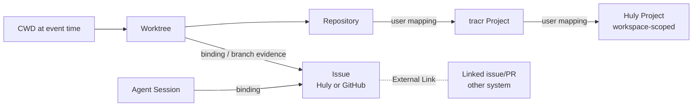

# Attribution model

Status: **Draft specification v0.2 (2026-09-28)**. Evidence: [research/github.md](../research/github.md), [research/huly.md](../research/huly.md), [research/activity-tracking.md](../research/activity-tracking.md).

## 1. Purpose

**Attribution** links a *subject* to a *context target*. It records how the link was established and how certain it is. Attribution answers *"what was this for?"*.

Attribution subjects:

- human-timeline intervals,
- Manual Entries,
- Agent Sessions,
- agent segments,
- Token Usage records.

A Worklog Entry is not a separate attribution subject. It carries the resolved attribution of the human-timeline intervals and manual entries it covers ([time and worklog §2](time-and-worklog.md#2-worklog-entry)).

**Principle:** attribution applies per explicitly named subject. An operation acts only on the subjects its scope names in [time and worklog §3](time-and-worklog.md#3-two-precedence-axes-and-operation-scope), and nothing cascades beyond that scope. A reattribution, allocation or joint mark acts on the subject it names. A binding acts on the records of the bound session or worktree and on human-timeline intervals whose engaged context is that session or worktree (§5). Operations on human time (manual entry, confirm as work, mark break, trim, split, reattributing a human-timeline interval) never reattribute agent sessions, agent segments, token usage, tool calls or cost records ([time and worklog §3](time-and-worklog.md#3-two-precedence-axes-and-operation-scope)). Those change only through operations whose subject is that record or its session/worktree: a binding, or an explicit correction. Whether a correction whose subject is an agent session also reaches that session's segments and usage records, and how it composes with corrections on those records, is **Unresolved** ([OQ-P-19](open-questions.md#product-questions)).

Whether a human-timeline interval counts as human work at all is a separate question, the **counting axis**. It is answered by the interval's work status (`work`, `unknown`, `non_work`; [activity model §5](activity-model.md#5-work-status-counting-is-separate-from-activity)) and its precedence ([time and worklog §3](time-and-worklog.md#3-two-precedence-axes-and-operation-scope)). **Principle:** counting and attribution are independent. A change on one axis never implicitly changes the other.

## 2. Context targets

| Target kind | Reference must include | Source of truth |
|---|---|---|
| Machine | installation ID | tracr |
| Worktree | machine + path + repository | local Git (observed) |
| Repository | normalized remote identity or machine + common Git dir | local Git / GitHub |
| **Project** (tracr) | internal ID | tracr (user-defined) |
| Huly Workspace | instance + workspace ID | Huly |
| Huly Project | instance + **workspace** + project ID | Huly |
| Huly Issue | instance + **workspace** + issue ID (+ identifier label) | Huly |
| GitHub Issue | host + repository + node ID (+ number label) | GitHub |
| GitHub PR | host + repository + node ID (+ number label) | GitHub |
| Agent / Agent Provider | provider + session + actor (`known`, `main` or `unknown`, §10) | tracr (derived from observations) |
| Manual work | the Manual Entry itself; a category such as meeting or review (finite list with "Other…") | user |

**Principle:** a Huly reference without its workspace is invalid. The same identifier `TRACR-12` in two workspaces refers to two different issues. The "current" or default workspace of a connection is never implied. The conceptual shape is `HulyIssueRef` in [concepts §4.3](concepts.md#43-code-and-context).

**Principle:** Huly is a **context provider** (and optionally an export target). tracr's activity, attribution and worklog records are stored and decided in tracr. Huly issue state is mirrored and never used as the storage of tracr's own model.

### Hierarchy and derivation

Context resolves outward from observed facts. Each step is a separate attribution with its own evidence:



- Worktree and repository come from observed evidence. They are usually `confirmed` with origin `observation` (§3).
- Repository → Project and Project → Huly/GitHub project come from **user-defined mappings**, confirmed by definition.
- Issue-level attribution is where inference, ambiguity and conflict concentrate.

## 3. Attribution states

**Proposed:** an attribution has a **state** (how it was established and how certain it is) and, once resolved, a **shape** (how many targets it names).

Shapes of a resolved attribution:

| Shape | Meaning | In per-target views |
|---|---|---|
| **single target** | One target | Under that target |
| **allocation** | Explicit weights summing to 100 %, entered or confirmed by the user | Each target shows its weighted share. The shares sum to the subject's minutes or usage. |
| **joint** | A set of targets the subject served together, **unsplit** | Each target shows it as "joint with …". Counted once in the human total. Never added in full to any target's exclusive total. |

States:

| State | Meaning | Effect in per-target views |
|---|---|---|
| `confirmed` | Stated by the user (binding, manual entry, or an explicit attribution correction: confirm target, reattribute, allocate, mark joint; these can be made during review), or a direct observation for structural targets (worktree/repository) | Shown under its target(s), according to its shape |
| `inferred` | Proposed by a rule with sufficient evidence and no conflict | Declared default: shown under its target in provisional reports, labeled *inferred*. Whether inferred issue attribution counts in exports and finalized reports, and whether reviewing a day's time also confirms its attribution, is **Unresolved** ([OQ-P-04](open-questions.md#product-questions)). |
| `ambiguous` | Several candidate targets, one of which is meant (not joint), none dominant | In no target's total. Shown as "ambiguous: X \| Y". |
| `conflicting` | Strong evidence for different targets (e.g. two bindings on one session disagree) | In no target's total until resolved. Where a higher precedence level exists (§5), its effect applies and the disagreement stays visible. |
| `rejected` | The user rejected this target for this subject (a per subject, target pair state) | No. Suppresses re-suggestion (§6). |
| `unattributed` | Counted human work, or an agent/usage record, with no target candidate | Reported as unattributed time or usage |

`ambiguous`, `conflicting` and `unattributed` have no resolved shape yet. A joint shape is `confirmed` when the user states it. Evidence of engagement in several contexts can only propose joint (§7).

**Principle: `unknown` ≠ `unattributed`.** `unattributed` means the time **is** counted human work (work status `work`) and its target is unknown. `unknown` is a work status, not an attribution state: it is not established that the interval was human work at all ([activity model §5](activity-model.md#5-work-status-counting-is-separate-from-activity)). Unknown minutes appear in neither the attributed nor the unattributed totals. For human time, attribution only takes effect on counted work. Attribution records on an `unknown` or `non_work` interval are kept but affect no total, and a reattribution never turns such an interval into counted time. Agent and usage records have no counting axis. Their attribution applies directly.

Each attribution record keeps **origin** (`user`, `binding`, `rule:<id>@<version>`, `observation`), **shape**, **evidence references**, **valid-from/to** where it derives from a standing binding, and the **revision** of the subject it applies to.

## 4. Evidence ladder for issue attribution

From research (github.md). The strength labels are **Proposed**, not calibrated.

| Evidence | Strength | Caveat |
|---|---|---|
| User binding of session/worktree/timer to an issue | Highest (user intent) | Binding can be outdated. Show valid-from/to. |
| Verified Huly ↔ GitHub external relation (sync metadata) | Strong **identity** link between two issues | Readability through the custom Huly MCP is **U** |
| PR closing relationship to an issue | Strong relationship | A PR can address several issues |
| Branch name contains a scoped issue key | Candidate | Convention, not ownership |
| Commit/PR text mentions the issue | Supporting | Mention ≠ work on it |
| Prompt/tool text mentions the issue | Weak unless confirmed | Needs content retention, so it is unavailable under the MVP default `never_stored` ([OQ-P-21](open-questions.md#product-questions)); may reference a dependency |
| Changed-file similarity | Suggestion only | Shared files, monorepos |

**Proposed rule for `inferred`:** at least one candidate-or-stronger signal pointing to exactly one issue, and no signal of equal or higher strength pointing elsewhere within the subject's interval. Weak and supporting signals alone yield at most a **suggestion** shown in review, not an `inferred` attribution. *(Candidate approach; the exact algorithm is **Unresolved**, [OQ-P-05](open-questions.md#product-questions).)*

**Principle:** time is never split equally between issues just because several are mentioned. Multi-target human time is a single target, an explicit user allocation, or joint (unsplit, counted once). Otherwise it is ambiguous (§7).

## 5. Precedence

**Proposed** precedence on the **attribution axis** ("what was this for?"):

1. User **correction** on the subject (confirm, reattribute, reject, allocate, mark joint). How several corrections compose (overlap, undo, field-level supersession) is **Unresolved** ([OQ-P-19](open-questions.md#product-questions)).
2. **Manual Entry** attribution inside its interval, on the human timeline only
3. Standing **binding** (session, worktree or timer → target), within its validity
4. Rule-based **inference**
5. `unattributed`

A higher level replaces the lower level's *effect*. It does not delete the lower record. The review UI shows "manual: X, detected: Y" when they disagree ([research/time-tracking.md](../research/time-tracking.md): manual attribution initially wins, disagreement shown).

Each level acts only on its own subjects (§1). A manual entry's attribution covers the human-timeline interval it states. It never reaches the agent records of a session that runs meanwhile. A binding covers the records of the bound session or worktree, and human-timeline intervals whose engaged context is that session or worktree.

Competing operations of equal priority are not decided by order of arrival. Overlapping bindings on one session, or a session binding and a worktree binding that disagree, are shown as `conflicting`, visibly, until the user resolves them. There is no silent last-write rule. How these cases are decided is **Unresolved** ([OQ-P-20](open-questions.md#product-questions)). A binding that disagrees with a manual entry for the same period does not override the manual entry on the human timeline (level 2 ranks above level 3). The disagreement stays visible, and further handling of that case is part of OQ-P-20.

This ordering is for **attribution only**. Whether a human-timeline instant counts as human work is the **counting axis**: correction → manual entry → inferred activity → unknown ([time and worklog §3](time-and-worklog.md#3-two-precedence-axes-and-operation-scope)). A binding appears only here, on the attribution axis. It never creates human minutes. A reattribution never changes work status. The research's time ladder also lists the binding ([research/time-tracking.md](../research/time-tracking.md)). This specification places it on the attribution axis only, because a binding says *what*, not *whether* or *when*. A manual entry says *what* and *when*, so it appears on both axes.

## 6. Corrections and rejection memory

- Reattribution creates a Correction on the attribution axis. It references the subject at a specific revision, the old and new target, actor, time and optional reason.
- **Rejections persist.** A rejected (subject, target) pair is not re-suggested after reindexing, parser upgrades or rule changes. A *new* rule version may re-suggest only if the rejection is scoped to the old rule and the user has chosen that behavior (**Unresolved**, [OQ-P-06](open-questions.md#product-questions)).
- A binding can be ended (valid-to set). This never retroactively changes reviewed worklog revisions.

## 7. Multiple targets, joint contexts and allocation

A subject can legitimately relate to several targets: one PR closing two issues, a session touching two repositories, a few minutes of attention shared by two sessions. Rules (**Proposed**):

- **Relations** (segment ↔ commit, PR ↔ issues, commit ↔ segments) are many-to-many and stored as such.
- For **counted human time**, each instant on the human timeline is counted once. Its attribution is a **single target**, an **allocation** (weights summing to 100 %, entered or confirmed by the user) or **joint** (the targets it served together, unsplit). Otherwise it is `ambiguous` (one target is meant, unknown which), `conflicting`, or `unattributed` (no target candidate, §3).
- **Joint is not ambiguous.** Joint says the work served several contexts together. Ambiguous says it served one context and tracr does not know which. Joint is established by user confirmation. Evidence of engagement in several contexts may propose it, as a suggestion.
- Joint applies only where the counting axis says `work`. Engagement in two contexts inside one gap leaves the interval `unknown` until the user confirms it as work ([activity model, interleaved variant](activity-model.md#variant-interleaved-engagement)).
- tracr is not forced to split human attention between simultaneous contexts. This is a valid record ([walkthrough C](walkthroughs.md#c-parallel-sessions)):

  ```text
  09:25–09:28
  human work: 3 min (user_asserted)
  engaged contexts: PDF Export, Server Fix
  attribution: joint {PDF Export, Server Fix}, no split
  ```

  It must not become PDF Export 3 + Server Fix 3 = human 6, nor an invented 2/1 split.
- **Per-target views:** counted human total = per-target exclusive + joint + counted work without a resolved target (`unattributed`, `ambiguous`, `conflicting`). Per-target exclusive figures, allocation shares and joint minutes counted once never sum to more than the counted human total; joint minutes shown under several targets are labeled "joint with …" and are never summed across targets ([reporting](reporting.md#human-time-totals-and-parallel-sessions)).
- Joint time is not exported to a single-issue target without an explicit user split ([time and worklog §9](time-and-worklog.md#9-export-to-external-worklogs), [OQ-P-27](open-questions.md#product-questions)).
- For **usage/cost**, a turn or session with several targets is allocated by an explicit policy, marked joint, or reported as ambiguous. No automatic equal split. How the usage of a session with several bindings over time is apportioned is **Unresolved** ([OQ-P-17](open-questions.md#product-questions)).

## 8. Conflict examples

| Situation | Resulting state |
|---|---|
| Session S bound to `jokeks2023/TRACR-12`; branch name `feature/TRACR-15` | Binding wins → `confirmed` TRACR-12. Branch signal is recorded as a disagreement hint. |
| No binding; branch `feature/TRACR-15`; PR closes GitHub #7, which is externally linked to TRACR-15 | `inferred` TRACR-15 (two consistent signals) |
| No binding; branch `main`; prompts mention TRACR-12 and TRACR-15 | Suggestions only → `unattributed` with suggestions shown |
| Manual entry "TRACR-12" 09:00–10:00; automatic interval 09:30–09:40 inferred TRACR-15 | 09:00–10:00 counted once (manual entry) and attributed TRACR-12. TRACR-15 kept as a visible disagreement. The agent records of the TRACR-15 session keep their own attribution. |
| Two worktrees of one repository, each bound to a different issue; engagement in both within one window | Counting axis first: the window is `unknown` (conflicting evidence) and not counted until the user confirms it as work ([activity model, interleaved variant](activity-model.md#variant-interleaved-engagement)). Once confirmed: joint (no split), an explicit allocation, or a user split. Each worktree's agent records stay attributed through their own binding. |
| Manual entry "meeting" on `jokeks2023/TRACR-12`, 13:00–14:00; meanwhile a background agent in session S, bound to `jokeks2023/SERV-7`, runs unattended | Human time: 60 min TRACR-12 (manual entry). S's agent segments, usage and estimated cost stay attributed to SERV-7. The manual entry does not reattribute them (§1, [time and worklog §3](time-and-worklog.md#3-two-precedence-axes-and-operation-scope)). |
| Issue identifier `TRACR-12` known but workspace unknown | Invalid reference. User must select the workspace. |

## 9. External Links

External Links connect entities across systems (Huly issue ↔ GitHub issue/PR, PR ↔ issue). Each link has kind, evidence (sync metadata, closing keyword, manual link, mention) and state (`observed`, `confirmed`, `rejected`). Links are **never** created by title similarity alone (research, github.md). Linked entities keep their own natural keys. They are related, not merged.

Phases ([AT-07](requirements.md#attribution-at)): the evidence rule above holds in all phases. In MVP, PR closing relationships read from GitHub context serve as issue *suggestion* evidence. Persisted, confirmable External Link records are Later.

## 10. Agent/provider attribution

**Principle:** actor identity is **capability-limited** ([AT-09](requirements.md#attribution-at)).

- Agent segments and Token Usage records are attributed to their Agent Provider and Agent Session by observation (`confirmed`, origin `observation`) where the source provides them.
- The acting agent (actor) is recorded as `known` (native actor/agent ID from the source), `main` (only where the provider's documented semantics identify the main agent) or `unknown` (the source indicates agent activity but does not identify the actor, e.g. Codex subagent hooks carrying the parent session ID, [OQ-I-06](open-questions.md#integration-specific-unknowns)). See [concepts §4.1](concepts.md#41-people-agents-and-sessions).
- tracr never assigns child usage to `main` by default and never fabricates a child ID or parentage. Subagents keep their parent relation where the source provides it. Provider and session totals stay valid. Per-actor breakdowns show an "unknown actor" row ([walkthrough G](walkthroughs.md#g-unknown-actor-identity)).
- Issue and project attribution of agent records comes from their own session/worktree binding, inference or explicit correction (§1, §5). Operations on human time never change it.

Human-timeline intervals carry the agent session(s) whose engagement evidence supports them as *evidence* (engaged contexts), not as the "owner" of human time. Agents running concurrently are informational and create no human time. A manual entry without agent evidence is attributed to **manual work**.
