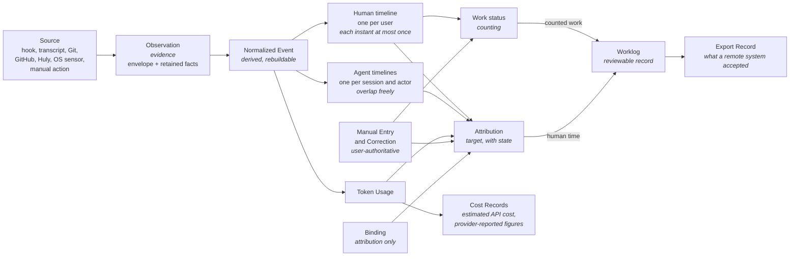

# Domain concepts

Status: **Draft specification v0.2 (2026-09-28)**. Conceptual only. Nothing in this document is a relational schema, class design, or storage decision. Status labels (**Principle**, **Proposed**, **Declared default**, **Candidate approach**, **Unresolved**, **Deferred**) are defined in [README](README.md#status-labels).

## 1. The processing chain

Five separate questions carry the whole product: **evidence**, **activity**, **counting**, **attribution** and **worklog**. Their records are deliberately separate, with separate lifecycles.



The diagram shows only cost records that attach to usage. Actual expenses attach to charges, not usage, and reach targets through user assignment or allocation ([cost model §6](cost-model.md#6-association-of-costs)).

| Concept | Question it answers | Nature | Can the user edit it? |
|---|---|---|---|
| **Observation** | What did a source actually report, when, and through which channel? | Evidence: envelope and retained fact body; payload optional | No. Its payload can be redacted or deleted under a retention policy, but nothing is rewritten. |
| **Normalized Event** | What does that observation mean in provider-neutral vocabulary? | Derived from observations by a versioned normalizer | No. It is regenerated when normalizer rules change, for rules whose inputs are retained. |
| **Activity** | What activity is evidenced, and on which timeline? Agent timelines per session and actor; engagement instants and inferred continuity on the one human timeline. | Inference | Indirectly, through Corrections |
| **Work status** (counting) | Does this human-timeline interval count as human work? | `work` (user-asserted or inferred), `unknown` or `non_work`; inference or user assertion | Yes: confirm as work, mark break/exclude, manual entry |
| **Attribution** | What was this (counted human time, or an agent/usage record) for: which project, repository, issue, agent or manual work, and how sure are we? | Inference or user assertion, always with evidence | Yes: confirm, reject, replace, allocate, mark joint |
| **Worklog** | What time record does the user stand behind, and what may be reported or published? | Resolved from work status, attribution, manual entries and corrections; becomes authoritative when reviewed | Yes, through revisions |

Activity lives on two kinds of timeline. **Agent timelines** (one per agent session, and per identified actor within it) overlap freely. There is **one human timeline** per user, and each instant on it is counted at most once. See §6.

**Principle:** counting and attribution are independent dimensions. A change on one axis never implicitly changes the other. A binding acts on attribution only and never creates human time. A correction of human time never reattributes agent sessions, agent segments, usage or costs ([time and worklog §3](time-and-worklog.md#3-two-precedence-axes-and-operation-scope)).

**Principle:** `unknown` is not `unattributed`. `unattributed` is counted work whose target is unknown. `unknown` means it is not established that work happened at all. Unknown minutes are shown separately and are never silently counted ([activity model §5](activity-model.md#5-work-status-counting-is-separate-from-activity)). Whether any explicitly enabled, labeled policy may count them is **Unresolved** ([OQ-P-18](open-questions.md#product-questions)).

**Principle:** each step keeps references to the records it was derived from. A Worklog Entry can be traced back to its Human-timeline Intervals and Manual Entries, then to Normalized Events, then to Observations, as long as their retained facts still exist. Where required inputs are gone, the derived record is `non_rebuildable` and its evidence links are tombstones (§2). See [event model](event-model.md), [activity model](activity-model.md), [attribution](attribution.md), [time and worklog](time-and-worklog.md), [walkthroughs](walkthroughs.md).

## 2. Record origin and lifecycle

Preservation depends on the **origin** and the **lifecycle state** of each record, revision or component. It does not depend on the entity type. One entity can combine components of different origins (table below).

**Origins:**

| Origin | Meaning | Rebuild behavior |
|---|---|---|
| **Evidence** | What a source reported, as received. | Never regenerated. Records that live observation missed can still be ingested later, by reconciliation from the durable ingest cursor or by backfill, while they remain readable at the source (coverage completeness `recovered`; EV-11, EV-13). Evidence that the source no longer holds and tracr never ingested (e.g. records rotated away before reconciliation read them) cannot be recovered. Where completeness cannot be established, the interval is a coverage gap with a reason (EV-12, [event model §10](event-model.md#10-ingestion-completeness-and-recovery)). Removal is not a coverage gap: a deleted payload is a payload state, and the envelope and retained facts remain. If retained facts are removed (retention expiry or user-directed deletion), dependent derived records become `non_rebuildable`, and links from preserved records become tombstones ([event model §3](event-model.md#3-retained-facts-and-replay-guarantees), [OQ-P-22](open-questions.md#product-questions)). |
| **Derived** | Computed from evidence and/or user records by versioned rules. | Rebuildable **only while its required inputs exist**. It carries the rule/parser version and source references. Without its inputs it becomes `non_rebuildable`, and tracr does not claim it can be rebuilt. |
| **User-authoritative** | Stated by the user: manual entries, corrections, bindings, confirmed and rejected attributions and links, manual mappings (repository → project, project → Huly/GitHub), reviewed worklog revisions, notes, subscriptions, entered expenses, project definitions. | Never discarded by a rebuild. Revisioned, append-only history. Never depends on an observation payload. |
| **External mirror** | Cached state of a record owned by a remote system (Huly, GitHub). | Refreshable from the remote system. Identity and tombstones are kept while referenced. |
| **Configuration** | Provider capabilities, pricing sources, policies and their versions. | Versioned. Old versions stay addressable as long as derived or finalized records reference them. |
| **Outward record** | What tracr sent to a remote system, and what came back. | Append-only. It is reconciled, never silently replaced. |

**Lifecycle states:**

| State | Applies to | Meaning |
|---|---|---|
| `rebuildable` | derived | Regenerated by versioned rules while its required inputs exist. Drafts are in this state only while their inputs exist; otherwise they are `non_rebuildable`. |
| `non_rebuildable` | derived | A required input is gone, e.g. retained facts removed by user-directed deletion or retention expiry. The record is marked, kept or removed per policy ([OQ-P-22](open-questions.md#product-questions)), and never presented as rebuildable. |
| `reviewed` | user-authoritative revision | The user stands behind this revision. Re-derivation never changes it. Differences appear as discrepancies. |
| `finalized` | preserved revision | Never silently regenerated. Changed only by an explicit reopen with a reason ([time and worklog §5](time-and-worklog.md#5-worklog-lifecycle)). |
| `tombstoned` | any referenced record | Identity kept while referenced; content removed. Visible as such. |

Finalized reports, finalized allocations and export records are preserved like user-authoritative records. None of them depends on an observation payload. When evidence they reference is removed, they stay, and their evidence links become visible tombstones.

Three rebuild operations are distinct: **renormalization** (observations → normalized events), **activity rebuild** (normalized events + user records → agent timelines, human timeline, work status, attribution drafts) and **report rebuild** (draft projections only). What each can do per payload state is specified in [event model §3](event-model.md#3-retained-facts-and-replay-guarantees).

**Entities that combine components:**

| Entity | Components |
|---|---|
| **Observation** | Envelope + retained fact body: Evidence. Payload: its own state (`present`, `redacted`, `deleted`, `never_stored`). |
| **Repository** | Identity: Derived. Aliases and merges: User-authoritative mappings. |
| **Agent Session** | Session record: Derived from observations. User label and mapping: User-authoritative. |
| **Attribution** | Inferred: Derived. Confirmed or rejected: User-authoritative. Structural observation (worktree, repository): Derived. |
| **External Link** | Observed: Derived / External mirror. Confirmed or rejected: User-authoritative. |
| **Worklog Entry** | Draft: Derived, `rebuildable`. Reviewed revision: User-authoritative, `reviewed`. Finalized revision: `finalized`. |
| **Cost Record** | Billing import: Evidence. Entered expense: User-authoritative. Estimate, provider-reported figure (read from its observation) or allocation: Derived. Finalized allocation: `finalized`. |
| **Diary Entry** | User-authored: User-authoritative. Generated draft: Derived. Accepted generated text: User-authoritative revision. |
| **Daily Report** | Projection: Derived. Finalized revision: preserved, `finalized`. |

**Unresolved:** how origins, lifecycle states and retained facts are stored (immutable observation store with derived projections, normalized facts with bounded raw retention, or a hybrid; [OQ-A-04](open-questions.md#architecture-questions)).

## 3. Identifier conventions

**Proposed:**

- Every tracr record has an **internal ID**: opaque, never reused, never derived from a display label.
- Every record that mirrors or originates from an external system also keeps a **natural key**: a scoped tuple identifying it in its source namespace. Natural keys are for deduplication and joins. Internal IDs are for references inside tracr.
- **Display labels** (directory basenames, issue titles, `TRACR-12`, `#12`, session titles) are never keys.
- Derived records should get **deterministic IDs** computed from their inputs and rule version. Rebuilding the same inputs with the same rules then reproduces the same IDs, and user records that reference them survive the rebuild. *(Candidate approach. The alternative is stable surrogate IDs with a remapping step. Unresolved: [OQ-A-03](open-questions.md#architecture-questions).)*
- A missing value is **unknown**. Zero means an observed zero. This holds for token counts, durations, prices and coverage.

Scoping rules that must hold regardless of implementation:

| Namespace | Natural key must include |
|---|---|
| Agent session | provider, installation/machine, (account where relevant), native session/thread ID |
| Huly entity | Huly instance, **workspace**, then project/issue ID |
| GitHub issue/PR | host, repository, then native node ID; the number is repository-scoped display |
| Repository | normalized remote identity where one exists; otherwise machine + common Git directory |
| Worktree | machine + worktree path + repository |
| Observation | source + source cursor/native record ID + content hash |

## 4. Entity catalogue

Columns: **Origin** as in §2. Where an entity combines components, the value names each one, e.g. "Derived + User-authoritative (mapping)". **Identity** is the natural key where applicable. Examples in `pseudo` blocks are **conceptual**, not implementation-ready schema.

### 4.1 People, agents and sessions

| Entity | Purpose | Origin | Identity | Key relationships |
|---|---|---|---|---|
| **User** | The person whose work tracr records. MVP assumes one user per installation. | Configuration | internal ID; optional external identities (GitHub login, Huly member) as linked refs | owns Manual Entries, Corrections, Worklog |
| **Machine** | Device on which observations are collected. | Configuration | installation ID | scopes sessions, worktrees, sensors |
| **Agent Provider** | A coding-agent product integrated as a data source (Claude Code, Codex). It declares a **capability manifest**. | Configuration | provider key + adapter version | has Agent Sessions |
| **Agent** | An acting agent (actor) inside a session: the main agent or a subagent. Separates the actor from the conversation. Actor identity is **capability-limited**: `known` (native actor/agent ID from the source), `main` (only where the provider's documented semantics identify the main agent), or `unknown` (the source shows agent activity but does not identify the actor). Child usage is never assigned to `main` by default. A child ID or parentage is never fabricated. Provider and session totals stay valid; per-actor breakdowns show an "unknown actor" row. | Derived | provider + session + native agent ID; `main` only where documented; otherwise actor `unknown` ([OQ-I-06](open-questions.md#integration-specific-unknowns)) | belongs to Agent Session; parent Agent only where the source provides it; [attribution §10](attribution.md#10-agentprovider-attribution) |
| **Agent Session** | Provider-native session or thread. A session's lifetime is **not** effort. Sessions of different providers, repositories and projects may run at the same time. Their agent timelines overlap; each session is kept individually and never collapsed into one "active session" (§6). | Derived (from observations) + User-authoritative (label, mapping) | see §3 | Agents, Agent Timelines, Turns, Normalized Events; observed Worktree(s) over time; parent/child sessions only where the source provides them (no invented parentage, AT-09) |
| **Turn** | One request/response cycle, from user interaction to agent completion, interruption or failure. | Derived | session + native turn ID, or derived ordinal if the provider has none | Tool Calls, Token Usage, interaction events |
| **Tool Call** | One tool invocation, begin to end. | Derived | session + native tool-call ID where available | Turn; may produce File Changes |

### 4.2 Evidence and events

| Entity | Purpose | Origin | Identity | Key relationships |
|---|---|---|---|---|
| **Source** | A concrete observation channel on a machine, e.g. "Claude Code hooks on machine M" or "GitHub API for account X". | Configuration | adapter + machine + locator | produces Observations; has Coverage Intervals |
| **Observation** | One thing a source reported: an **envelope**, a **retained fact body** (the minimum non-content facts kept whatever the payload state, [event model §3](event-model.md#3-retained-facts-and-replay-guarantees)) and an optional **payload**. MVP payload state is `never_stored` (**Declared default**, EV-08). | Evidence (envelope + retained facts); the payload has its own state | see §3 | Source; normalized into ≥0 Normalized Events |
| **Normalized Event** | Provider-neutral statement derived from ≥1 observations. Rebuildable from retained observation data (payload where present, retained facts otherwise) for rules whose inputs are retained. | Derived | deterministic from observation keys + normalizer version | Session/Agent/Turn; context evidence |
| **Coverage Interval** | Period in which a source was known to be collecting, degraded, or missing. It makes "no data" distinguishable from "no activity". It records completeness: `unverified` (live-ingested, not yet reconciled), `verified`, `recovered` (reconciliation found and ingested missed records) or `gap` with a reason (recovery could not establish completeness). A gap is never reported as complete ingestion (EV-11, EV-12, [event model §10](event-model.md#10-ingestion-completeness-and-recovery)). | Derived from collector observations | source + interval | Source; consulted by Activity and Reports |
| **Token Usage** | One deduplicated usage record (request or counter delta) with category semantics and its **temporal extent**: an instant, or an interval for counter deltas. A delta spanning days or a coverage gap is not silently assigned to one day ([OQ-P-23](open-questions.md#product-questions)). | Derived ("observed normalized fact") | provider request/message identity, or counter-delta key; unidentified records per [OQ-P-24](open-questions.md#product-questions) | Turn/Agent (actor may be `unknown`)/Session; model; Cost Records; attribution subject |
| **File Change** | A file modification observed by a tool call, filesystem watcher, or commit. File content is not stored. | Derived | source-specific | Worktree; Tool Call or Commit |

### 4.3 Code and context

| Entity | Purpose | Origin | Identity | Key relationships |
|---|---|---|---|---|
| **Repository** | Stable codebase identity, independent of checkout location. | Derived + User-authoritative (aliases/merges) | see §3 | Worktrees, Commits, GitHub Repository, Projects |
| **Worktree** | A concrete checkout (a Git worktree or the main working tree) with per-checkout HEAD/branch state. | Derived | see §3 | Repository; Agent Sessions observed in it |
| **Branch Observation** | The ref/HEAD seen for a worktree at a specific time. | Derived | worktree + observed time | Worktree; attribution evidence |
| **Commit** | Delivered-code identity: hash, parents, author/committer timestamps, changed paths. | Derived (local) / External mirror (GitHub) | repository + hash | Repository; PRs; Activity Segments as evidence |
| **Project** | tracr's own user-defined grouping of work. It is **not** a Huly project and not a repository. | User-authoritative | internal ID | maps to Repositories, Huly Projects, GitHub Repositories |
| **GitHub Repository** | Remote repository. | External mirror | host + node ID (owner/name as label) | Repository, Issues, PRs |
| **GitHub Issue** | Remote task. | External mirror | host + repo + node ID; number is a label | Project, PRs, External Links |
| **GitHub PR** | Review/delivery unit. | External mirror | host + repo + node ID | Commits, Issues (closing/mention relations) |
| **Huly Account Context** | Credentials/connection through which Huly is reachable. It can reach several workspaces. | Configuration | connection ID | Huly Workspaces |
| **Huly Workspace** | Namespace for all Huly entities. **Principle:** never omitted from a Huly reference. | External mirror | instance + workspace ID (slug/name as labels) | Huly Projects |
| **Huly Project** | Workspace-scoped task container. | External mirror | workspace + project ID; identifier (e.g. `TRACR`) as label | Huly Issues; Project mapping |
| **Huly Issue** | Workspace-scoped task identity and state. | External mirror | workspace + issue ID; `TRACR-12` as label | Project, External Links, Worklog export |
| **External Link** | Evidence-backed relation between external entities (Huly issue ↔ GitHub issue/PR, PR ↔ issue). | Derived / External mirror (observed) + User-authoritative (confirmed/rejected) | endpoints + relation kind + evidence | Attribution evidence |

```pseudo
// Conceptual reference shape — not an implementation type.
HulyIssueRef {
  instance      // which Huly deployment
  workspaceId   // required; never inferred from "current workspace"
  projectId
  issueId       // internal ID where the integration exposes it (unverified for custom MCP)
  identifier    // e.g. "TRACR-12"; display label, may be the only handle today
}
```

### 4.4 Activity, counting, attribution and time

| Entity | Purpose | Origin | Identity | Key relationships |
|---|---|---|---|---|
| **Activity Candidate** | A possible interval of activity proposed by one rule from one evidence stream. Competing candidates can coexist. | Derived | deterministic | Normalized Events; competes with other candidates |
| **Agent Timeline** | One per agent session, and per identified actor within it: session span, agent segments (execution), turns, tool calls, usage. Timelines of different sessions, providers and projects **overlap freely**. Each is kept and displayed individually. It never creates human time. | Derived | Agent Session (+ Agent where identified) | Agent Session, Agents, Turns, Tool Calls, Token Usage; supplies `concurrentAgentContexts` to the human timeline |
| **Activity Segment** | A reconciled interval on one timeline, with a boundary basis per endpoint (`observed`, `bounded`, `policy`, `user`) and an evidence grade. On an agent timeline it is an **agent segment** (execution). On the human timeline it is a Human-timeline Interval. | Derived | deterministic | Candidates, evidence, Attributions; [activity model §4](activity-model.md#4-boundaries-and-duration-basis) |
| **Human-timeline Interval** | An interval on the user's one human timeline. Each instant is counted at most once. It carries a **work status** (the counting axis), a **duration basis** per sub-interval, `engagedContexts[]` and `concurrentAgentContexts[]`. Periods without any human-activity evidence are blank, not intervals. | Derived (from evidence and user records) | deterministic | Activity Candidates, observed instants, Manual Entries, Corrections, Attributions; [activity model §5](activity-model.md#5-work-status-counting-is-separate-from-activity) |
| **Attribution** | Link from a subject (human-timeline interval, manual entry, agent session, agent segment, usage record) to a context target, with a **state** and evidence. States: `confirmed`; `inferred`; `ambiguous` (one of several targets is meant, none dominant; not joint); `conflicting`; `rejected` (kept per (subject, target)); `unattributed` (counted work or an agent/usage record with no target candidate; never unknown work). A resolved attribution also has a **shape**: **single target**; **allocation** (explicit weights summing to 100 %, entered or confirmed by the user); **joint** (a set of targets served together, unsplit, counted once). `ambiguous`, `conflicting` and `unattributed` have no resolved shape yet ([attribution §3](attribution.md#3-attribution-states)). | Derived (inferred; structural observation) + User-authoritative (confirmed/rejected) | subject + target + origin | [attribution.md](attribution.md), [attribution §3](attribution.md#3-attribution-states), [attribution §7](attribution.md#7-multiple-targets-joint-contexts-and-allocation) |
| **Binding** | Standing user statement such as "session S works on TRACR-12" or "worktree W from date D is issue X". It produces confirmed attributions for matching subjects: records of the bound session/worktree, and human-timeline intervals whose engaged context is that session/worktree. It acts on **attribution only** and never creates human time. Competing bindings stay `conflicting` until resolved ([OQ-P-20](open-questions.md#product-questions)). | User-authoritative | internal ID; valid-from/to | Session / Worktree / Timer → context ref |
| **Manual Entry** | User-asserted interval: a running/stopped timer (duration basis `timer_measured`) or a retroactive entry (`user_asserted`). It counts its interval as work and sets its target for the human timeline only. It never reattributes agent sessions, agent segments, usage or costs. It works without any agent or network. | User-authoritative | internal ID + revisions | Project/Issue ref; Worklog |
| **Correction** | Recorded user operation on derived or manual records. Operations on human time: confirm as work, mark break/exclude, trim, extend, split, merge. Attribution operations: reattribute, confirm target, reject target, allocate, mark joint. Each records its **subject**, **axis** (counting or attribution), **fields changed**, the revision it applies to, actor, time and reason. Scope per operation: [time and worklog §3](time-and-worklog.md#3-two-precedence-axes-and-operation-scope). How several corrections compose is **Unresolved** ([OQ-P-19](open-questions.md#product-questions)). | User-authoritative (append-only) | internal ID | subject record(s) at a specific revision; reason |
| **Worklog Entry** | The resolved time record used for reports and export. It carries counted human time (work status `work`) with its duration basis and attribution. Unknown and non-work minutes are shown separately, never counted. | Derived (draft) + User-authoritative (reviewed revision); finalized revision preserved | internal ID + revision | Human-timeline Intervals, Manual Entries, Corrections, Export Records |
| **Export Record** | Intent and outcome of publishing a worklog revision to a remote system (e.g. Huly). | Outward record | internal ID + target + source key | Worklog Entry revision; remote entry ID if returned |

```pseudo
// Conceptual shape — not an implementation type.
HumanTimelineInterval {
  interval [start, end)
  boundaryBasis { start, end }      // observed | bounded | policy | user
  workStatus: work                  // counting basis per sub-interval, see subIntervals
            | unknown { reason: unresolved_window | conflicting_evidence | coverage_gap }
            | non_work
  subIntervals[] { interval, durationBasis, countingBasis }
                                    // timer_measured | user_asserted | inferred_continuity
                                    // | policy_estimated (suggestion; never counted silently) | none
                                    // countingBasis (work status work only), derived from durationBasis:
                                    //   timer_measured | user_asserted → user_asserted; inferred_continuity → inferred
                                    // policy_estimated and none carry no counting basis (OQ-P-18). A mixed interval has sub-intervals of both bases;
                                    // minutes per basis come only from subIntervals, and inferred minutes are never upgraded.
  engagedContexts[]                 // contexts with human-engagement evidence inside or bounding it; may be several
  concurrentAgentContexts[]         // contexts whose agents ran meanwhile; informational, not attribution
  attribution                       // independent axis; see Attribution
}
```

### 4.5 Money

A real **charge** is recorded once, as an Expense. The five monetary kinds classify amounts. Allocations and per-target views are analytical representations ([cost model §1](cost-model.md#1-monetary-kinds)).

| Entity | Purpose | Origin | Identity | Key relationships |
|---|---|---|---|---|
| **Pricing Source** | Where rates come from: an official price page snapshot, a bundled catalogue, a user override. None is universal truth. | Configuration | source + fetched-at | Price Rules |
| **Price Rule** | Rate for an exact provider/model/tier/token category, with effective period, currency and unit scale. | Configuration (versioned) | pricing source + model key + effective-from + revision | Estimated Cost Records |
| **Cost Record** | One monetary amount of a declared **kind** (see [cost model](cost-model.md)). An actual-expense amount is a view of an Expense. Subscription cost is a classification carried on that same record, never a second amount or a separate record. | Evidence (billing import), User-authoritative (entered expense) or Derived (estimated API cost; provider-reported figure, read from its observation, which is the Evidence; allocation); finalized allocation `finalized` | kind-specific | Token Usage (estimated API cost, provider-reported figure) / Expense (actual expense, subscription cost) / Subscription Allocation; association targets |
| **Expense** | The **charge**: money actually charged (an API bill line, an invoice line, a subscription payment, extra purchased usage). Recorded **once**. A subscription payment is one Expense classified as subscription cost; it is not two expenses. | User-authoritative (entered) or Evidence (billing import) | internal ID; billing reference if imported | Subscription (classification); Cost Records; targets by user assignment or allocation |
| **Subscription** | A paid plan with a period and declared terms, e.g. "€100/month". The terms are not a charge. A charge exists when it is entered or imported as an Expense. **Subscription cost** is the classification of such an Expense, not a second amount. | User-authoritative | internal ID | Expenses classified as its charges; Subscription Allocations |
| **Subscription Allocation** | Reproducible split of one subscription charge across targets under an explicit allocation basis, including an **unallocated** remainder. Shares partition the charge and are never added to actual expense. Without an allocation, a day's share of the charge is unallocated. | Derived; finalized allocation `finalized` | subscription charge + period + allocation basis + version | Projects/Issues/Agents; [cost model §5](cost-model.md#5-subscriptions-and-allocation) |

### 4.6 Reporting (mostly later phases)

| Entity | Purpose | Origin |
|---|---|---|
| **Diary Entry** | User-authored note or accepted generated narrative for a day or item. | User-authoritative (user-authored; accepted generated text as a revision) + Derived (generated draft) |
| **Daily Report** | Projection of one reporting day with coverage and rule versions. | Derived (projection); a **finalized** revision is preserved |
| **Qualifying Day / Streak / Contribution** | Calendar-level derived facts under a named policy. | Derived; see [reporting](reporting.md) |

## 5. Three clocks

**Principle** (from research, activity-tracking): these durations are different quantities and must never be substituted for one another.

| Clock | Meaning | May overlap across sessions? |
|---|---|---|
| **Session span** | From session start to end (or last evidence). | Yes, and it says nothing about effort. |
| **Agent execution time** | Intervals in which an agent was generating, running tools, or waiting on resources, on its agent timeline. | Yes. Several agents can run at once. Their sum may exceed wall-clock time. |
| **Human work time** | Human-timeline intervals whose work status is `work` (user-asserted or inferred): manual work, engaged work and, where counted, quiet reading/planning. Intervals with work status `unknown` or `non_work` are not counted. | **No.** Each instant is counted at most once. It may serve one target, several contexts jointly (unsplit), or an explicit allocation. |

The span covered by evidence (from the first to the last instant covered by engagement instants or user-asserted intervals) is an **upper bound** on counted human work time, never a total. User-asserted time (manual entries, timers, corrections) may lie outside the engagement instants and counts on its own basis ([walkthrough A](walkthroughs.md#a-manual-only-work) has no engagement instants and counts 135 minutes). Session spans and agent execution time never become human work time.

## 6. Concurrent sessions and contexts

**Principle:** concurrent agent activity is fully logged even when human time is reconciled separately.

- **Agent timelines overlap freely.** tracr keeps one agent timeline per agent session, and per identified actor within it. Sessions of different providers, repositories and projects run in parallel. Each is ingested, stored and displayed individually. They are never collapsed into one "active session". Their durations may sum to more than wall-clock time. That is correct for agent time and irrelevant to human time.
- **One human timeline.** It is reconciled separately. Each instant is counted at most once, however many sessions or contexts are active.
- **An interval can reference several contexts.** `engagedContexts[]` lists every context (session, worktree, project, issue) with human-engagement evidence inside or bounding the interval. `concurrentAgentContexts[]` lists contexts whose agents were running. That second list is informational. It is not attribution and creates no human time.
- **No forced split.** tracr does not split human attention between simultaneous contexts without evidence or a user statement. Work that served several contexts together can be attributed **jointly**: counted once, unsplit ([attribution §7](attribution.md#7-multiple-targets-joint-contexts-and-allocation)).
- **Human-time corrections stay on the human timeline.** They never reattribute agent sessions, agent segments, usage or costs. Example: a manual meeting on TRACR-12 while a background agent works on SERV-7. The agent's usage and estimated cost stay attributed to SERV-7.

A valid representation, after the user confirmed the interval as work during review (before review it was `unknown`, conflicting, and not counted):

```text
09:25–09:28
human work: 3 min (user_asserted)
engaged contexts: PDF Export, Server Fix
attribution: joint {PDF Export, Server Fix} — no split
```

What must not happen:

| Wrong | Why |
|---|---|
| PDF Export 3 + Server Fix 3 = 6 human minutes | Counts one instant twice |
| An invented 2 / 1 split | No evidence or user statement supports a split |
| Adding session spans or agent execution time of parallel sessions to human time | Agent time is not human time (§5) |
| Treating a running agent of another session as human engagement | `concurrentAgentContexts` is informational |
| Collapsing parallel sessions into one "active session" | Every session is logged individually |

Per-target views show joint time as "joint with …". It is never added in full to each target's exclusive total. The counted human total is per-target exclusive + joint + counted work without a resolved target (`unattributed`, `ambiguous`, `conflicting`) ([RP-07](requirements.md#reporting-rp), [attribution §7](attribution.md#7-multiple-targets-joint-contexts-and-allocation)). Unknown and non-work minutes are shown separately. How joint time reaches single-target exports such as Huly `log_time` is **Unresolved** ([OQ-P-27](open-questions.md#product-questions)).

In [walkthrough C](walkthroughs.md#c-parallel-sessions), three sessions accumulate 134 agent-execution minutes within 80 minutes of wall clock. After review, the counted human total is 55 minutes: 25 exclusive to TRACR-12, 27 exclusive to server#41, 3 joint. Adding the joint minutes to each target (28 + 30 = 58) would be wrong. Session C ("Docs cleanup", tracr Project "Personal docs") gets 0 human minutes, while its 59 agent minutes and its usage stay fully logged. See also [activity model §9](activity-model.md#9-concurrent-agent-sessions-and-the-human-timeline).

## 7. Mapping to research vocabulary

The research package ([research/data-model.md](../research/data-model.md), [research/activity-tracking.md](../research/activity-tracking.md)) uses some different names. This specification uses the right-hand column.

| Research term | Spec term | Note |
|---|---|---|
| SourceObservation | Observation | same concept; v0.2 adds the retained fact body |
| AgentEvent | Normalized Event | extended to non-agent sources (Git, OS, manual) |
| CollectorHealth | Coverage Interval (derived from collector observations) | |
| Agent / SubagentRun | Agent | actor identity may be `unknown` (§4.1) |
| ActivityCandidate / ActivitySegment | Activity Candidate / Activity Segment | a segment is an agent segment on an Agent Timeline or a Human-timeline Interval (§4.4) |
| Exclusive human total | counted human total | only work status `work`; the evidence span (§5) is an upper bound, never a total |
| Checkout / Worktree | Worktree | "checkout" includes the main working tree |
| BranchObservation | Branch Observation | unchanged |
| ExternalIdentity / Link | External Link + natural keys (§3) | |
| ManualTimeEntry | Manual Entry | |
| WorklogEntry + WorklogRevision | Worklog Entry (revisioned) + Correction | a Correction is the user operation; a revision is its result |
| SyncReceipt / OutboxItem | Export Record | |
| PriceRule | Price Rule under a Pricing Source | |
| AllocationRun | Subscription Allocation | |
| DailySnapshot | Daily Report (finalized revision) | |
