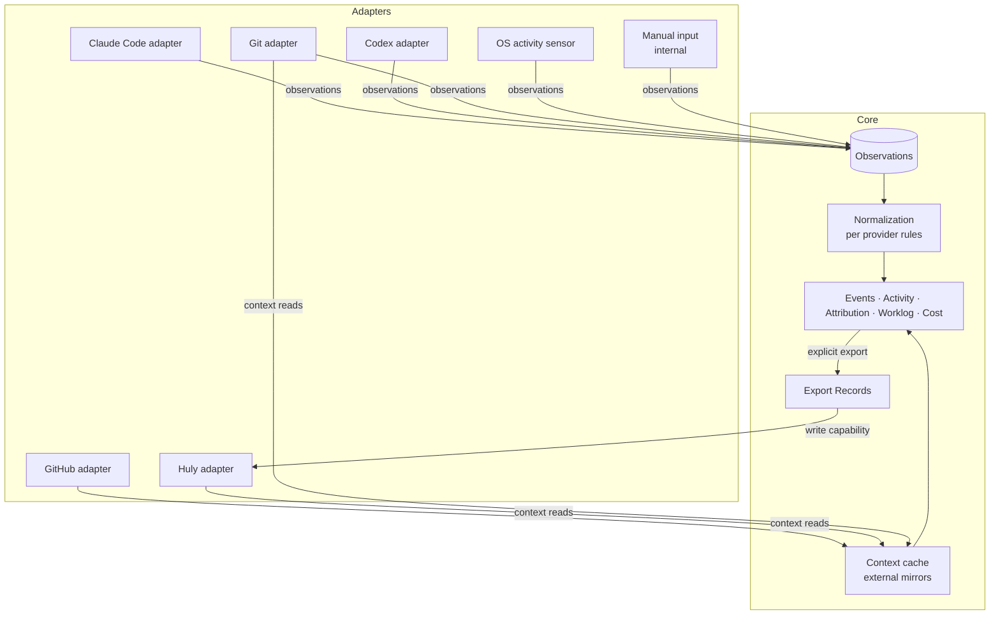

# Integration model

Status: **Draft specification v0.2 (2026-09-28)**. Evidence: [research/claude-code.md](../research/claude-code.md), [research/codex.md](../research/codex.md), [research/github.md](../research/github.md), [research/huly.md](../research/huly.md), [research/desktop.md](../research/desktop.md), [research/tools.md](../research/tools.md), [research/activity-tracking.md](../research/activity-tracking.md). Adapter shapes below are **conceptual boundaries**, not APIs.

## 1. Relationship to the core



**Principles:**

- Adapters depend on the core vocabulary. The core never depends on an adapter, transport, file layout or tool name.
- Each adapter declares a **capability manifest**. Core features degrade according to declared capabilities, not by probing for provider names.
- Unavailability is a **coverage state**, never silent absence ([event model §11](event-model.md#11-coverage-and-diagnostics)).
- Remote integrations are **read-only by default**. Writes are separate, explicit capabilities with Export Records.

## 2. Two adapter roles

**Observation adapter** (agents, Git, OS, manual). Candidate responsibilities:

| Responsibility | Meaning |
|---|---|
| Capability manifest | Which event kinds, usage semantics, identities, timestamps and history it can supply, per producer version |
| Actor capability | Declares whether actor identity (main agent, child/subagent ID, parent-session reference) is available, per producer version. Where it is not, events carry actor `unknown`; no parentage or child ID is invented (AT-09, [event model §4](event-model.md#4-normalized-event)). |
| Discovery | Find sources (installations, transcript locations, repositories) within user-approved scope |
| Backfill | Read history from a durable cursor. Resumable and idempotent. Archived, resumed and older history stays eligible (EV-13). |
| Live observation | Receive new evidence with low overhead; must never delay the user's agent session. Live notifications are hints, not a complete ledger. |
| Recovery and reconciliation | Reconcile each source against its durable cursor after start/restart, detected notification loss/overflow, rotation/atomic replacement/truncation, resume from suspend, and periodically (EV-11). Report intervals that cannot be recovered as coverage gaps with a reason (EV-12). Technology-neutral; mechanism and schedule are open ([OQ-A-07](open-questions.md#architecture-questions)). See [event model §10](event-model.md#10-ingestion-completeness-and-recovery). |
| Normalization rules | Provider-specific mapping to [normalized events](event-model.md), with a version |
| Health | Emit coverage events, including reconciliation completeness; report producer version and incompatibility |

**Context adapter** (GitHub, Huly, and Git for repository metadata). Candidate responsibilities: resolve references, list/search entities in scope, read relations, refresh with cursors/overlap windows, report permission loss as `unavailable` (not deleted). Optional, separately declared **write capabilities** (e.g. Huly time export) with idempotency/readback properties stated explicitly.

## 3. Integration catalogue

### Claude Code

| Aspect | Specification |
|---|---|
| Provides | Session/agent/turn lifecycle, prompts (optional content), tool calls, CWD, model, token usage, subagent linkage, transcript references |
| Interfaces | **Documented (D):** hooks (SessionStart/End, UserPromptSubmit, Pre/PostToolUse, Subagent*, Stop/StopFailure, CwdChanged), status line JSON, OpenTelemetry export, programmatic CLI. **Public but unstable (C):** local JSONL transcripts. **Undocumented/inferred:** folder-name→CWD decoding, context-fork filename rules, incomplete-stream billing election. **Not established (U):** compaction. No researched hook; compaction is a future fixture case ([OQ-I-07](open-questions.md#integration-specific-unknowns)). |
| Live vs backfill | Live: hooks (+ optional OTel); file-change notifications on transcripts can serve as live hints ([event model §10](event-model.md#10-ingestion-completeness-and-recovery)). Backfill and reconciliation: transcripts. Which channel is primary is open ([OQ-A-07](open-questions.md#architecture-questions)). |
| When unavailable | Hooks not installed → live coverage `missing`; backfill still possible. Transcript format unknown → quarantine + `degraded`. Missed notifications whose records can no longer be read at reconciliation → coverage gap with a reason ([event model §10](event-model.md#10-ingestion-completeness-and-recovery)). |
| Stays provider-specific | Hook payload shapes, transcript layout, streaming record election, copied-context exclusion, OTel `user`/`cli` active-time counters |
| Constraints | Passive hooks return no decisions and inject no context (research). They must preserve existing user hooks. Credentials and undocumented account endpoints are never read. |

### Codex

| Aspect | Specification |
|---|---|
| Provides | Session/thread, turns, items (prompts, tools), CWD, model, token usage, subagents (child actor `unknown` until [OQ-I-06](open-questions.md#integration-specific-unknowns) is resolved, AT-09), interrupts |
| Interfaces | **Documented (D):** hooks (with an explicit transcript-instability warning), App Server (threads/turns/items, usage notifications), non-interactive exec mode. **Internal/reverse-engineered (C):** rollout JSONL `token_count`/`turn_context` records, `state_N.sqlite`. |
| Live vs backfill | Live: hooks; App Server only for clients connected to it (no established desktop-wide passive subscription). Backfill: rollout files. Archived and resumed threads stay eligible for backfill (EV-13; [research/codex.md](../research/codex.md), "Observed internal behavior"). The internal DB is a read-only fallback that fails visibly on schema mismatch. |
| When unavailable | As for Claude, including recovery gaps. The DB fallback never writes, never assumes the highest-numbered file is compatible, and never treats lifetime totals as a daily ledger. |
| Stays provider-specific | Cumulative/last usage handling, service tiers, subagent hooks carrying the parent session ID (actor `unknown`, never `main` by default), hosted-tool coverage gaps |

**Symmetry (Principle):** Claude Code and Codex feed the same event vocabulary, activity model, attribution and cost logic. Differences are expressed only in capability manifests and normalizer rules ([event model §5.1](event-model.md#51-claude-code-and-codex-side-by-side)).

### Git (local)

| Aspect | Specification |
|---|---|
| Provides | Repository identity, worktrees, HEAD/branch observations, commits (hash, parents, timestamps, changed paths), remote identity |
| Interfaces | **D:** Git's documented CLI/worktree semantics |
| Live vs backfill | Both: event-time snapshots when agent events arrive; history scan for commits |
| When unavailable | Non-Git directory or Git missing → context `unknown`, not an error for activity |
| Stays specific | Submodule and detached-HEAD handling |
| Note | Commits are *output evidence*, never duration. Line/file/commit counts are not productivity measures. |

### GitHub

| Aspect | Specification |
|---|---|
| Provides | Repositories, issues, PRs, PR↔issue closing links, commits, contribution calendar (later) |
| Interfaces | **D:** REST, GraphQL, webhooks. Rate budgets are respected from response headers, not hard-coded. |
| Live vs backfill | MVP: scheduled incremental pulls (read-only). Webhooks need a reachable receiver or relay (**deferred**). |
| When unavailable | Offline or permission loss → cached mirrors marked stale/unavailable, never deleted |
| Stays specific | Node IDs vs numbers, closing-keyword semantics, contribution eligibility rules |

### Huly

| Aspect | Specification |
|---|---|
| Provides | Workspaces, projects, issues (status, identifier), possibly GitHub relations, optional time export |
| Interfaces | **L:** the user's custom Huly MCP, with explicit workspace selection on every call. Exact read schemas: `list_workspaces`, `list_projects`, `get_project`, `list_issues`, `get_issue`, `search_issues`. Write: `log_time(workspace, identifier, hours, description?)`. **C:** upstream platform model (TimeSpendReport, GitHub sync mixin). **U:** fork revision, returned fields, `log_time` semantics, idempotency, pagination. |
| Live vs backfill | Periodic context reads. No subscription mechanism is advertised. |
| When unavailable | Mirrors marked stale. Attributions keep their `HulyIssueRef`. Export blocked with a visible reason. |
| Stays specific | Transport (MCP tool names differ by host: the research observed `mcp__huly_joris__*`, this session exposes `mcp__huly__*`), identifier formats, status sets per project |

**Principle:** the Huly adapter's contract is **transport-independent**. Conceptually:

```pseudo
HulyContextPort {                                   // conceptual, not an interface definition
  listWorkspaces()
  listProjects(workspaceId)
  getIssue(workspaceId, issueRef)
  searchIssues(workspaceId, query)
  readExternalLinks(workspaceId, issueRef)           // capability: unknown today
  exportTime(workspaceId, issueRef, amount, note)    // write capability; idempotency: none advertised
}
```

The custom MCP (multi-workspace) is one transport. The upstream platform API is another candidate. The core sees only the port and its declared capabilities. Every call carries an explicit workspace.

### OS activity sensor (internal)

| Aspect | Specification |
|---|---|
| Provides | Device active/idle (elapsed-input time), lock/unlock, suspend/resume |
| Interfaces | **D:** Windows `GetLastInputInfo` (session-scoped). macOS elapsed-input queries (**C** via ActivityWatch; the lock-state key is an implementation dependency, **U**). |
| Platforms | The product targets macOS and Windows (PL-01). No parity claim without per-OS validation (PL-02). Lock-state detection and sensor permission behavior per OS are open ([OQ-I-10](open-questions.md#integration-specific-unknowns)). MVP delivery staging by OS: [mvp §4](mvp.md#4-platform-target-and-delivery-staging). |
| When unavailable | Device lane `unknown`. Rules 2 and 4 of the continuation rule cannot be met, so no gap is bridged ([activity model §6](activity-model.md#6-quiet-thinking-idle-and-heartbeats), [§12](activity-model.md#12-sparse-evidence-situations)). Gaps between engagement instants are `unknown` (`coverage_gap`), not counted, until the user confirms them. Idle-trimming proposals are unavailable, and the report says so. |
| Excluded | Screen recording, screenshots, OCR, key content, clipboard, accessibility-tree scraping |

### Manual input (internal)

Timers, retroactive entries, bindings, corrections, notes. It is always available and needs no network or agent.

### Later/optional sources (deferred)

Editor metadata (repository/file activity without text content), terminal foreground/pane adapters, and billing imports each need separate permission and privacy review before specification.

## 4. Source-coverage reporting

Each adapter surfaces: producer version seen, last successful observation, parse-failure counts, quarantined records, coverage intervals with their completeness (`unverified`, `verified`, `recovered`, `gap` with reason), and declared capability limits such as unavailable actor identity ([event model §11](event-model.md#11-coverage-and-diagnostics)). The daily report footer summarizes them ([reporting](reporting.md#4-quality-footer)).

## 5. Local integration surfaces offered by tracr (deferred)

A local read-only query surface for coding agents (e.g. an MCP server over tracr's own history) is a **promising, deferred** idea (research, best-practices). If pursued, it needs explicit scope, redaction and local access control. A local server is still an attack surface (research, desktop).
