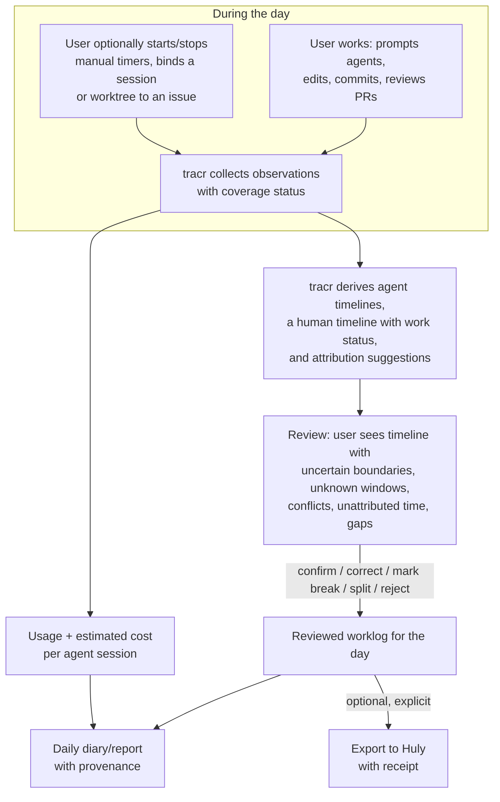

# Product definition

Status: **Draft specification v0.2 (2026-09-28)**. Evidence base: [research/README.md](../research/README.md). Terms follow [concepts](concepts.md).

## 1. What tracr is

tracr is a **local development diary and time ledger for one developer**. It is built for development with several coding-agent sessions running concurrently, in different projects, worktrees and issue contexts. It combines four things that the inspected tools ([research/comparison.md](../research/comparison.md)) do not combine in one demonstrated workflow:

1. **What happened.** It collects evidence of development activity from coding agents (Claude Code, Codex), Git, GitHub, Huly, the operating system (idle/lock state only), and the user's own timers and notes. Every agent session is recorded individually, including sessions that run at the same time.
2. **How long the person worked, and on what.** It infers human work periods conservatively, keeps periods in which it is not established that the person worked visible as *unknown* instead of counting them, attributes counted time to projects and issues, and lets the user review and correct the result into a worklog.
3. **What it cost.** It records token usage and keeps five monetary kinds separate: actual expense, estimated API cost, provider-reported cost figure, subscription cost, and allocated subscription cost ([cost model §1](cost-model.md#1-monetary-kinds)).
4. **What it adds up to.** It produces a daily timeline and diary. Later phases add longer-range analytics: history, streaks, contribution calendar, project-setup diagnostics.

Claude Code and Codex are **integrations**: data sources with provider-specific adapters. They are not the product, and tracr's core model does not depend on either being present. A day with only manual timers is a complete tracr day.

**Principle:** the product targets **macOS and Windows** (PL-01; [research/README.md](../research/README.md), [research/desktop.md](../research/desktop.md)). The desktop framework or shell is not chosen ([OQ-A-06](open-questions.md#architecture-questions)). Whether MVP delivery is staged by OS is **Unresolved** ([OQ-P-26](open-questions.md#product-questions); [MVP §4](mvp.md#4-platform-target-and-delivery-staging)). No OS-parity claim is made without per-OS validation (PL-02).

## 2. The user problem

A developer works with several coding-agent sessions in parallel: for example, Claude Code and Codex sessions on different projects and issues, running at overlapping times, across repositories and worktrees. Tasks are tracked in Huly and GitHub. This developer cannot currently answer these reliably:

- *How much of my time went into issue X today?* Agent sessions stay open for hours, run concurrently, and continue while the person does something else. Session lifetimes overstate effort, and summing them double-counts. Gaps between interactions do not show whether the person worked at all. [research/activity-tracking.md](../research/activity-tracking.md)
- *What did each of my agents do?* Parallel sessions produce overlapping activity and usage. Collapsing them into one "active session" hides work. Adding them into human time inflates effort.
- *What did I actually do?* The evidence is scattered across transcripts, commits, PRs, issue trackers and memory.
- *What did it cost?* Token counts, API list prices, subscription fees and actual bills are different quantities. The inspected usage tools mainly show API-equivalent estimates, which are easily read as spend. [research/costs.md](../research/costs.md), [research/gaps.md](../research/gaps.md)
- *Can I trust and fix the numbers?* Among the inspected tools, automatic estimates (e.g. Timelog's per-session gaps) do not reconcile concurrent sessions, and the inspected manual trackers (Timing, Kimai) do not use coding-agent evidence. [research/comparison.md](../research/comparison.md)

## 3. Product boundary

| In the product's scope (over its lifetime) | Outside the product |
|---|---|
| Collecting metadata-first evidence from agents, Git, GitHub, Huly, OS idle/lock state, manual input | Screen recording, screenshots, OCR, keystroke content, clipboard capture, accessibility-tree scraping |
| Inferring and reconciling human activity with visible uncertainty | Claiming exact human attention from agent logs |
| Attributing activity to projects/issues, with review | Acting as the task tracker. Huly/GitHub stay the systems of record for issues. |
| Reviewable worklog; optional export to Huly | Payroll, invoicing, team timesheet approval workflows *(not requested; out of scope unless later decided)* |
| Usage, estimated API cost, provider-reported cost figures, expenses, subscription allocation | Being a billing system of record; accessing provider accounts through undocumented endpoints |
| Daily diary, history, streaks, contribution calendar | Productivity scoring of the person; team surveillance |
| Diagnosing whether a project is prepared for multiple agents | Silently rewriting a project's agent configuration |
| Transcript/prompt content, **optional and minimized** | Storing prompts/tool output by default for analytics |

**Principle:** tracr is local-first. Remote integrations are context providers and optional export targets. They are not the store of tracr's own activity model.

**Unresolved:** multi-user/team use, multi-device merge of one user's data. See [open questions](open-questions.md).

## 4. Central workflow

The user does not have to review every day for tracr to be useful. Unreviewed days are shown as **provisional**. Unknown windows stay unknown and uncounted until the user resolves them. Review is the only path that turns inference into a worklog the user stands behind.

## 5. How activity, time, context and cost relate

Evidence passes through separate questions: activity evidence → **work status** (counting) → **attribution** → reviewed worklog ([concepts §1](concepts.md#1-the-processing-chain)).

- **Activity** is derived from evidence. Each agent session has its own **agent timeline**. Agent timelines of concurrent sessions overlap freely and each stays visible. The person has one **human timeline**, reconciled separately; each instant on it is counted at most once ([concepts §6](concepts.md#6-concurrent-sessions-and-contexts)).
- **Counting** decides whether a human-timeline interval counts as human work. Its **work status** is `work` (user-asserted or inferred), `unknown` (it is not established that the person worked) or `non_work` (break or exclusion). Only `work` enters the counted human total ([activity model §5](activity-model.md#5-work-status-counting-is-separate-from-activity)).
- **Time** comes in several kinds: session span, agent execution, human work ([concepts §5](concepts.md#5-three-clocks)). Only reviewed human work time becomes worklog time.
- **Context** (project, repository, worktree, issue, agent) is attached through **attribution**. Counting and attribution are independent axes. A segment can be counted yet unattributed, attributed yet excluded, or unknown (not counted, whatever its attribution). **`unknown` is not `unattributed`:** unattributed time is counted work without a target; unknown time is not counted at all.
- **Cost** has several kinds ([cost model §6](cost-model.md#6-association-of-costs)). Estimated API cost and provider-reported cost figures attach to **usage** (requests, turns, sessions), not to human minutes. They reach projects and issues through the attribution of the session, segment or usage record that produced the usage. Actual expenses attach to **charges**; each charge is recorded once and reaches targets only through user assignment or an allocation with an explicit basis. Allocated subscription cost attaches to allocation targets. Correcting human time never reattributes agent usage or cost.

Agent cost and human time are therefore reported **side by side, never combined** into one number unless a later, explicitly labeled analysis (e.g. labor-rate × time + allocated expense) declares its formula. *(Deferred.)*

## 6. How tracr differs from adjacent tools

These are scope differences against the demonstrated paths of the inspected tools ([research/comparison.md](../research/comparison.md)). They are not claims about the whole market. Where the comparison marks a capability as not verified (**?**), the difference is not established. Examples: repository and issue context in Timing and Kimai; GitHub/Huly integration and agent integration in ActivityWatch and WakaTime; human work time and GitHub context in native Claudoscope.

| Adjacent tool type | What it does | What tracr additionally models |
|---|---|---|
| Claude transcript/observability viewer (e.g. native Claudoscope; other-provider support not verified) | Parses Claude transcripts, usage and estimated cost (inspected path) | Several providers in one vocabulary, human work time distinct from agent activity, manual time, corrections, issue attribution |
| Token/cost CLI (e.g. ccusage) | Deduplicated usage and API-equivalent estimates | Separate expense and subscription-allocation kinds; time and diary |
| Session-gap timesheet (e.g. Timelog) | Per-session gap sums | Cross-session reconciliation so concurrent sessions are not summed |
| Traditional time tracker (Timing, Kimai) | Manual entries, app usage, timesheets | Agent evidence, repository/worktree/issue context, token cost |
| Activity sensor (ActivityWatch, WakaTime) | Heartbeats, AFK, editor time | Issue-level attribution with review; per-session agent timelines |

The value is in **reconciliation with provenance**. Not every one of these capabilities is new; they are made consistent with each other.

## 7. Product principles

**Principle** unless marked otherwise. These are binding for all other documents in this specification.

1. **Session lifetime is not human effort.** Neither is agent execution time.
2. **Concurrent sessions are never summed** into human time. Each instant of human time is counted at most once. An interval may reference several contexts jointly without an invented split.
3. **Unknown is not work.** A human-timeline interval whose work status is `unknown` never enters the counted human total unless the user asserts it (confirm as work, manual entry). It is shown separately, and it is not unattributed time. Whether any explicitly enabled, labeled policy may count unknown time is **Unresolved** ([OQ-P-18](open-questions.md#product-questions)). See [activity model §5](activity-model.md#5-work-status-counting-is-separate-from-activity).
4. **Concurrent agent activity is fully logged.** Agent timelines of different sessions, providers and projects overlap, and each stays individually visible with its execution time and usage. They are never collapsed into one active session, even though human time is reconciled separately ([activity model §9](activity-model.md#9-concurrent-agent-sessions-and-the-human-timeline)).
5. **No invented precision.** If evidence only bounds a switch to a window, the boundary is represented as that window.
6. **Evidence is kept separate from conclusions.** Observations are not rewritten. Derived records carry rule/parser versions and source identity. They are rebuildable only while the source facts they need are retained ([event model §3](event-model.md#3-retained-facts-and-replay-guarantees)).
7. **Corrections do not erase evidence.** A correction records what changed, why, and against which revision.
8. **Missing coverage is explicit.** "No data" is not "no activity" and not "zero cost".
9. **Unknown prices are never zero.** Unpriced usage is reported as unpriced.
10. **Money kinds stay distinct:** actual expense, estimated API cost, provider-reported cost figure, subscription cost, allocated subscription cost ([cost model §1](cost-model.md#1-monetary-kinds)). Each real charge is recorded and counted once. Subscription cost classifies a charge; it is never a second amount. Estimated and provider-reported figures are never presented as spend or added to paid totals.
11. **Content is optional and minimized.** Metadata and usage are enough for the default feature set. Prompt/tool content retention is an explicit setting.
12. **Manual intent has clear precedence** over inference, separately on the counting axis and on the attribution axis (see [time and worklog §3](time-and-worklog.md#3-two-precedence-axes-and-operation-scope)). Bindings never create human time. Corrections of human time never reattribute agent sessions, usage or cost.
13. **Automatic attribution is conservative and reviewable.** Suggestions carry reasons, rejections are remembered.
14. **Remote writes are explicit and receipted.** No blind retries of non-idempotent writes.
15. **Documented interfaces are preferred** over reverse-engineered ones. Reverse-engineered adapters are labeled, version-gated, and fail visibly.

## 8. Non-goals for this specification

No technology stack, framework, database engine, desktop shell, or UI architecture is chosen. The desktop candidates in [research/desktop.md](../research/desktop.md) remain open ([OQ-A-06](open-questions.md#architecture-questions)). This does not reopen the target operating systems (§1).
