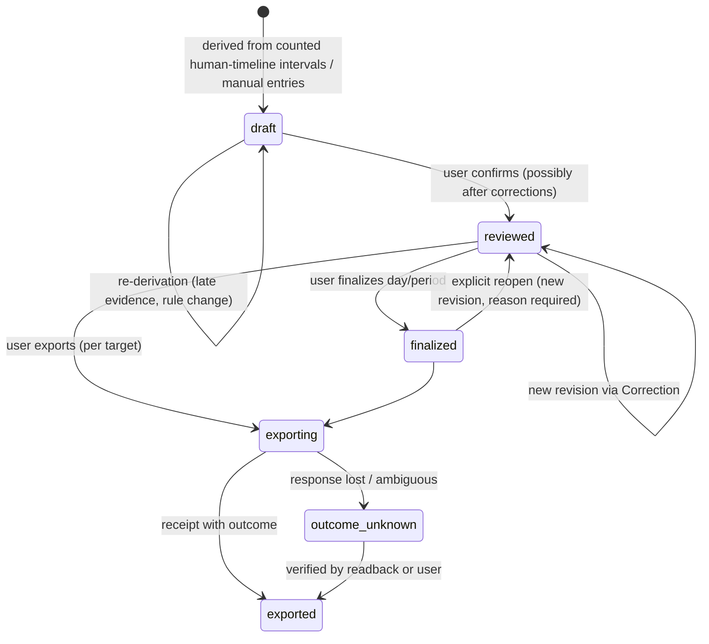

# Time and worklog model

Status: **Draft specification v0.2 (2026-09-28)**. Evidence: [research/time-tracking.md](../research/time-tracking.md), [research/activity-tracking.md](../research/activity-tracking.md), [research/huly.md](../research/huly.md), [research/reporting.md](../research/reporting.md).

## 1. Time quantities

These are **distinct quantities**. Reports label which one they show. Inferred minutes are never reported as measured or observed ([activity model §4](activity-model.md#4-boundaries-and-duration-basis)).

| Quantity | Definition | Source | Counted as human work? | May overlap across contexts? |
|---|---|---|---|---|
| **Session span** | Session start to end or last evidence | Agent lifecycle | Never. Not a work measure. | Yes |
| **Agent execution time** | Agent execution segments on the agent timelines | Agent lifecycle/usage | Never | Yes. Sessions may sum to more than wall-clock time. |
| **Timer elapsed time** | Measured elapsed interval between durable timer start/stop actions (duration basis `timer_measured`) | Manual timer | Yes, by user assertion. The interval is measured; that it was work is the user's statement. | No (human timeline). Overlapping manual entries need resolution (§4). |
| **User-asserted time** | Time the user states as work: timer elapsed time, retroactive manual entries, intervals confirmed as work | User | Yes | No. Overlapping manual entries need resolution (§4). |
| **Inferred work time** | Minutes bridged between observed engagement instants in one context by the named continuation rule (`inferred_continuity`) | Activity model | Yes, provisional until reviewed. Not measured attention. | No |
| **Unknown time** | Human-timeline intervals whose work status is `unknown`: unresolved window, conflicting evidence, coverage gap inside otherwise plausible work | Activity model | **No.** Shown separately. | No |
| **Non-work time** | Intervals the user marked as break or excluded | User | No | No |
| **Counted human time** | User-asserted time + inferred work time. `policy_estimated` minutes only as far as [OQ-P-18](open-questions.md#product-questions) allows, and then labeled. Reflects applied Corrections (confirm as work, mark break/exclude, trim, extend, §3; composition [OQ-P-19](open-questions.md#product-questions)). | Derivation | Yes | No. Each instant at most once. It may serve one target, several contexts jointly (unsplit, counted once), or an explicit allocation ([attribution §7](attribution.md#7-multiple-targets-joint-contexts-and-allocation)). |
| **Worklog time** | Time in reviewed Worklog Entry revisions | Worklog | Yes | No |
| **Published worklog time** | Time a remote system accepted, per Export Record | Remote receipt | n/a | n/a (per target) |

Relations:

- **Principle:** counted human time = user-asserted time + inferred work time (`policy_estimated` minutes only as far as [OQ-P-18](open-questions.md#product-questions) allows, and then labeled; see the table). Unknown and non-work time are shown separately. Non-work time is never counted. Unknown time is never silently counted (see the next principle).
- **Principle:** unknown time is never an input to counted, worklog or published time. It enters them only when the user asserts it (confirm as work, manual entry), at which point it is user-asserted time. Whether an explicitly enabled, labeled policy may count it is **Unresolved** ([OQ-P-18](open-questions.md#product-questions)).
- Counted human time in any period ≤ the period's length. Each instant counts at most once, however many sessions or contexts are active. The span covered by evidence (e.g. 09:00–10:47) is an **upper bound**, never a total. For human quantities, "No" in the overlap column means an instant is never counted more than once. It does not forbid joint attribution: a jointly attributed interval appears as "joint with …" under each of its targets and is counted once in the total (§7).
- Worklog time ⊆ counted human time: only intervals with work status `work` in reviewed Worklog Entry revisions (§2). Unknown and non-work time are never worklog time.
- Published time is derived from worklog time but may differ: rounding at the export boundary, or a remote format that cannot carry intervals (Huly `log_time` accepts hours, [research/huly.md](../research/huly.md)).
- Session span and agent execution time are **never** inputs to human time. Agent evidence contributes only its observed engagement instants. Instants have no duration: the activity model bridges a gap between them into inferred work time only under the named continuation rule; a gap that fails the rule is `unknown` (`unresolved_window`) and not counted ([activity model §6](activity-model.md#6-quiet-thinking-idle-and-heartbeats)).

## 2. Worklog Entry

```pseudo
WorklogEntry {                       // conceptual
  id, revision
  interval [start, end)              // or allocation atoms, see OQ-A-02
  boundaryBasis { start, end }       // observed | bounded | policy | user
  durationBasis [                    // mixed provenance: one part per sub-interval
    { subInterval, basis }           // timer_measured | user_asserted | inferred_continuity
  ]                                  // policy_estimated only as OQ-P-18 allows, labeled
  attribution: target | allocation{target: weight} | joint{targets}
                                     // ambiguous | conflicting | unattributed until resolved
  engagedContexts[]                  // evidence, not ownership
  provenance: automatic | manual | mixed   // inputs in derivedFrom; not the duration basis — minutes per basis come only from durationBasis
  derivedFrom { humanIntervals[], manualEntries[], corrections[] }
  state: draft | reviewed | finalized | (exported per target → Export Records)
  reportingTimezone
  notes?
}
```

- **Only counted work becomes worklog time.** A Worklog Entry covers human-timeline intervals whose work status is `work`. Unknown windows stay visible next to the draft entries for review. They are not entries.
- An entry can have **mixed provenance**. Reports explain it by minutes per duration basis ([reporting](reporting.md#mixed-provenance)). Example: after the user confirms 09:25–09:32 as A (§7), A's entry 09:00–09:32 shows 25 min `inferred_continuity` + 7 min `user_asserted`. Inferred minutes are never upgraded to measured.
- `engagedContexts` lists the contexts with human-engagement evidence ([activity model §9](activity-model.md#9-concurrent-agent-sessions-and-the-human-timeline)). It is evidence, not attribution.

Whether a Worklog Entry stores exact intervals or an allocation over interval atoms is **Unresolved** ([OQ-A-02](open-questions.md#architecture-questions); research, data-model).

## 3. Two precedence axes and operation scope

Two separate questions, each with its own precedence. **Principle:** a change on one axis never implicitly changes the other.

**Counting axis** (**Principle**, [TW-09](requirements.md#time-and-worklog-tw)): *does this human-timeline instant count as human work?*

1. **Correction**: a user operation on that instant (confirm as work, mark break/exclude, trim, extend). How several corrections compose is **Unresolved** ([OQ-P-19](open-questions.md#product-questions)).
2. **Manual Entry**: user-asserted interval (timer or retroactive)
3. **Inferred activity**: work inferred under the named continuation rule
4. **Unknown**: not established, not counted

**Bindings never appear on the counting axis. A binding never creates human minutes.** Neither does agent execution.

**Attribution axis** (**Proposed**, [AT-04](requirements.md#attribution-at)): *what was this for?* correction → manual entry → binding → inference → unattributed. Specified in [attribution §5](attribution.md#5-precedence).

### Operation scope

| Operation | Subject | Fields changed | Counting axis | Attribution axis | Agent sessions / segments / usage / costs |
|---|---|---|---|---|---|
| Manual entry (timer or retroactive) | stated interval on the human timeline | interval, work status `work` (basis `timer_measured` or `user_asserted`), target | Yes: counts its interval | Yes: its target, for the human timeline only | **No effect** |
| Confirm as work | human-timeline range | work status → `work` (`user_asserted`) | Yes | No, unless the user also chooses a target, recorded as a separate attribution correction | No |
| Mark break / exclude | human-timeline range | work status → `non_work` | Yes | No. Attribution records are kept but have no effect while non-work | No |
| Trim / extend | human-timeline interval | bounds | Yes. For a `work` interval: a range removed by a trim takes `non_work` (user exclusion, boundary basis `user`). Its attribution records are kept but have no effect, as for a break. A range added by an extension takes `work` (`user_asserted`). Trimming or extending other intervals, and composition with other corrections: [OQ-P-19](open-questions.md#product-questions). | Resulting pieces keep the interval's attribution (Proposed) | No |
| Split / merge | human-timeline interval(s) | partition | No change to the counted total by itself | Pieces can be attributed separately; merge needs compatible attribution or an explicit choice | No |
| Reattribute / confirm target / reject target | any explicitly named attribution subject (human interval, manual entry, agent session, agent segment, usage record) | target / state | **No** | Yes | Only when the subject is that agent/usage record |
| Allocate / mark joint | human interval or explicitly named usage subject | attribution shape | No | Yes | Only when the subject is that agent/usage record |
| Binding set / end | session, worktree or timer, with validity | standing target | **No** | Yes, for matching subjects: records of the bound session/worktree, and human intervals whose engaged context is that session/worktree | Yes, for records of the bound session/worktree |
| Review (worklog) | day or entries | revision state | Freezes the resolved counting of the reviewed revision | Whether review also confirms attribution is **Unresolved** ([OQ-P-04](open-questions.md#product-questions)) | No |

**Invariants (Principle):**

- A reattribution never changes work status. A non-work mark never deletes attribution records; it removes their effect on counted totals. A reattribution after an exclusion never re-enables time.
- **Correcting human time (manual entries, confirm/mark break, trim, split …) never automatically reattributes agent sessions, agent segments, token usage, tool calls or cost records** ([AT-10](requirements.md#attribution-at)). Those change only through operations whose subject is that record or its session/worktree (binding, explicit correction). Example: a manual meeting on TRACR-12 while a background agent works on SERV-7: the agent's usage and estimated cost stay attributed to SERV-7 (§4).

Rules:

- A higher level overrides the **effect** of lower levels on its own axis, in its interval. Lower-level records are kept and visible as "overridden by …" (**Principle**: corrections do not erase evidence).
- Every Correction records its subject, axis (counting or attribution), the fields it changes, the revision it applies to, actor, time and reason ([TW-10](requirements.md#time-and-worklog-tw)).
- How several corrections compose (overlapping ranges, trim then confirm, undo; whether a later correction supersedes only the fields it changes) is **Unresolved** ([OQ-P-19](open-questions.md#product-questions)). No silent last-write rule is adopted.
- Competing bindings and other equal-priority operations are shown as `conflicting`, visibly, until resolved ([OQ-P-20](open-questions.md#product-questions)).
- A Correction references the revision it was made against. If the underlying derivation changes later, the correction still applies where its target still exists. A correction that states an explicit time range keeps applying to that range. Otherwise it becomes an **orphaned correction** shown for review, never silently dropped ([walkthrough H](walkthroughs.md#h-changed-derivation-with-a-prior-correction); identity approach [OQ-A-03](open-questions.md#architecture-questions)). *(Proposed.)*

## 4. Reconciliation cases

From research (time-tracking), with **Proposed** behavior:

| Situation | Behavior |
|---|---|
| Manual A 09:00–10:00; detected A 09:10–09:45 | One 60-minute interval for A, counted once as user-asserted. The inferred interval agrees and is kept as evidence. Duration basis: 60 min user-asserted (the manual entry's basis: `user_asserted`, or `timer_measured` if it is a timer). The agreeing inferred interval 09:10–09:45 stays in `derivedFrom` as evidence, shown as overridden on the counting axis (§3). It is not a counted basis. Both origins are kept. The entry is not mixed-basis. |
| Manual A 09:00–10:00; detected B 09:30–09:40 | 60 minutes A (manual wins on both axes for its interval). Disagreement with B is shown for optional correction. |
| Manual A and manual B overlap | Not resolved automatically. The user must split, override, enter an explicit weighted allocation, or mark the overlap joint. Until then the overlap is counted **once** (both entries assert work) with attribution `conflicting`. |
| Automatic A and automatic B overlap | Counted at most once, never summed ([activity model §10](activity-model.md#10-reconciliation-invariants)). Continuity the continuation rule does not support (e.g. other-context engagement inside the gap) is `unknown` and not counted ([interleaved variant](activity-model.md#variant-interleaved-engagement)). Where work is established but its target cannot be decided, attribution is `joint` only when the user states it served both. Until then it has no resolved shape (`ambiguous` or `conflicting`, [attribution §3](attribution.md#3-attribution-states)). Evidence of engagement in several contexts may propose joint, as a suggestion only ([attribution §7](attribution.md#7-multiple-targets-joint-contexts-and-allocation)). Whether an interval with engagement in several differently bound contexts is proposed as joint or shown as `conflicting` before review is [OQ-P-20](open-questions.md#product-questions). |
| Unknown window, no user action | Stays `unknown`: visible, not counted, not worklog time. A window policy may only pre-fill a suggestion ([OQ-P-03](open-questions.md#product-questions), [OQ-P-18](open-questions.md#product-questions)). |
| Timer left running overnight | Keep the user's record unchanged. Offer a correction suggestion based on last evidence, e.g. last engagement, lock or suspend (timer policy, §8). |
| Manual meeting with no desktop evidence | Counts as user-asserted work |
| Manual meeting on TRACR-12 13:00–14:00 while a background agent works on SERV-7 | Human time: 60 min TRACR-12 (manual entry). The agent's execution, usage and estimated cost stay attributed to SERV-7 through its session binding. The manual entry never reattributes them (§3). |
| Idle detected inside a manual entry | The manual entry wins. Idle is shown as a hint only. Idle and lock never end user-asserted time. |
| Manual entry and later imported remote entry refer to the same work | Joined through Export Record/source identity, not added twice |

## 5. Worklog lifecycle



- **Draft** entries are derived and may change at any time.
- **Reviewed** entries are user-authoritative. Automatic re-derivation never changes them. A disagreement with new evidence shows as a **discrepancy** (§6). Review freezes the resolved counting of the reviewed revision. Whether it also confirms attribution is **Unresolved** ([OQ-P-04](open-questions.md#product-questions)).
- **Finalized** is an explicit lock for a day or period, e.g. for reporting. Declared: the user may reopen a finalized period, which creates a new revision with a required reason. *(Kimai precedent of exported-record locking, research M1.)*
- Export state is tracked **per target** in Export Records, not as a single flag.

Whether finalization is required before export is **Unresolved** ([OQ-P-07](open-questions.md#product-questions)).

## 6. Reconciliation and late evidence

- Late evidence (backfill, delayed transcript flush, coverage recovered) re-derives affected **draft** entries automatically.
- For **reviewed/finalized** entries, tracr computes the would-be derivation and, if it differs, shows a discrepancy (*"new evidence suggests 10 more minutes on TRACR-12"*). The user accepts it (new revision) or dismisses it (recorded).
- New evidence never overrides a user assertion on its axis. A contradiction is shown as a discrepancy ([walkthrough H](walkthroughs.md#h-changed-derivation-with-a-prior-correction)).
- **Principle:** a published report or exported worklog is never silently altered.

## 7. Concurrency example

Two Claude Code sessions, following the sequence *A active → A quiet → B starts → B active → A active again → B ends* ([activity model §11](activity-model.md#11-worked-example-a--b--a-with-sparse-evidence), [walkthrough B](walkthroughs.md#b-a--b--a-with-a-possible-break)). Under the assumed continuation rule, A 09:00–09:25 (25) and 10:15–10:47 (32) and B 09:32–10:02 (30) are inferred work. The cross-context gaps 09:25–09:32 (7) and 10:02–10:15 (13) are `unknown`.

| Outcome | User action | A | B | Counted human total | Unknown | Non-work |
|---|---|---:|---:|---:|---:|---:|
| **Unresolved** (default) | none | 57 (inferred) | 30 (inferred) | **87** | 20 (visible, not counted) | 0 |
| **Break** | marks both windows as break | 57 | 30 | **87** | 0 | 20 |
| **User-confirmed work** | confirms 09:25–09:32 as A (reading output) and 10:02–10:15 as B (reviewing result) | 64 | 43 | **107** | 0 | 0 |
| **Partial** | confirms 09:25–09:32 as A; marks 10:02–10:15 as break | 64 | 30 | **94** | 0 | 13 |

No outcome is established in advance. The 107-minute total is **conditional on user evidence**: the two confirmations are user assertions, and the session evidence alone does not prove 107. The evidence span 09:00–10:47 (107 min) is an upper bound, not a total. The 87 inferred minutes depend on the assumed continuation rule ([OQ-P-02](open-questions.md#product-questions)) and stay provisional until reviewed. The reviewed worklog carries the counted figures of the outcome the user reached. Unknown minutes never enter it. Session spans A 09:00–10:55 (115) and B 09:32–10:30 (58), sum 173, belong to the agent timelines: they are never effort and never enter human time. Agent execution time for A and B is reported separately and may overlap human time.

**Parallel sessions.** When several agents run at once, the human timeline still counts each instant once. [Walkthrough C](walkthroughs.md#c-parallel-sessions) traces three concurrent sessions. After review, the counted human total is 55 = TRACR-12 exclusive 25 + server#41 exclusive 27 + joint 3. The 3 joint minutes count once. Adding them to each target (28 + 30 = 58) is wrong. 10 unknown minutes stay visible and uncounted. The third session's agent minutes and usage are fully logged with 0 human minutes.

For an interleaved span ([activity model variant](activity-model.md#variant-interleaved-engagement)), nothing is counted until the user confirms it as work: 0 counted, 25 unknown. Once confirmed, the user may keep it **joint** {A, B} without a split (25, counted once), split it by time (e.g. 09:00–09:12 A and 09:12–09:25 B, 12 + 13), or state an allocation (e.g. 50/50, half its length to each target). The sum always equals the confirmed span length.

## 8. Rounding, days, timezones and timers

- **Principle:** stored intervals keep original precision. Rounding happens only at a declared export/report boundary, e.g. Huly hours. The rounding policy is a finite choice.
- Intervals are split at local midnight in the **reporting timezone**. A 23:50–00:10 entry contributes 10 minutes to each day. DST days have 23 or 25 hours.
- Travel/timezone policy (fixed home zone vs recorded local zone) is **Unresolved** ([OQ-P-08](open-questions.md#product-questions)).
- Timer durability: start/stop persist immediately. Elapsed time is computed from durable boundaries, not from a UI counter. After a crash, running timers are shown with the last-known evidence (research, time-tracking).
- Timer policy ([TW-11](requirements.md#time-and-worklog-tw)): behavior across sleep/suspend, wall-clock changes and simultaneous starts (a single running timer, or several open timers with one active owner) follows a **visible, stated policy**. The user can see which policy produced a timer's elapsed time. The policy itself is **Unresolved** ([OQ-P-25](open-questions.md#product-questions)).

## 9. Export to external worklogs

Huly is the first candidate export target. Known constraints (**L**, live schema, [research/huly.md](../research/huly.md)):

- `log_time` accepts **workspace, issue identifier, hours, optional description**. It has no start/end, date, author override, external source ID or idempotency key.
- There is no advertised time-entry read/list, update or delete.

Consequences (**Proposed**):

1. Export only **reviewed** (or finalized, pending [OQ-P-07](open-questions.md#product-questions)) worklog revisions. Only counted work is exportable. Unknown time never is.
2. Every export attempt creates an Export Record *before* sending (intent) and records the outcome: `accepted` + remote ID if returned, `rejected`, or `outcome_unknown`.
3. **Principle:** `outcome_unknown` is never retried automatically. Without idempotency or readback, a retry can duplicate hours. The user resolves it, or a future readback capability does.
4. The local ledger remains the detailed record. Huly receives an aggregate that is less expressive by construction.
5. A later correction of an exported revision produces a *pending adjustment*, not an automatic remote change, because remote update/delete is not advertised.
6. Bidirectional time sync is **deferred** until remote worklogs can be read with stable IDs.
7. Joint time cannot be exported to a single-issue target (such as Huly `log_time`) without an explicit user split. tracr never invents one. How joint time is exported is **Unresolved** ([OQ-P-27](open-questions.md#product-questions)).

Huly writeback is **not** part of the MVP ([MVP](mvp.md)).
