# Specification walkthroughs

Status: **Draft specification v0.2 (2026-09-28)**. Evidence: the normative documents linked from each walkthrough; [research/activity-tracking.md](../research/activity-tracking.md) for the A→B→A and interleaved examples.

These are specification walkthroughs. They check that the concepts compose: evidence, activity, counting, attribution and worklog stay separate, and every figure can be traced to evidence or a user record. They are not implementation tests, and they add no rules. Where a walkthrough and a normative section disagree, the normative section wins and the walkthrough is corrected. All times are one reporting day in the reporting timezone (variant F5 alone refers to the next day). Intervals are half-open. Numbers are illustrative. No threshold or window policy is selected. Where an example needs a continuation maximum, the assumption is stated in that example. It is not a choice ([OQ-P-02](open-questions.md#product-questions)).

Reading key. Each walkthrough follows the same order: setup, evidence, what tracr records per layer (agent timelines, human timeline with work status, attribution, worklog; usage and cost where relevant), report view, what must not happen, checks. Huly references always include the workspace (`jokeks2023/TRACR-12`). `example-org/server#41` is the display label of a GitHub issue whose key is host + repository + node ID ([concepts §3](concepts.md#3-identifier-conventions)). Walkthrough B keeps the v0.1 example, in which both sessions are Claude Code sessions. From walkthrough C on, sessions A, B and C are those defined in C, and session B is a Codex session. Walkthrough H starts from walkthrough B.

## A. Manual-only work

**Setup.** A day without coding agents. No Claude Code or Codex session runs. Both agent sources are installed. Their coverage is `collecting` all day, and reconciliation has covered the whole day with completeness `verified` ([event model §10](event-model.md#10-ingestion-completeness-and-recovery), [§11](event-model.md#11-coverage-and-diagnostics)). Zero agent usage is therefore an observed zero, not unknown ([concepts §3](concepts.md#3-identifier-conventions)). The OS sensor is collecting. No network is needed.

- Timer "TRACR-12 design", 08:30–09:45, started with target `jokeks2023/TRACR-12`.
- The device is idle from 09:10 (last input) until 09:25, while the timer runs.
- Retroactive entry 13:00–14:00, category "meeting" (chosen from the finite category list), tracr Project "tracr".

**Evidence.**

| Time | Channel | Observation | Nature |
|---|---|---|---|
| 08:30 | manual | `timer_started`, target `jokeks2023/TRACR-12` | observed instant (timer action) |
| 09:10 | os_sensor | `device_idle`, last-input instant 09:10 (reported once idle exceeds the threshold) | observed instant |
| 09:25 | os_sensor | `device_active` | observed instant |
| 09:45 | manual | `timer_stopped` | observed instant (timer action) |
| 14:05 | manual | `manual_entry_recorded`: 13:00–14:00, meeting, Project "tracr" | user statement |
| all day | collector | coverage `collecting` for Claude Code, Codex and the OS sensor | coverage |

There are no agent observations and no engagement instants.

**What tracr records.**

*Agent timelines.* None. Agent usage is 0 tokens. That is an observed zero, because both agent sources were collecting and their completeness is `verified`.

*Human timeline, work status and attribution.*

| Interval | Record | Work status | Duration basis | Boundary basis | Attribution | Minutes |
|---|---|---|---|---|---|---:|
| 08:30–09:45 | Manual Entry (timer) | `work` (`user_asserted`) | `timer_measured` | `observed` (timer actions) | `jokeks2023/TRACR-12`, confirmed (manual entry) | 75 |
| 13:00–14:00 | Manual Entry (retroactive) | `work` (`user_asserted`) | `user_asserted` | `user` | Project "tracr", manual work: meeting, confirmed | 60 |

- The idle period 09:10–09:25 (15 min) is shown as a hint on the timer. Idle never ends user-asserted time. The timer wins ([time and worklog §4](time-and-worklog.md#4-reconciliation-cases)).
- Timer elapsed time is computed from the durable start and stop actions ([time and worklog §8](time-and-worklog.md#8-rounding-days-timezones-and-timers)). No suspend or clock change occurs here. Timer behavior across them is [OQ-P-25](open-questions.md#product-questions).
- Nothing else lies on the human timeline. There are no engagement instants, so no gap lies between evidence that a rule fails to bridge. 00:00–08:30, 09:45–13:00 and 14:00–24:00 are **blank**: not counted, not flagged as unknown, not coverage gaps ([activity model §5](activity-model.md#5-work-status-counting-is-separate-from-activity)).
- Without network, the Huly mirror of TRACR-12 may be stale. The reference keeps its workspace and stays valid ([integrations §3](integrations.md#3-integration-catalogue)).

*Worklog.* Two draft entries. The user reviews them in the evening, creating revision r1.

**Report view.**

```text
Human time, reviewed (r1)                     135 min
  jokeks2023/TRACR-12                           75   user-asserted (timer) 08:30–09:45
  Project "tracr" · meeting                     60   user-asserted (manual entry) 13:00–14:00
  unattributed                                   0
  = 75 + 60 = 135          by basis: user-asserted 135 · inferred 0
Unknown, not counted                             0
Non-work                                         0
Hint             device idle 09:10–09:25 inside the timer (not deducted)
Agent activity   none; Claude Code and Codex collecting all day
Usage            0 tokens (observed zero); no estimated API cost
Coverage         no gaps; Claude Code and Codex completeness verified
```

**Must not happen.**

- The idle period trims the timer to 60 minutes (75 − 15).
- The blank periods before, between or after the entries appear as unknown minutes or as coverage gaps.
- Zero agent usage is shown as unknown. Conversely, had an agent source been `missing`, or had an interval's completeness been `gap`, its usage would be a coverage gap, never an observed zero.
- A manual entry requires an agent session or network.
- A reference `TRACR-12` without its workspace is accepted.
- The meeting category is typed as free text instead of chosen from a finite list with "Other…".

**Checks.**

- Counted human total 135 = 75 + 60, all user-asserted. Per-target exclusive 75 + 60 + unattributed 0 = 135.
- Requirements: [TW-01](requirements.md#time-and-worklog-tw), [TW-11](requirements.md#time-and-worklog-tw), [AC-15](requirements.md#activity-ac), [AT-02](requirements.md#attribution-at), [EV-09](requirements.md#evidence-and-events-ev), [RP-07](requirements.md#reporting-rp), [UI-01](requirements.md#ui-conventions-ui).
- Sections: [activity model §5](activity-model.md#5-work-status-counting-is-separate-from-activity), [activity model §6](activity-model.md#6-quiet-thinking-idle-and-heartbeats), [time and worklog §1](time-and-worklog.md#1-time-quantities), [time and worklog §4](time-and-worklog.md#4-reconciliation-cases), [attribution §2](attribution.md#2-context-targets), [concepts §3](concepts.md#3-identifier-conventions), [event model §10](event-model.md#10-ingestion-completeness-and-recovery).
- Open questions: [OQ-P-02](open-questions.md#product-questions) (idle threshold), [OQ-P-25](open-questions.md#product-questions).

## B. A → B → A with a possible break

**Setup.** Two Claude Code sessions, **A "PDF Export"** and **B "Server Fix"**, in different worktrees. No manual timer. The OS idle sensor is active and detects no idle. Coverage is `collecting`. The full event log is in [activity model §11](activity-model.md#11-worked-example-a--b--a-with-sparse-evidence). Assume the continuation maximum is at least 17 minutes. This is an assumption for the example only. The value is [OQ-P-02](open-questions.md#product-questions).

Targets are written A and B. They stand for whatever each session resolves to on the attribution axis: a worktree, a Project through a mapping, or an issue through a binding. None of those choices changes any minute below.

**Evidence.**

| Stream | Observed |
|---|---|
| Engagement instants, A | 09:00, 09:12, 09:21, 09:25 · 10:15, 10:30, 10:47 |
| Engagement instants, B | 09:32, 09:40, 09:51, 10:02 |
| Agent runs | A 09:02–09:20 · B 10:03–10:12 · A 10:48–10:55 |
| Session lifecycle | B `session_ended` 10:30 |
| Device | idle sensor active, no idle |

Eleven observed instants (A 7, B 4). Zero observed minutes.

**What tracr records.**

*Agent timelines* (never human time):

| Session | Session span | Agent execution |
|---|---|---|
| A | 09:00–10:55 = 115 min | 09:02–09:20 (18) + 10:48–10:55 (7) = 25 min |
| B | 09:32–10:30 = 58 min | 10:03–10:12 = 9 min |

The session spans sum to 173 minutes. That is never effort.

*Human timeline and work status.* Same-context gaps are bridged under the assumed rule. The two cross-context gaps are not, whatever their length ([activity model §6](activity-model.md#6-quiet-thinking-idle-and-heartbeats), rule 3).

| Interval | Engaged context | Work status | Basis | Minutes |
|---|---|---|---|---:|
| 09:00–09:25 | A | `work` | inferred (`inferred_continuity` between observed instants 09:00, 09:12, 09:21, 09:25) | 25 |
| 09:25–09:32 | A→B (cross-context gap) | **`unknown`** (`unresolved_window`) | none | 7 |
| 09:32–10:02 | B | `work` | inferred | 30 |
| 10:02–10:15 | B→A (cross-context gap) | **`unknown`** (`unresolved_window`) | none | 13 |
| 10:15–10:47 | A | `work` | inferred | 32 |

Counted (inferred, provisional): A 57 (25 + 32) + B 30 = **87**. Unknown: 7 + 13 = **20**, visible and not counted. The evidence span 09:00–10:47 = 107 minutes is an **upper bound** only. B's agent run 10:03–10:12 lies inside the unknown window 10:02–10:15. It is a concurrent agent context of that window, not evidence of human work.

*Attribution.* 09:00–09:25 and 10:15–10:47 are attributed to A, 09:32–10:02 to B, through their engaged context. The unknown windows carry no effective attribution. They are not unattributed work. A binding on A or B changes targets only. It never adds a minute.

```mermaid
gantt
    dateFormat HH:mm
    axisFormat %H:%M
    section Agent timelines
    A agent run        :active, 09:02, 09:20
    B agent run        :active, 10:03, 10:12
    A agent run        :active, 10:48, 10:55
    section Human timeline before review
    A inferred 25      :crit, 09:00, 09:25
    unknown 7          :09:25, 09:32
    B inferred 30      :crit, 09:32, 10:02
    unknown 13         :10:02, 10:15
    A inferred 32      :crit, 10:15, 10:47
```



*Review outcomes.* Review offers a finite list per unknown window: A, B, joint A+B, break, "Other…" ([AC-10](requirements.md#activity-ac)).

| Outcome | User action | A | B | Counted human total | Unknown | Non-work |
|---|---|---:|---:|---:|---:|---:|
| **Unresolved** (default) | none | 57 (inferred) | 30 (inferred) | **87** | 20 (visible, not counted) | 0 |
| **Break** | marks both windows as break | 57 | 30 | **87** | 0 | 20 |
| **User-confirmed work** | confirms 09:25–09:32 as A (reading output) and 10:02–10:15 as B (reviewing result) | 64 | 43 | **107** | 0 | 0 |
| **Partial** | confirms 09:25–09:32 as A; marks 10:02–10:15 as break | 64 | 30 | **94** | 0 | 13 |

Arithmetic: 25 + 32 = 57; 57 + 30 = 87; 7 + 13 = 20; 57 + 7 = 64; 30 + 13 = 43; 64 + 43 = 107; 64 + 30 = 94. In every row, counted + unknown + non-work = 107, the evidence span. Only the split between those columns differs.

- The 107 outcome is **conditional on user evidence**. The two confirmations are user assertions. The session evidence alone does not prove 107.
- The 87 inferred minutes depend on the assumed continuation rule. They are not measured attention. They stay inferred (provisional) until reviewed. After review they keep their duration basis `inferred_continuity`. Review freezes the counting of the reviewed revision. Whether it also confirms attribution is [OQ-P-04](open-questions.md#product-questions).
- Each confirmation is a counting correction (confirm as work). Its target is a separate attribution correction ([time and worklog §3](time-and-worklog.md#3-two-precedence-axes-and-operation-scope)).
- A window policy may only pre-fill a suggestion. Example: carry forward would show "suggestion: A, 7 min, estimated (policy)" next to 09:25–09:32, with duration basis `policy_estimated`. The counted total stays 87 until the user acts ([OQ-P-03](open-questions.md#product-questions), [OQ-P-18](open-questions.md#product-questions); policy table in [activity model §11](activity-model.md#11-worked-example-a--b--a-with-sparse-evidence)).

*Worklog.* In the user-confirmed outcome, entries have **mixed provenance** ([reporting: mixed provenance](reporting.md#mixed-provenance)): A 09:00–09:32 = 25 inferred + 7 user-asserted; A 10:15–10:47 = 32 inferred; B 09:32–10:15 = 30 inferred + 13 user-asserted.

**Report view.**

```text
Unresolved (default), provisional
Human time                                      87 min
  A                                              57   inferred (25 + 32)
  B                                              30   inferred
  by basis: inferred 87 · user-asserted 0
Unknown, not counted                             20   09:25–09:32 (7), 10:02–10:15 (13): review
Non-work                                          0
Evidence span 09:00–10:47                      (107)  upper bound, not a total
Agent activity (not human time)                       A 25 min, B 9 min execution
```

```text
User-confirmed work, reviewed (r1)
Human time                                     107 min
  A                                              64   inferred 57 + user-asserted 7
  B                                              43   inferred 30 + user-asserted 13
  by basis: inferred 87 · user-asserted 20
Unknown                                           0
Non-work                                          0
```

The break outcome reads like the unresolved one, except that its 20 minutes appear as non-work and unknown is 0.

**Must not happen.**

- **107 minutes as the human total without the user's confirmations.** 107 is the evidence span.
- The 20 unknown minutes reported as unattributed work, or merged into A or B.
- Policy-estimated minutes merged silently into the counted total.
- Session spans (115 + 58 = 173) or agent execution (25 + 9 = 34) reported as human time.
- 09:32 or 10:15 reported as the instant attention switched. They are only the first evidence of the new context.
- A binding on A or B adding minutes to a window.
- A break mark deleting attribution records. It removes their effect on totals only.
- Acceptance that only checks "total below 107". The break outcome (87 counted, 20 non-work) must be tested explicitly.

**Checks.**

- Unresolved: counted 87, unknown 20. Break: counted 87, non-work 20, unknown 0. Confirmed: 107, only with two user assertions. Partial: 94, non-work 13.
- Requirements: [AC-02](requirements.md#activity-ac), [AC-05](requirements.md#activity-ac), [AC-10](requirements.md#activity-ac), [AC-12](requirements.md#activity-ac), [AC-15](requirements.md#activity-ac), [TW-09](requirements.md#time-and-worklog-tw), [RP-07](requirements.md#reporting-rp), [RP-08](requirements.md#reporting-rp).
- Sections: [activity model §5](activity-model.md#5-work-status-counting-is-separate-from-activity), [activity model §11](activity-model.md#11-worked-example-a--b--a-with-sparse-evidence) (with the [interleaved](activity-model.md#variant-interleaved-engagement) and [manual timer](activity-model.md#variant-manual-timer-present) variants), [time and worklog §3](time-and-worklog.md#3-two-precedence-axes-and-operation-scope), [time and worklog §7](time-and-worklog.md#7-concurrency-example), [reporting: mixed provenance](reporting.md#mixed-provenance).
- Open questions: [OQ-P-02](open-questions.md#product-questions), [OQ-P-03](open-questions.md#product-questions), [OQ-P-04](open-questions.md#product-questions), [OQ-P-14](open-questions.md#product-questions), [OQ-P-18](open-questions.md#product-questions).

## C. Parallel sessions

**Setup.** Three agent sessions run in parallel on one machine:

| Session | Provider | Context | Attribution of its records |
|---|---|---|---|
| **A** "PDF Export" | Claude Code | worktree of repository `tracr-app` | binding → `jokeks2023/TRACR-12` (workspace-scoped) |
| **B** "Server Fix" | Codex | repository `server` | binding → GitHub issue `example-org/server#41` |
| **C** "Docs cleanup" | Claude Code | repository `notes` | mapping → tracr Project "Personal docs"; no issue binding |

Assume the continuation maximum is at least 15 minutes (example only, [OQ-P-02](open-questions.md#product-questions)). Coverage is `collecting` for all sources. The OS idle sensor is active and detects no idle, lock or suspend (continuation rule 2, [activity model §6](activity-model.md#6-quiet-thinking-idle-and-heartbeats)).

**Evidence.**

| Stream | Observed |
|---|---|
| Engagement instants | C 08:50 (prompt starting a long run) · A 09:00, 09:10, 09:25 (approval) · B 09:26 · A 09:27 · B 09:28 (approval), 09:40, 09:55 |
| Agent execution, C | 08:51–09:50 |
| Agent execution, A | 09:01–09:09 · 09:11–09:24 · 09:28–09:45 |
| Agent execution, B | 09:29–09:39 · 09:41–09:54 · 09:56–10:10 |
| Usage (illustrative) | A 1.1 M tokens · B 0.8 M tokens (Codex cumulative counters converted to deltas) · C 2.4 M tokens |

**What tracr records.**

*Agent timelines.* One per session. Each is ingested, stored and displayed individually. They overlap freely.

| Session | Provider | Execution segments | Execution minutes | Session span (first–last evidence) | Usage | Usage attributed to |
|---|---|---|---:|---|---:|---|
| C | Claude Code | 08:51–09:50 (59) | 59 | 08:50–09:50 = 60 | 2.4 M | Project "Personal docs" (mapping) |
| A | Claude Code | 09:01–09:09 (8), 09:11–09:24 (13), 09:28–09:45 (17) | 38 | 09:00–09:45 = 45 | 1.1 M | `jokeks2023/TRACR-12` (binding) |
| B | Codex | 09:29–09:39 (10), 09:41–09:54 (13), 09:56–10:10 (14) | 37 | 09:26–10:10 = 44 | 0.8 M | `example-org/server#41` (binding) |
| **Sum** | | | **134** | *149, never effort* | **4.3 M** | |

134 agent-execution minutes lie within 80 minutes of wall clock (08:50–10:10). All three sessions execute at once during 09:29–09:39 and 09:41–09:45. That is correct for agent time and irrelevant to human time. Estimated API cost is computed per usage record under the price rules that apply to that record ([CO-03](requirements.md#cost-co), [cost model §3](cost-model.md#3-estimation-from-usage)) and shown per session, labeled as an API-equivalent estimate, not spend ([cost model §1](cost-model.md#1-monetary-kinds)).

*Human timeline and work status.* One timeline. Each instant is counted at most once.

| Interval | Engaged contexts | Concurrent agents | Work status | Minutes |
|---|---|---|---|---:|
| 08:50–09:00 | C→A (cross-context gap) | C | `unknown` (`unresolved_window`) | 10 |
| 09:00–09:25 | A | C, A | `work`, inferred | 25 |
| 09:25–09:28 | A, B (instants A 09:25, B 09:26, A 09:27, B 09:28) | C | `unknown` (`conflicting_evidence`) | 3 |
| 09:28–09:55 | B | C, A, B | `work`, inferred | 27 |
| after 09:55 | none | B until 10:10 | no human interval (blank) | 0 |

- A's gap 09:25→09:27 contains B@09:26, and B's gap 09:26→09:28 contains A@09:27. Neither is bridged.
- Before review: counted 25 + 27 = **52** (inferred). Unknown 10 + 3 = **13**. The human evidence span 08:50–09:55 = 65 = 52 + 13 is an upper bound.
- Session C has one engagement instant (08:50). An instant has no duration, and the next instant belongs to A. C therefore has no human minutes. Its 59-minute run is agent time only.

*Attribution before review.* 09:00–09:25: engaged context A, so A's binding gives `jokeks2023/TRACR-12`, `confirmed`. 09:28–09:55: B's binding gives `example-org/server#41`, `confirmed`. Both intervals keep counting basis *inferred*. Attribution and counting are separate axes. The two unknown windows have no effective attribution. Evidence of engagement in A and B may propose joint for 09:25–09:28 as a suggestion ([attribution §7](attribution.md#7-multiple-targets-joint-contexts-and-allocation)).

*Review.* The user makes two corrections on 09:25–09:28 and leaves 08:50–09:00 unresolved:

| Correction | Axis | Subject | Change |
|---|---|---|---|
| confirm as work | counting | human-timeline range 09:25–09:28 | `unknown` → `work` (`user_asserted`) |
| mark joint | attribution | the same range | joint {`jokeks2023/TRACR-12`, `example-org/server#41`}, no split |

Neither correction touches the agent records. A's and B's usage stays attributed through their own bindings. It does not become joint ([AT-10](requirements.md#attribution-at)).

```text
09:25–09:28
human work: 3 min (user_asserted)
engaged contexts: PDF Export, Server Fix
attribution: joint {jokeks2023/TRACR-12, example-org/server#41}, no split
```

After review: counted **55** = TRACR-12 exclusive 25 + server#41 exclusive 27 + joint 3. By basis: inferred 52 + user-asserted 3 = 55. Unknown 10, visible and not counted. 55 ≤ 65 (human evidence span) ≤ 80 (wall clock).

```mermaid
gantt
    dateFormat HH:mm
    axisFormat %H:%M
    section Agent C Docs cleanup
    C run              :active, 08:51, 09:50
    section Agent A PDF Export
    A run 1            :active, 09:01, 09:09
    A run 2            :active, 09:11, 09:24
    A run 3            :active, 09:28, 09:45
    section Agent B Server Fix
    B run 1            :active, 09:29, 09:39
    B run 2            :active, 09:41, 09:54
    B run 3            :active, 09:56, 10:10
    section Human timeline after review
    unknown C to A     :08:50, 09:00
    A work TRACR-12    :crit, 09:00, 09:25
    joint A and B      :crit, 09:25, 09:28
    B work server 41   :crit, 09:28, 09:55
```



**Report view.**

```text
Human time, reviewed (r1)                        55 min
  jokeks2023/TRACR-12       exclusive 25    joint with server#41: 3
  example-org/server#41     exclusive 27    joint with TRACR-12:  3
  joint {TRACR-12, server#41}           3    counted once
  unattributed / ambiguous / conflicting 0
  = 25 + 27 + 3 + 0 = 55        by basis: inferred 52 · user-asserted 3
Unknown, not counted                    10   08:50–09:00 (C → A): review
Non-work                                 0
Project "Personal docs" (session C)      0 human min

Agent activity (not human time)      exec min   span          usage
  C  Claude Code  Docs cleanup           59    08:50–09:50    2.4 M   Personal docs
  A  Claude Code  PDF Export             38    09:00–09:45    1.1 M   jokeks2023/TRACR-12
  B  Codex        Server Fix             37    09:26–10:10    0.8 M   example-org/server#41
  134 execution minutes in 80 min wall clock; sessions overlap      4.3 M tokens
Estimated API cost    per session; API-equivalent estimate, not spend
```

The per-target lines show the joint minutes as "joint with …". Their sum is never presented as a total ([reporting: human-time totals](reporting.md#human-time-totals-and-parallel-sessions)).

**Must not happen.**

| Wrong | Arithmetic | Why |
|---|---|---|
| 58 human minutes | 28 + 30 (joint 3 added to each target) | Counts 09:25–09:28 twice |
| 6 minutes for 09:25–09:28 | 3 + 3 | Counts one instant per context |
| An invented 2/1 split of the joint 3 minutes | none | No evidence or user statement supports a split |
| 65 human minutes | 55 + 10 (or 52 + 13 before review) | Counts unknown minutes. 65 is the human evidence span, an upper bound. |
| 134 human minutes | 59 + 38 + 37 | Agent execution is not human time |
| 149 minutes of effort | 60 + 45 + 44 | Session spans are never effort |
| 80 human minutes | wall clock 08:50–10:10 | Upper bound only |
| Session C missing from agent activity | "one active session" | Every session is logged individually ([AC-13](requirements.md#activity-ac)) |
| Human minutes for C | from its run or its 08:50 prompt | Agent execution creates no human time. An instant has no duration. |
| A's or B's usage marked joint | joint confirmation cascaded | Human-time corrections never reattribute usage |

If the user later resolves 08:50–09:00 as work for C, C gets those minutes as user-asserted. tracr does not assume it. The joint 3 minutes cannot go to a single-issue export target, such as Huly `log_time`, without an explicit user split ([time and worklog §9](time-and-worklog.md#9-export-to-external-worklogs), [OQ-P-27](open-questions.md#product-questions)). Huly writeback is not in the MVP.

**Checks.**

- Before review: counted 52, unknown 13. After review: counted 55 = 25 + 27 + 3, unknown 10. Session C: 0 human minutes, 59 agent minutes, 2.4 M tokens logged.
- Requirements: [AC-02](requirements.md#activity-ac), [AC-12](requirements.md#activity-ac), [AC-13](requirements.md#activity-ac), [AC-14](requirements.md#activity-ac), [AT-06](requirements.md#attribution-at), [AT-10](requirements.md#attribution-at), [TW-09](requirements.md#time-and-worklog-tw), [RP-07](requirements.md#reporting-rp), [RP-09](requirements.md#reporting-rp).
- Sections: [activity model §9](activity-model.md#9-concurrent-agent-sessions-and-the-human-timeline), [concepts §6](concepts.md#6-concurrent-sessions-and-contexts), [attribution §7](attribution.md#7-multiple-targets-joint-contexts-and-allocation), [time and worklog §3](time-and-worklog.md#3-two-precedence-axes-and-operation-scope), [cost model §6](cost-model.md#6-association-of-costs), [reporting: human-time totals](reporting.md#human-time-totals-and-parallel-sessions).
- Open questions: [OQ-P-02](open-questions.md#product-questions), [OQ-P-18](open-questions.md#product-questions), [OQ-P-27](open-questions.md#product-questions).

## D. Mixed providers

**Setup.** Sessions A (Claude Code) and B (Codex) from walkthrough C. The question: do the same normalized kinds arise from different sources, and does everything downstream apply the same rules?

**Evidence: same kind, different source.** Mapping as in [event model §5.1](event-model.md#51-claude-code-and-codex-side-by-side).

| Normalized kind | Session A (Claude Code) | Session B (Codex) | Downstream meaning (identical) |
|---|---|---|---|
| `session_started` | SessionStart hook | start hook; App Server thread records | Agent-timeline start |
| `user_interaction.prompt_submitted` | UserPromptSubmit hook | prompt-submission hook; App Server user item | Engagement instant for the session's context |
| `turn_completed` | Stop hook | stop hook; turn status | Agent-timeline boundary |
| `tool_started` / `tool_finished` | PreToolUse / PostToolUse | tool hooks; hosted tools are not covered | Agent-timeline segments. The hosted-tool gap is a declared capability limit. |
| `usage_reported` | Per-message usage records. Streaming re-emits the same message with growing usage. A provider-specific election keeps the final usage-bearing record, deduplicated by message/request identity. | Cumulative `token_count` totals. Converted to deltas with reset detection. Unchanged totals are suppressed. Each delta keeps its temporal extent `[from, to)`. | Token Usage records with explicit semantics and identity |
| `agent_started` / `agent_stopped` | SubagentStart/Stop with agent IDs: actor `known` | Subagent hooks carry the parent session ID: actor `unknown` ([walkthrough G](#g-unknown-actor-identity)) | Per-actor rows, including an "unknown actor" row |
| `context_compacted` | **U**: no researched hook ([OQ-I-07](open-questions.md#integration-specific-unknowns)) | compact hook | Capability difference, recorded in the manifest |
| History / backfill | Local JSONL transcripts (public but unstable) | Rollout files; internal DB read-only. Archived and resumed threads stay eligible ([EV-13](requirements.md#evidence-and-events-ev)). | Same recovery rules ([walkthrough F](#f-missed-watcher-notification)) |

Walkthroughs B and C use approval instants. [Event model §5.1](event-model.md#51-claude-code-and-codex-side-by-side) does not map `approval_given` for either provider yet. An adapter emits it only if its capability manifest declares a source for it ([event model §5](event-model.md#5-event-kinds)). Without one, the instant is absent, fewer gaps are bridged, and nothing is invented.

**Usage normalization (illustrative).**

| | Session A (Claude Code) | Session B (Codex) |
|---|---|---|
| Raw | Message m1 appears three times while streaming, with output 120, 480 and 910 tokens | Cumulative totals, assumed to be main-agent usage (the assumption of [walkthrough G](#g-unknown-actor-identity)): 0.25 M, 0.25 M, 0.45 M, 0.60 M |
| Rule | Elect the final usage-bearing record for m1 | Deltas with reset detection; the repeated 0.25 M is suppressed |
| Normalized | One record for m1: 910 output tokens | Deltas 0.25 + 0.20 + 0.15 = 0.60 M |
| Naive sum (wrong) | 120 + 480 + 910 = 1,510 output tokens | 0.25 + 0.25 + 0.45 + 0.60 = 1.55 M |
| Session total | 1.1 M over all elected records | 0.60 M (main) + 0.20 M (actor `unknown`, walkthrough G) = 0.80 M |

The `main` label rests on that assumption only. The research does not establish that Codex usage records identify the main agent ([AT-09](requirements.md#attribution-at)). Without that identification, all 0.8 M tokens would carry actor `unknown`, and the session total would stay 0.80 M.

**What tracr records downstream.** The same rules apply to both sessions. No downstream rule reads a provider name ([IN-01](requirements.md#integrations-in), [IN-02](requirements.md#integrations-in)).

| Step | Session A (Claude Code) | Session B (Codex) |
|---|---|---|
| Human timeline | Engagement instants 09:00, 09:10, 09:25, 09:27; same continuation rule | Engagement instants 09:26, 09:28, 09:40, 09:55; same continuation rule |
| Counting | Work status per interval; same counting precedence | Same |
| Attribution | Binding → `jokeks2023/TRACR-12` | Binding → `example-org/server#41` |
| Usage totals | Sum of Token Usage records | Sum of Token Usage records (deltas) |
| Estimated API cost | Usage × the price rules for A's exact model, per record | Usage × the price rules for B's exact model and service tier, per record |

- Each provider's usage is priced by its own price rules, per usage record, before aggregation ([cost model §3](cost-model.md#3-estimation-from-usage), [§4](cost-model.md#4-pricing-sources-and-price-rules)).
- If B's model had no price rule in the active pricing revision, B's 0.8 M tokens would be **unpriced**: shown as "unpriced, not zero", while A's usage is estimated.
- A provider-reported cost figure, where an imported source contains one, is kept as its own kind. It is never added to the estimate and never shown as spend.
- None of these figures establishes the day's actual spend ([cost model §7](cost-model.md#7-worked-illustration)).

**Report view.** The human-time and agent-activity views are those of walkthrough C. The usage view adds provider, model and pricing status:

```text
Usage and estimated API cost        tokens   estimate
  Claude Code  session A              1.1 M   API-equivalent estimate (pricing revision p1)
  Codex        session B              0.8 M   API-equivalent estimate (p1), or "unpriced, not zero"
                 main agent           0.6 M
                 unknown actor        0.2 M
Provider-reported cost figures        own line, where an imported source contains one; not spend
```

**Must not happen.**

- A provider-specific branch in activity, counting, attribution or cost rules.
- Summing Claude's re-emitted streaming records (1,510 instead of 910 output tokens for m1).
- Summing Codex cumulative totals as if they were deltas (1.55 M instead of 0.60 M).
- Assigning Codex subagent usage to the main agent.
- Treating Codex lifetime totals from the internal DB as daily usage, or excluding archived threads.
- Pricing an unknown model by substring similarity, or showing unpriced usage as zero cost.
- Adding a provider-reported figure to the estimate, or presenting either as spend.

**Checks.**

- Provider symmetry: every row of the downstream table uses one rule set.
- Requirements: [IN-01](requirements.md#integrations-in), [IN-02](requirements.md#integrations-in), [EV-05](requirements.md#evidence-and-events-ev), [EV-06](requirements.md#evidence-and-events-ev), [EV-13](requirements.md#evidence-and-events-ev), [EV-14](requirements.md#evidence-and-events-ev), [AT-09](requirements.md#attribution-at), [CO-01](requirements.md#cost-co), [CO-02](requirements.md#cost-co), [CO-04](requirements.md#cost-co), [CO-05](requirements.md#cost-co).
- Sections: [event model §5.1](event-model.md#51-claude-code-and-codex-side-by-side), [event model §6](event-model.md#6-usage-semantics), [event model §8](event-model.md#8-deduplication), [integrations §3](integrations.md#3-integration-catalogue), [cost model §1](cost-model.md#1-monetary-kinds), [cost model §4](cost-model.md#4-pricing-sources-and-price-rules).
- Open questions: [OQ-I-06](open-questions.md#integration-specific-unknowns), [OQ-I-07](open-questions.md#integration-specific-unknowns), [OQ-I-13](open-questions.md#integration-specific-unknowns), [OQ-P-23](open-questions.md#product-questions).

## E. Metadata-only rebuild

**Setup.** The day of walkthrough C. Session B's observations have payload state `never_stored`, the MVP default ([EV-08](requirements.md#evidence-and-events-ev)). The user reviewed the day (revision r1: 55 counted minutes) and finalized its daily report, computed with normalizer version n1 and pricing revision p1. Later, a new Codex normalizer version n2 and a new pricing revision p2 arrive.

**Evidence: what is retained.** Every one of B's observations keeps its envelope and the retained fact body ([event model §3](event-model.md#3-retained-facts-and-replay-guarantees)). Example: B's prompt at 09:40.

```pseudo
Observation {                                  // conceptual; session B, 09:40
  source { adapter + version, channel: hook, machine, locator, cursor }
  producer { provider: codex, producerVersion? }
  nativeIds { session: B, turn }               // actor only if the source provides it
  occurredAt?, observedAt, timeQuality, monotonicReceipt
  contentHash, parseStatus: ok
  facts {
    kind: user_interaction, subtype: prompt_submitted    // no prompt text
    context { cwd, repositoryEvidence: server, branchEvidence }
  }
  extractorVersion
  payload { state: never_stored }              // the prompt text never existed in tracr
}
```

A usage observation also retains its usage facts: semantics, scope, categories, model and model source, service tier, dedup identity, copied-context flag and temporal extent. Tool observations retain the tool name and kind, never arguments or results. User records (the binding to `example-org/server#41`, the joint confirmation, reviewed r1, the finalized report) never depend on payload.

**What tracr records: what can be rebuilt.**

| Derivation for session B | Rebuildable under `never_stored`? | Why |
|---|---|---|
| Renormalization under n2, rules that need only retained facts | **Yes** | Their inputs are retained |
| Renormalization under n2, rules that need content | **No** | The payload never existed in tracr |
| Agent timeline (turns, tool calls, execution segments) | **Yes** | Lifecycle kinds, native IDs and timestamps are retained |
| Engagement instants | **Yes** | Kind, subtype and timestamp are retained. No prompt text. |
| Inferred intervals and work status | **Yes** | From engagement instants, device lane, coverage and user records |
| Usage deduplication and totals | **Yes** | Dedup identities and usage semantics are retained |
| Estimated API cost under p2 | **Yes**, labeled with pricing revision p2 | The finalized report keeps p1 ([CO-03](requirements.md#cost-co)) |
| Issue suggestions from prompt text | **No** | Content-dependent ([OQ-P-21](open-questions.md#product-questions)) |
| Full-text search; generated narrative from prompts | **No** | Content-dependent |
| Correcting an extractor defect discovered later | **No** | Re-extraction needs the payload ([OQ-P-21](open-questions.md#product-questions)) |

**The three operations stay distinct** ([event model §3](event-model.md#3-retained-facts-and-replay-guarantees)):

| Operation | Here | Result |
|---|---|---|
| **Renormalization** | B's observations → normalized events under n2 | From retained facts only. Content rules are reported as unavailable. |
| **Activity rebuild** | Normalized events + user records → agent timelines, human timeline, work status, attribution drafts | A draft derivation. Compared with reviewed r1: if equal, nothing is shown; if different, a discrepancy. r1 is never changed silently. |
| **Report rebuild** | Draft projections only | A draft report view at p2, labeled. The finalized report remains the preserved revision (n1, p1). |

**Part 2: retained facts expire.** The evidence-metadata retention period for that day ends ([OQ-P-09](open-questions.md#product-questions)). The day's retained facts are removed.

| Record | Before | After expiry |
|---|---|---|
| Observations (envelope + retained facts) | Evidence | Removed. Tombstones where still referenced. |
| Normalized events, agent timelines, human-timeline intervals, usage records | Derived, `rebuildable` | `non_rebuildable`. Kept or removed per policy ([OQ-P-22](open-questions.md#product-questions)). |
| Draft usage totals and cost estimates | Derived | `non_rebuildable`. Repricing under a later revision is no longer possible, and tracr says so. |
| Binding, corrections (confirm as work, mark joint) | User-authoritative | Preserved |
| Reviewed worklog r1 (55 min) | `reviewed` | Preserved. Evidence links become visible tombstones. |
| Finalized daily report | `finalized` | Preserved. Evidence links become visible tombstones. |
| Export records, if any | Outward record | Preserved |

**Report view.**

```text
Daily report, finalized revision 1 (preserved)
  Human time 55 min (reviewed r1): TRACR-12 25 · server#41 27 · joint 3
  Unknown, not counted 10 min (08:50–09:00)
  Agent sessions 3 · usage 4.3 M tokens · estimates at pricing revision p1
Evidence        retained facts expired; evidence links are tombstones
Rebuild         not available for this day; derived drafts are non-rebuildable
Content-based   issue suggestions, text search, narrative: unavailable (payload never stored)
```

**Must not happen.**

- tracr claims full replay for a period whose payload was never stored.
- A content-dependent rule silently yields nothing, as if there were no mentions, instead of being reported as unavailable.
- p2 silently reprices the finalized report.
- After expiry, a draft is presented as rebuildable, or the day's usage is shown as zero.
- Reviewed r1 or the finalized report is dropped or regenerated because its evidence expired.

**Checks.**

- Before expiry, every "Yes" row can be derived from retained facts plus user records. After expiry, reviewed and finalized figures are unchanged and their evidence links are tombstones.
- Requirements: [EV-03](requirements.md#evidence-and-events-ev), [EV-08](requirements.md#evidence-and-events-ev), [EV-10](requirements.md#evidence-and-events-ev), [CO-03](requirements.md#cost-co), [RP-04](requirements.md#reporting-rp), [PS-05](requirements.md#privacy-and-security-ps).
- Sections: [event model §3](event-model.md#3-retained-facts-and-replay-guarantees), [concepts §2](concepts.md#2-record-origin-and-lifecycle), [time and worklog §6](time-and-worklog.md#6-reconciliation-and-late-evidence), [reporting §3](reporting.md#3-day-boundaries-provisional-data-finalization).
- Open questions: [OQ-P-09](open-questions.md#product-questions), [OQ-P-21](open-questions.md#product-questions), [OQ-P-22](open-questions.md#product-questions), [OQ-A-04](open-questions.md#architecture-questions).

## F. Missed watcher notification

**Setup.** Session A (Claude Code, "PDF Export", bound to `jokeks2023/TRACR-12`) is resumed in the afternoon. This walkthrough follows its transcript source only. Live processing reached the 14:06 record, but the durable ingest cursor was last persisted after the 14:05 record, a prompt in session A (an engagement instant, ingested live). From 14:07 until 14:20 no live notifications are processed: the collector is not running, or a notification overflow drops them. At 14:20 the collector restarts, or detects the overflow. No watcher technology or reconciliation schedule is chosen ([OQ-A-07](open-questions.md#architecture-questions)).

**Evidence.** On detecting the restart or overflow, tracr reconciles the source from its durable cursor ([event model §10](event-model.md#10-ingestion-completeness-and-recovery)).

| Transcript record | Time | Before reconciliation | Reconciliation result |
|---|---|---|---|
| prompt | 14:06 | ingested live; cursor not yet advanced past it | re-read; skipped by identity ([EV-02](requirements.md#evidence-and-events-ev)) |
| usage | 14:08 | missed | ingested |
| usage | 14:12 | missed | ingested |
| prompt | 14:14 | missed | ingested: a new engagement instant |
| usage | 14:18 | missed | ingested |

**What tracr records.**

- Coverage for 14:05–14:20: completeness `recovered`. Before reconciliation, this interval was never shown as `verified`. In the restart branch the coverage state for 14:07–14:20 is also `missing` (collector not running); state and completeness are independent ([event model §11](event-model.md#11-coverage-and-diagnostics)).
- Usage: the three recovered records (illustrative total 0.12 M tokens) are added to session A once. No record is counted twice.
- Human timeline: the draft day is re-derived (activity rebuild) with the new 14:14 engagement instant, under the same rules. Whether 14:06–14:14 is bridged depends on the full continuation rule ([activity model §6](activity-model.md#6-quiet-thinking-idle-and-heartbeats)), not only on its maximum ([OQ-P-02](open-questions.md#product-questions)). In the restart branch the collector was not running from 14:07, so coverage for that period is `missing` and rules 2 and 4 cannot be met: 14:06–14:14 stays `unknown` (`coverage_gap`), 8 minutes, not counted. Recovering the records does not change the coverage state. Only if the collector kept running and just the notifications overflowed can the gap be bridged, subject to the other conditions.
- Had the day already been reviewed, the reviewed revision would not change. The would-be derivation appears as a discrepancy ([time and worklog §6](time-and-worklog.md#6-reconciliation-and-late-evidence)).

**Variants.**

| Variant | What happens | Result |
|---|---|---|
| **F2** Atomic replacement | At 14:30 the provider rewrites the transcript and renames it over the original. The notification looks like delete + create. | Not treated as deletion. Earlier observations stay. The file is re-read. Known records are skipped by identity (native record ID, content hash). Only records not seen before are ingested. Totals do not double. |
| **F3** Unrecoverable segment | Rotation removed the part covering 14:05–14:12 before reconciliation read it. Nothing after the 14:05 prompt had been ingested live. | Coverage 14:05–14:12: `gap`, reason "rotated before reconciliation". Coverage 14:12–14:20: `recovered` (usage 14:12, prompt 14:14, usage 14:18). The report says activity and usage in 14:05–14:12 may be incomplete. tracr does not claim complete ingestion. On the human timeline, the gap between A's engagement instants 14:05 and 14:14 cannot be bridged, because 14:05–14:12 has completeness `gap`, even though the source may still be `collecting` ([event model §10](event-model.md#10-ingestion-completeness-and-recovery), [§11](event-model.md#11-coverage-and-diagnostics); [activity model §8](activity-model.md#8-coverage-gaps)). It is `unknown` (`coverage_gap`): 9 minutes, not counted, not zero. |
| **F4** Partial trailing line | At 14:20 the last transcript line is only partly flushed. | Kept with `parseStatus = incomplete_trailing`. Not discarded, not quarantined as an unknown format, not counted as usage until it parses. Re-read later and ingested once. |
| **F5** Archived and resumed thread | Codex session B was archived after the day and is resumed the next day. | Its history stays eligible for backfill. Archived threads are not excluded ([EV-13](requirements.md#evidence-and-events-ev)). Next-day deltas belong to the next day by their temporal extent, never to the thread's creation day. A delta spanning midnight keeps its extent; per-day reporting is [OQ-P-23](open-questions.md#product-questions). |

**Report view** (F3).

```text
Coverage        Claude Code transcripts
  14:05–14:12   gap: rotated before reconciliation. Activity and usage may be incomplete.
  14:12–14:20   recovered by reconciliation
Human time      14:05–14:14  unknown (coverage gap), 9 min, not counted
Usage           session A: recovered records included; 14:05–14:12 may be incomplete
```

**Must not happen.**

- Coverage shows the interval as complete (`verified`) while records may be missing.
- A missed notification silently becomes missing evidence, because replay was idempotent but nothing re-read the source.
- A re-read record is counted twice.
- An atomic replacement is treated as deletion, making earlier usage disappear.
- A coverage gap is shown as zero activity or zero usage.
- A partial trailing line is discarded or reported as corrupt.
- An archived Codex thread is excluded from backfill.
- A reviewed day changes silently after reconciliation.

**Checks.**

- Main case: 4 new records ingested, 1 skipped, completeness `recovered`. Restart branch: 14:06–14:14 unknown, 8 minutes, not counted. F3: 7-minute coverage gap, 9 unknown human minutes, no completeness claim.
- Requirements: [EV-02](requirements.md#evidence-and-events-ev), [EV-11](requirements.md#evidence-and-events-ev), [EV-12](requirements.md#evidence-and-events-ev), [EV-13](requirements.md#evidence-and-events-ev), [EV-14](requirements.md#evidence-and-events-ev), [AC-08](requirements.md#activity-ac), [TW-03](requirements.md#time-and-worklog-tw).
- Sections: [event model §8](event-model.md#8-deduplication), [event model §10](event-model.md#10-ingestion-completeness-and-recovery), [event model §11](event-model.md#11-coverage-and-diagnostics), [activity model §8](activity-model.md#8-coverage-gaps), [integrations §2](integrations.md#2-two-adapter-roles).
- Open questions: [OQ-A-07](open-questions.md#architecture-questions), [OQ-P-23](open-questions.md#product-questions).

## G. Unknown actor identity

**Setup.** Codex session B from walkthrough C, bound to `example-org/server#41`. At 09:43, during B's execution segment 09:41–09:54, B spawns a subagent that stops at 09:52. The observed subagent hooks carry the parent session ID. For this producer version, no source that tracr observes supplies a child ID. Assumption for this walkthrough only: the sources identify B's execution segments 09:29–09:39, 09:41–09:54 and 09:56–10:10 as the main agent's, and 0.6 M tokens as main-agent usage. `main` is assigned only where the provider's documented semantics identify the main agent; the research does not establish this for Codex turn, tool or usage records. Without that identification, those segments and all 0.8 M tokens would carry actor `unknown`, and the session and provider totals would stay the same.

**Evidence.**

| Time | Observation | Identities in the source |
|---|---|---|
| 09:43 | subagent start hook | session B; no child ID |
| 09:52 | subagent stop hook | session B; no child ID |
| 09:29–10:10 | turn and tool lifecycle of session B | session B; actor identified as main for the execution segments (setup assumption) |
| 09:29–10:10 | usage records of session B | session B; actor identified as main for 0.6 M tokens, not identified for 0.2 M tokens |

**What tracr records.**

*Agent timeline.* Session B keeps its main-agent segments (setup assumption). The subagent segment 09:43–09:52 is recorded with actor `unknown`. It overlaps the main segment, which is correct for agent timelines. Walkthrough C lists only B's main-agent segments (37 minutes). The subagent segment is an additional, overlapping agent segment and is not part of those 37 minutes.

*Usage.* The records without an actor identity: provider = Codex, session = B (known), actor = `unknown`. Not `main`. No fabricated child ID. No invented parentage beyond what the source states.

| Actor in session B | Usage |
|---|---:|
| main | 0.6 M |
| unknown actor | 0.2 M |
| **Session B total** | **0.8 M** |

- Provider and session totals remain valid: Codex 0.8 M, session B 0.8 M.
- Estimated API cost is computed per usage record by its model's price rule. The actor does not affect pricing.
- Attribution: B's binding is on the session, so it covers every record of session B, including the unknown-actor usage. All 0.8 M are attributed to `example-org/server#41`.
- The unknown actor is a declared capability limit. It is reported as a diagnostic, not as missing coverage ([event model §11](event-model.md#11-coverage-and-diagnostics)).
- Human time is unaffected. The subagent run lies inside the human interval 09:28–09:55 (B, inferred). It is a concurrent agent context only. The counted total stays 55.
- If sources for future sessions supply child IDs, those are recorded as `known`. Past records are re-derived only where their retained facts allow. Nothing is invented retroactively. How Codex child identity can be obtained stays open ([OQ-I-06](open-questions.md#integration-specific-unknowns)).

**Report view.**

```text
Usage by provider / session / actor          tokens
  Codex                                         0.8 M
    session B "Server Fix"                      0.8 M   example-org/server#41 (binding)
      main agent                                0.6 M
      unknown actor                             0.2 M   source identifies the session, not the actor
  Claude Code                                   3.5 M   session A 1.1 M · session C 2.4 M
  Total                                         4.3 M
Diagnostics     Codex subagent identity not available for this producer version (OQ-I-06)
```

**Must not happen.**

- The 0.2 M tokens assigned to the main agent (main 0.8 M).
- A fabricated child ID, or an invented parent/child relation.
- The 0.2 M tokens dropped from the session or provider total (session B shown as 0.6 M).
- The unknown actor reported as a coverage gap or as zero usage.
- The subagent run creating human time.

**Checks.**

- 0.6 + 0.2 = 0.8 M for session B. 1.1 + 2.4 = 3.5 M for Claude Code. 3.5 + 0.8 = 4.3 M in total.
- Requirements: [AT-09](requirements.md#attribution-at), [RP-09](requirements.md#reporting-rp), [AC-01](requirements.md#activity-ac), [IN-01](requirements.md#integrations-in).
- Sections: [event model §4](event-model.md#4-normalized-event), [event model §5.1](event-model.md#51-claude-code-and-codex-side-by-side), [attribution §10](attribution.md#10-agentprovider-attribution), [concepts §4.1](concepts.md#41-people-agents-and-sessions), [cost model §6](cost-model.md#6-association-of-costs).
- Open questions: [OQ-I-06](open-questions.md#integration-specific-unknowns), [OQ-P-24](open-questions.md#product-questions).

## H. Changed derivation with a prior correction

**Setup.** The day of walkthrough B, reviewed with the user-confirmed outcome (A 64, B 43, total 107), plus one more correction: the user says they stopped working on A at 10:40. Reviewed revision **r1**:

| Correction | Axis | Refers to | Effect |
|---|---|---|---|
| k1 confirm 09:25–09:32 as work | counting | explicit range | `work` (`user_asserted`), 7 min |
| k2 target A for 09:25–09:32 | attribution | explicit range | A |
| k3 confirm 10:02–10:15 as work | counting | explicit range | `work` (`user_asserted`), 13 min |
| k4 target B for 10:02–10:15 | attribution | explicit range | B |
| k5 trim: A's work ends at 10:40 | counting | explicit range (end boundary basis `user`) | 10:40–10:47 → `non_work` (user exclusion), not counted |
| k6 reject suggestion `jokeks2023/TRACR-15` (from a branch name) | attribution | the derived B segment 09:32–10:02, by identity | TRACR-15 not suggested again for it |

| r1 entry | Interval | Duration basis | Minutes |
|---|---|---|---:|
| A | 09:00–09:25 | `inferred_continuity` | 25 |
| A | 09:25–09:32 | `user_asserted` | 7 |
| A | 10:15–10:40 | `inferred_continuity` (end boundary `user`) | 25 |
| B | 09:32–10:02 | `inferred_continuity` | 30 |
| B | 10:02–10:15 | `user_asserted` | 13 |

r1 totals: A 57 (= 25 + 7 + 25), B 43 (= 30 + 13), counted **100**. By basis: inferred 80, user-asserted 20. Unknown 0. Non-work 7 (10:40–10:47, trimmed by user, k5). 100 counted + 0 unknown + 7 non-work = 107, the evidence span.

**Evidence: the change.** A backfill reveals a B engagement instant at 10:05 that live collection missed. (A new normalizer version that fixes a timestamp bug would have the same consequences.)

**What tracr records.**

*Re-derivation (draft only).* Without user records, the new derivation has 10:02–10:05 as inferred B (3) and 10:05–10:15 as unknown (10). Its pure totals would be A 57, B 33, counted 90, unknown 7 + 10 = 17.

*Applying the user records.*

| Correction | After re-derivation |
|---|---|
| k1, k2 | Apply unchanged to their stated range |
| k3, k4 | Apply unchanged. They cover the new inferred 10:02–10:05 and the unknown 10:05–10:15. The correction ranks above inferred activity on the counting axis. The new evidence agrees with the user's target B. |
| k5 | Applies unchanged to its stated range |
| k6 | B's derived segment is now 09:32–10:05. If the identity approach cannot match it to the old segment ([OQ-A-03](open-questions.md#architecture-questions)), k6 becomes an **orphaned correction**, shown for review and never dropped silently. TRACR-15 is not re-suggested as if it had never been rejected ([OQ-P-06](open-questions.md#product-questions)). |

Resolved result: A 57, B 43, counted 100. Equal to r1. Reviewed revision r1 is **not** changed. The difference in evidence appears as a discrepancy.

**Variant H2: contradicting evidence.** The backfill instead reveals an A engagement instant at 10:08, inside the range the user confirmed as B. The user assertion wins on its axis: 10:02–10:15 stays counted and attributed to B. The disagreement is shown ("A engagement at 10:08 inside your confirmation of 10:02–10:15 as B"). It changes nothing unless the user acts.

**Report view.**

```text
Worklog, reviewed revision r1 (unchanged)         100 min
  A  57   inferred 50 · user-asserted 7
  B  43   inferred 30 · user-asserted 13
Unknown, not counted                                0
Non-work                                            7   10:40–10:47, trimmed by user
Discrepancy (backfill: B engagement instant at 10:05)
  New derivation: 10:02–10:05 now inferred B; your confirmation of 10:02–10:15
  as B already covers it — no change in counted total.
  Accept → revision r2 with a reason        Dismiss → recorded
Orphaned correction (review)
  k6: rejection of jokeks2023/TRACR-15 for B segment 09:32–10:02;
  that segment no longer exists in the new derivation.
```

Accepting the discrepancy creates revision r2 with a reason. r2 keeps the same minutes and cites the new evidence. Dismissing it is recorded too.

**Must not happen.**

- r1 changes silently.
- The counted total becomes 90 (user corrections dropped) or 103 (the new inferred 3 minutes added on top of the confirmed 13, counting 10:02–10:05 twice).
- The trim is lost, and A reverts to 64.
- k6 is dropped silently, and TRACR-15 reappears as a fresh suggestion.
- New evidence overrides a user assertion (H2: 10:02–10:15 reattributed to A).

**Checks.**

- r1 = 100 = 57 + 43, before and after the new evidence. Pure re-derivation: 90 counted + 17 unknown = 107. r1: 100 counted + 0 unknown + 7 non-work = 107.
- Requirements: [TW-02](requirements.md#time-and-worklog-tw), [TW-03](requirements.md#time-and-worklog-tw), [TW-09](requirements.md#time-and-worklog-tw), [TW-10](requirements.md#time-and-worklog-tw), [AT-05](requirements.md#attribution-at), [AC-09](requirements.md#activity-ac).
- Sections: [time and worklog §3](time-and-worklog.md#3-two-precedence-axes-and-operation-scope), [time and worklog §5](time-and-worklog.md#5-worklog-lifecycle), [time and worklog §6](time-and-worklog.md#6-reconciliation-and-late-evidence), [event model §9](event-model.md#9-ordering-and-late-arrival), [activity model §10](activity-model.md#10-reconciliation-invariants), [attribution §6](attribution.md#6-corrections-and-rejection-memory).
- Open questions: [OQ-A-03](open-questions.md#architecture-questions), [OQ-P-06](open-questions.md#product-questions), [OQ-P-19](open-questions.md#product-questions).

## Coverage of review findings

Findings refer to [the Codex review of v0.1](tasks/T-0002_product-spec/codex-review.md).

| Walkthrough | Findings exercised | What it demonstrates |
|---|---|---|
| A. Manual-only work | B-01, M-01, M-02 | Blank is not unknown. A timer is measured elapsed time, counted by user assertion. Idle never ends user-asserted time. A manual entry acts on both axes for the human timeline only. |
| B. A → B → A with a possible break | B-01, M-01, M-02 | Unknown windows are not counted. Break, confirmed and partial outcomes. 107 is conditional on user assertions. Observed instants are not minutes. Bindings add no minutes. |
| C. Parallel sessions | B-01, M-01, M-02, M-06 | Overlapping agent timelines, each logged. One human timeline. Joint time counted once (55, not 58). Human-time corrections never reattribute usage. Estimates are not spend. |
| D. Mixed providers | M-05, M-06 | Same rules downstream of provider-specific normalizers. Unknown actor. Per-provider price rules, unpriced usage, provider-reported figures as their own kind. |
| E. Metadata-only rebuild | M-03 | Retained fact body. Renormalization, activity rebuild and report rebuild are distinct. Non-rebuildable drafts; preserved reviewed and finalized records with tombstoned links. |
| F. Missed watcher notification | M-04, B-01 | Recovery from the durable cursor; idempotent re-read; atomic replacement; unrecoverable gap as a visible coverage gap and unknown (not counted) human time; archived threads eligible. |
| G. Unknown actor identity | M-05, M-01 | Actor `unknown`, never `main`; valid provider and session totals; a session binding covers unknown-actor usage; human time unaffected. |
| H. Changed derivation with a prior correction | M-01, M-03, B-01 | Reviewed revisions stable; range corrections keep applying; identity-bound corrections orphaned visibly; user assertions win on their axis. |

M-07 (platform scope) is a scope statement, not a behavior to trace. It is covered by [mvp §4](mvp.md#4-platform-target-and-delivery-staging). The minor findings are wording and scope corrections in the normative documents. Walkthrough D reflects N-03 (Claude Code compaction is **U**) and N-01 (provider-reported figures in MVP). Walkthrough E reflects N-02 (payload `never_stored` is a declared default).
